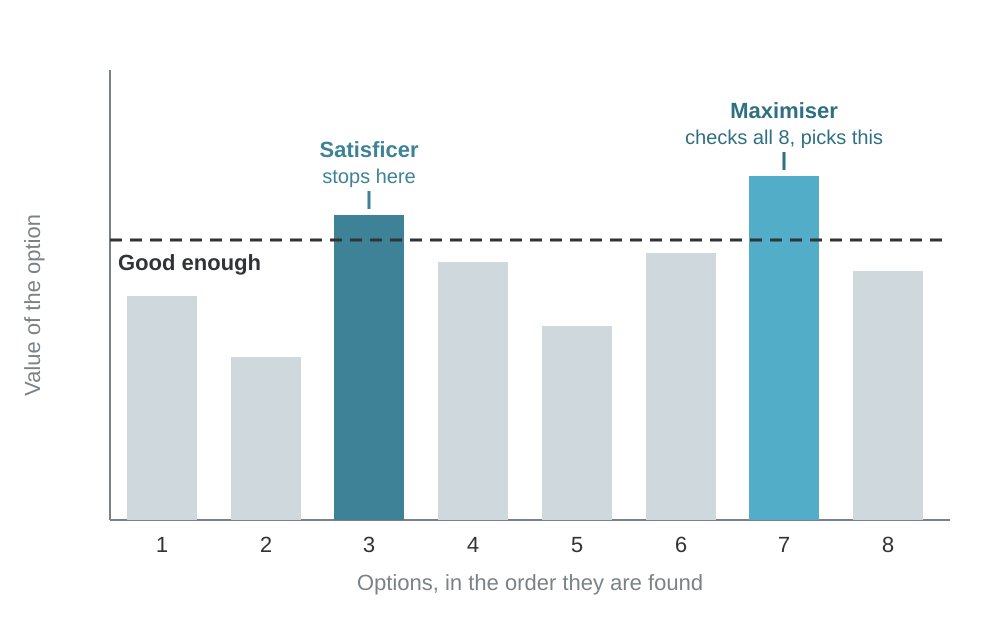

# How Decisions Actually Get Made

Behavioural Economics for Managers · Module 1

Bounded rationality, satisficing, and why the errors run in the same direction

---

<!-- layout: agenda -->
## Outline
### Four parts in this module

1. **Outline:** what we cover and why
2. **Concepts:** five ideas about how decisions get made
3. **The case:** Yadav General Store, read through the five concepts
4. **Close:** takeaways and preparation for Module 2

---

<!-- layout: table -->
## What you will be able to do
### One outcome for each concept

| Concept | By the end, you can |
|---|---|
| 1. The benchmark | State what the standard model assumes |
| 2. Bounded rationality | Name the three limits on a decision |
| 3. Satisficing | Tell "good enough" from "best" |
| 4. Two systems | Predict when people skip checking |
| 5. Should vs does | Separate advice from description |

---

<!-- layout: section -->
# 2. Concepts

The benchmark, bounded rationality, satisficing, two systems, and the gap between should and does

---

## Concept 1: The benchmark, stated plainly
### Four assumptions of the standard model

| Assumption | What it means | Example: a mobile plan |
|---|---|---|
| Complete, consistent preferences | You can rank any two options, and the ranking holds | Every plan ranked; the ranking never flips |
| Computation is free | Finding the best costs nothing | Every plan costed for your usage, no effort |
| Wording does not matter | Same choice however it is described | "₹299 a month" = "₹3,588 a year" |
| Choose the best | Not merely the acceptable | The best plan, not the first good one |

---

<!-- layout: callout -->
## The benchmark is incomplete, not stupid
### A modelling convenience, not a claim about people

> The standard is not stupid. It is incomplete.

It predicts well where stakes are high, feedback is fast and choices repeat. It predicts badly for rare, complex, one-off choices. This course adds the descriptive half. It does not replace your microeconomics.

---

<!-- layout: callout -->
## Concept 2: Bounded rationality
### Herbert Simon, 1955. Nobel Prize in Economics, 1978.

> People are rational, but inside limits. They do the best they can with the information, mental capacity and time they actually have.

The question changes from "what is the best choice?" to "what is a sensible way to choose, given the limits?"

---

<!-- layout: compare -->
## The three limits
### Every decision runs into all three

|||

### Information

You cannot see every option or every price. A buyer does not know every supplier's terms.

### Capacity

Even with the data, you cannot process all of it. A CFO gets forty reports and reads three.

|||

### Time

The decision has a deadline. A launch date forces a choice before the analysis ends.

### So what?

This is not irrationality. It is the setting every manager decides in.

---

<!-- layout: equation -->
## Optimising can be the irrational choice
### Search is not free

$$E[\text{gain}] > \text{cost}$$

Search once more only if the expected gain from one more search is greater than its cost. Finding the best supplier for one item might save ₹200 a year and take three hours. For most items, the sensible choice is to stop. Economists formalise this as rational inattention (Sims, 2003).

---

<!-- layout: quote -->
> A wealth of information creates a poverty of attention.

Herbert Simon, Designing Organizations for an Information-Rich World, 1971

Every report, dashboard and system competes for a manager's attention. Most lose.

---

<!-- layout: compare -->
## Heuristics: shortcuts under limits
### A simple rule that uses part of the information and ignores the rest

|||

### Examples

- Reorder what sold last month
- Hire from the college that worked last time
- Match the competitor's price

|||

### Works well, and fails

- **Works** when feedback is quick and visible
- **Fails** when the cost is slow or hidden
- Can match complex models (Gigerenzer and Gaissmaier, 2011)

---

<!-- layout: image-right -->
## Concept 3: Satisficing
### Satisfy + suffice: stop at "good enough"

- Set an **aspiration level**: what counts as good enough
- Look at options **one at a time**
- Take the **first** that clears the bar, and stop
- The bar **rises** after easy wins and **falls** after long searches

---

<!-- layout: compare -->
## Satisficers and maximisers
### Both are strategies. Each has a cost.

|||

### Maximiser

- Compares every option
- Gets a slightly better result
- Pays heavily in time and attention
- More regret, less satisfaction (Schwartz et al., 2002)

|||

### Satisficer

- Stops at the first acceptable option
- Gets a good-enough result
- Saves time and attention
- May miss a much better option

---

<!-- layout: callout -->
## Selling to a satisficer
### What the concept means for managers

> If your customer is a satisficer, being the best option is not enough. You have to be the first acceptable option they meet.

This reframes distribution, shelf position, search ranking and sales sequencing: eye level on the kirana shelf, the first search result, the first vendor to call the buyer.

---

## Why incumbents are hard to displace
### The current option already clears the bar

- The current way **already meets** the aspiration level
- So **search never starts**, however good the new option is
- A new option is never compared. It is never looked at.
- To win, the new option must make the **old one fall below the bar**
- Its name: **status quo bias** (Samuelson and Zeckhauser, 1988)

---

<!-- layout: compare -->
## Satisficing: failure or adaptation?
### Usually both. Telling which is the managerial skill.

|||

### Adaptation

- Scarce attention goes to what matters most
- Decisions stay fast in a busy setting
- Works where feedback is quick

|||

### Failure

- Misses gains that are slow or hidden
- Locks in old options
- Leaves money on the table

---

<!-- layout: compare -->
## Concept 4: Two systems
### Daniel Kahneman, Thinking, Fast and Slow (2011)

|||

### System 1

Fast, automatic, effortless, associative. Always running. Produces an answer before you ask for one.

*Reading a face. 2 + 2. Driving on an empty road.*

|||

### System 2

Slow, effortful, rule-governed. Lazy: it accepts System 1's answer unless something prompts it to check.

*17 × 24. Filling in a tax form. Comparing two loans.*

---

## A useful description, not brain machinery
### Treat the two systems as a way of talking

- Kahneman calls them **characters in a story**, not parts of the brain
- Evidence for two separate brain systems is **contested** (Melnikoff and Bargh, 2018)
- Use it to predict **when** checking fails
- Rush, fatigue, distraction, and questions that look familiar

---

<!-- layout: callout -->
## Attribute substitution
### What System 1 does with a hard question

> When a question is hard, System 1 quietly answers an easier one, and does not notice the swap.

"How likely is it?" becomes "How easily does an example come to mind?" "Which is more probable?" becomes "Which fits the description better?" (Kahneman and Frederick, 2002)

---

<!-- layout: table -->
## Your two answers from this morning
### The jacket returns in Module 4

| Puzzle | Answer | What happened |
|---|---|---|
| Bat and ball | ₹5 | System 1 offers ₹10. System 2 rarely checks. |
| Jacket and calculator | Same both times | ₹500 was judged against the price beside it. |

---

<!-- layout: equation -->
## Bat and ball: let System 2 check
### Let the ball cost x. The bat costs x + 100.

$$x + (x + 100) = 110 \;\Rightarrow\; x = 5$$

If the ball were ₹10, the bat would be ₹110 and the total ₹120. In Frederick's (2005) study of 3,428 people, only 17% got all three puzzles right. A third got all three wrong.

---

## Errors that run in the same direction
### Why predictable mistakes are useful

- **Random** errors cancel out, so the average is right
- **Systematic** errors add up: most people err the same way
- Most said ₹10, not a random spread of wrong answers
- What is predictable can be **designed for**

---

<!-- layout: compare -->
## Concept 5: Should, does, and what to do about the gap
### Three questions about any decision (Bell, Raiffa and Tversky, 1988)

|||

### Normative

What a decision maker **should** do.

### Descriptive

What they **actually** do.

|||

### Prescriptive

Given the gap, **what can be changed**.

### This course

This course is prescriptive. We are not here to catalogue failure.

---

<!-- layout: steps -->
## The three questions in one example
### Saving through the workplace (Madrian and Shea, 2001)

1. **Should:** join the employer's savings plan early
2. **Does:** many never get round to signing up
3. **What to do:** enrol everyone, with a free choice to opt out
4. **Result:** joining rose by about 48 points. The money on offer did not change.

---

## Not only limits on thinking
### Three bounds on the standard model (Mullainathan and Thaler, 2000)

- **Bounded rationality:** limited information, capacity and time
- **Bounded willpower:** knowing what to do and not doing it
- **Bounded self-interest:** caring about fairness and about other people
- The savings example is **willpower**, not information. People knew about the plan.

---

<!-- layout: table -->
## The five concepts in one table
### Keep this in view for the case

| Concept | The key idea |
|---|---|
| The benchmark | Full information, free thinking, choose the best |
| Bounded rationality | Limits of information, capacity and time |
| Satisficing | Stop at the first good-enough option |
| Two systems | Fast answers that slow thinking rarely checks |
| Should vs does | Advice must start from actual behaviour |

---

<!-- layout: section -->
# 3. The case through the concepts

Yadav General Store, Ghatkopar East

---

<!-- layout: case -->
## Yadav General Store, Ghatkopar East

**The shop:** Ramesh Yadav, 54, has run it since 2003. His father opened it in 1979. 420 sq ft on a lane off Rajawadi Road, ₹62,000 rent, about 900 items, one assistant.

**The customers:** About 190 households buy regularly. 70 of them buy on credit.

**The record:** All credit sits in a cloth-bound notebook, one page per household, in a shorthand only he reads fully. It is the fourteenth notebook.

---

<!-- layout: stat -->
## Exhibit 1: The shop in one month, in ₹ lakh
### Ramesh has never seen this table. His nephew built it from the notebook in one weekend.

|||

# 11.20

Monthly sales

|||

# 1.57

Gross margin at 14%

|||

# 0.64

Net to the household

---

<!-- layout: compare -->
## March 2025: The offer
### A tablet-based billing and credit system. Free in money is not free in anything else.

|||

### What it does

- Prints bills and tracks credit by household
- Sends payment reminders by SMS
- Flags slow-moving stock
- Weekly margin report by category

|||

### The terms

- **Free** for six months
- Then **₹1,500 a month**
- Cancel with **one month's notice**
- Setup and two hours of training included. The tablet goes back on cancellation.

---

<!-- layout: table -->
## Exhibit 2: What the nephew calculated
### Arjun, in the second year of an MBA, presented this in March

| Source of gain | Basis | Per year |
|---|---|---|
| Credit recovered | SMS reminders on overdue credit | ₹24,000 |
| Fewer ordering errors | Stock-outs and expiring stock | ₹11,000 |
| Time saved | Four hours a week, valued at zero | ₹0 |
| Fee from month 7 | ₹1,500 a month | (₹9,000) |
| **Net, year one** | The trial costs nothing | **₹26,000** |

---

## Behind Arjun's numbers
### Where the ₹24,000 and the ₹11,000 come from

|||

**Credit**

- ₹44,000 is overdue beyond 90 days
- It sits with 14 households
- Ramesh's own estimate: ₹24,000 a year is written off
- Arjun assumes SMS reminders recover half

|||

**Stock**

- 17 items were out of stock on three of eight visits
- 11 items were dusty or within 60 days of expiry
- **Time:** four hours a week after closing, valued at zero. Unpaid is not free.

---

<!-- layout: discussion -->
## You are Arjun. It is Sunday morning. What do you say?

Ramesh said he would think about it. Eight months later he still uses the notebook. One proposal each, then name the one number that matters most.

---

<!-- layout: compare -->
## By the standard model, this is not a close call
### Concept 1: the benchmark says yes in March

|||

### The gain is large

₹26,000 a year. That is about 41% of one month's household income.

### The trial is free

Six months, no payment, one month's notice to stop.

|||

### The downside is capped

The tablet goes back. Nothing is sunk.

### So the model predicts

He takes the offer and does not think about it again.

---

<!-- layout: discussion -->
## What would have to be true for refusing this to be the correct decision?

Not: why is he being irrational? That question ends the discussion. It does not solve the problem.

---

<!-- layout: steps -->
## Four ways refusing could be right
### Build the world in which Ramesh is correct

1. **The numbers are wrong.** Will SMS reminders really recover half?
2. **Costs are missing.** Learning time, errors at the counter, saying no later.
3. **Values are unpriced.** Privacy and trust are not in the table.
4. **He is not maximising.** He may be aiming for good enough.

---

## What the case says about missing costs
### The distributor's own evidence

- **3 of 14** shops cancelled during the free trial
- **Two** because billing slowed the evening rush
- **One** because the son who ran it left for a job in Pune
- If he stops, customer data **stays on the distributor's server**
- Shops that turn reminders off **usually stop using it**. Without reminders, Ramesh said, it is just a cash register.

---

## Four answers on four different days
### Ramesh, in his own words (1 of 2)

|||

> "I don't want a machine holding my customers' names. If a family falls behind, I don't want a message on their phone where a son or a mother-in-law can read it. In a lane of four buildings it would be known within a week."

|||

> "I know every family's habits. I know the two who always pay late and always pay. I know the family who took five months to clear eleven thousand in 2022. They still come. They pay cash now, and I never said a word about it."

---

## Four answers on four different days
### Ramesh, in his own words (2 of 2)

|||

> "In 2019 I added a second fridge on a distributor's advice. The building's wiring could not carry it. The power failed twice in one week during the evening rush. Two regular customers went to the shop on the main road and never came back."

|||

> "The notebook works."

**Four reasons, or one reason described four ways?**

---

<!-- layout: discussion -->
## Which are real costs, and which are avoidance dressed as reasons?

Every claim needs evidence from the case. Where does it say he is afraid of technology? It does not. He uses a phone, deals with distributors, and changed his stock in 2022.

---

<!-- layout: table -->
## Sorting the four reasons
### Claim what the evidence supports, nothing more

| Reason | What it is | Verdict |
|---|---|---|
| SMS on a family phone | Customers' privacy | Real cost |
| "I know every family" | Tacit knowledge | Real cost |
| The 2019 fridge | One vivid failure | Bias: availability |
| "The notebook works" | A stopping rule | Probe further |

---

<!-- layout: compare -->
## Two terms from the sorting
### Both return later in the course

|||

### Tacit knowledge

What he knows but could not write down. Who pays late but always pays. Which family now pays cash, and why.

A system cannot hold it, so it is a real cost of switching.

|||

### Availability

Judging how likely something is by how easily an example comes to mind.

One painful evening in 2019 is easy to recall, so it feels more likely to repeat than it is. Module 2 covers it in full.

---

<!-- layout: compare -->
## The three limits, in the case
### Concept 2: bounded rationality

|||

### Information

900 items, 70 credit accounts, and no category margins anywhere.

### Capacity

The data could exist and he still could not process it.

|||

### Time

Hours spent learning the system are hours off the counter.

### So what?

His refusal is a decision under limits, not a failure to see the numbers.

---

## How he actually decides
### Concept 2: he runs the shop on heuristics

| Asked | He said |
|---|---|
| How do you decide the atta order? | Last month's order, plus a little if there is a wedding in the lane |
| Have you worked out margin by category? | The store makes money and that is enough |
| Which category earns you the most? | Cold drinks: the distributor's terms are best |
| Which of your 900 items lose money? | There must be some |
| What would you do with the weekly report? | No answer. A week later: I would look at it. |

---

<!-- layout: callout -->
## The biscuit detail
### Concept 2: a heuristic at work

> In 2022 he stopped stocking three brands of biscuit because, as he put it, "they sat there." He could not say how he knew.

What is he doing, if he is not maximising?

---

<!-- layout: compare -->
## What his rule of thumb can and cannot see
### Concept 2: quick, visible feedback versus slow, hidden cost

|||

### It sees

- Stock that **sits** on the shelf
- Families who pay late but **always pay**
- Demand before a **wedding** in the lane

|||

### It misses

- Items that sell but **quietly lose margin**
- Cold drinks at **9%** against a 14% average
- **₹44,000** drifting past 90 days

---

<!-- layout: compare -->
## He is not maximising. He is meeting a threshold.
### Concept 3: satisficing

|||

### The threshold

"The store makes money and the household is fine."

This is his **aspiration level**: the bar an outcome must clear.

|||

### The stopping rule

"The notebook works."

Once the bar is cleared, **search stops**. No new option is looked at.

---

## The notebook is the incumbent
### Concept 3: why the tablet was never compared

- The notebook **already clears** his aspiration level
- So **search never started**, however good the tablet was
- Arjun tried to win a comparison Ramesh was not running
- To win, the tablet must make the **notebook fall below the bar**

What could do that? The case gives four candidates.

---

<!-- layout: table -->
## Four things changed by November
### Concept 3: what could push the notebook below the bar

| What changed | Why it matters |
|---|---|
| The free trial closes at month end | Waiting now has a price: ₹1,500 from the first day |
| The main-road shop adopted the system | The rival that took two customers in 2019 now has it |
| A ₹1,240 rice dispute, lost for want of an entry | The notebook failed, and Sonu thinks not for the first time |
| Three nights until eleven on the accounts | His time is not free, even though no one pays for it |

---

<!-- layout: compare -->
## Failure or adaptation?
### Concept 3: both. Telling which is the managerial skill.

|||

### Adaptation

- Scarce attention spent on what matters most
- Customers, credit trust, stock that sits
- A rule that has kept the shop alive since 2003

|||

### Failure

- Money left on the table
- Cold drinks earning 9%, not 14%
- ₹44,000 overdue beyond 90 days

---

## Fast answers at the counter
### Concept 4: two systems in the case

- Most of his decisions are made **at the counter, in the rush**
- The 2019 fridge comes to mind **fast**, so it feels likely
- "Which category earns most?" became "whose terms are best?": **attribute substitution**

---

<!-- layout: compare -->
## Arjun's two conversations
### Concept 5: normative advice failed because it had no descriptive content

|||

### First: normative

"Here are the numbers. Here is what you should do."

It assumed Ramesh compares options and maximises. He does neither.

|||

### Second: prescriptive

Start from what Ramesh actually does, and the costs he actually faces.

Then design something that fits inside that.

---

<!-- layout: steps -->
## What a prescriptive offer could look like
### Designed for a satisficer, inside his limits

1. **Keep the notebook.** Do not ask him to give up what works.
2. **One report, one category.** Start with cold drinks: 9% against 14%.
3. **Reminders stay with him.** The system lists who is overdue. He decides whom to speak to, and how.
4. **Make the notebook's risk visible.** The ₹1,240 dispute. Fourteen notebooks, one reader, no copy.

---

<!-- layout: table -->
## The case through the five concepts
### One line for each

| Concept | In the case |
|---|---|
| The benchmark | Take the trial: ₹26,000 a year |
| Bounded rationality | 900 items, no margins, no time |
| Satisficing | "The notebook works." |
| Two systems | Counter decisions, the 2019 fridge |
| Should vs does | Start from what he actually does |

---

<!-- layout: discussion -->
## Three takeaways. From you, not from me.

---

## Before Module 2
### Submissions close when the session begins. No extensions.

| Task | What to do |
|---|---|
| **Read** | Case 2.1, Valuation at Meridian Capital, with all four exhibits |
| **Submit** | Answers to the case's first two questions, 400 words maximum, plus your one-line answer to question 3 |
| **Team** | Layer 1 of the audit: the organisation, your access, one decision journey, three unknowns |

Everyone must take a position before hearing anyone else's. The board photograph goes on the LMS this evening.

---

<!-- layout: references -->
## Sources for this module

- Simon, H. A. (1955). A behavioral model of rational choice. *Quarterly Journal of Economics*, 69(1), 99–118.
- Simon, H. A. (1971). Designing organizations for an information-rich world. In M. Greenberger (Ed.), *Computers, Communications, and the Public Interest*. Johns Hopkins Press.
- Gigerenzer, G. and Gaissmaier, W. (2011). Heuristic decision making. *Annual Review of Psychology*, 62, 451–482.
- Kahneman, D. and Frederick, S. (2002). Representativeness revisited: Attribute substitution in intuitive judgment. In T. Gilovich, D. Griffin and D. Kahneman (Eds.), *Heuristics and Biases*, 49–81. Cambridge University Press.
- Kahneman, D. (2011). *Thinking, Fast and Slow*. Farrar, Straus and Giroux.
- Frederick, S. (2005). Cognitive reflection and decision making. *Journal of Economic Perspectives*, 19(4), 25–42.
- Schwartz, B., et al. (2002). Maximizing versus satisficing. *Journal of Personality and Social Psychology*, 83(5), 1178–1197.
- Samuelson, W. and Zeckhauser, R. (1988). Status quo bias in decision making. *Journal of Risk and Uncertainty*, 1(1), 7–59.
- Sims, C. A. (2003). Implications of rational inattention. *Journal of Monetary Economics*, 50(3), 665–690.
- Mullainathan, S. and Thaler, R. H. (2000). Behavioral economics. NBER Working Paper 7948.
- Madrian, B. C. and Shea, D. F. (2001). The power of suggestion. *Quarterly Journal of Economics*, 116(4), 1149–1187.
- Melnikoff, D. E. and Bargh, J. A. (2018). The mythical number two. *Trends in Cognitive Sciences*, 22(4), 280–293.
- Bell, D. E., Raiffa, H. and Tversky, A. (1988). *Decision Making: Descriptive, Normative, and Prescriptive Interactions*. Cambridge University Press.

---

<!-- layout: end -->
# Questions?

Dr. Pawan Ashok Kamble
