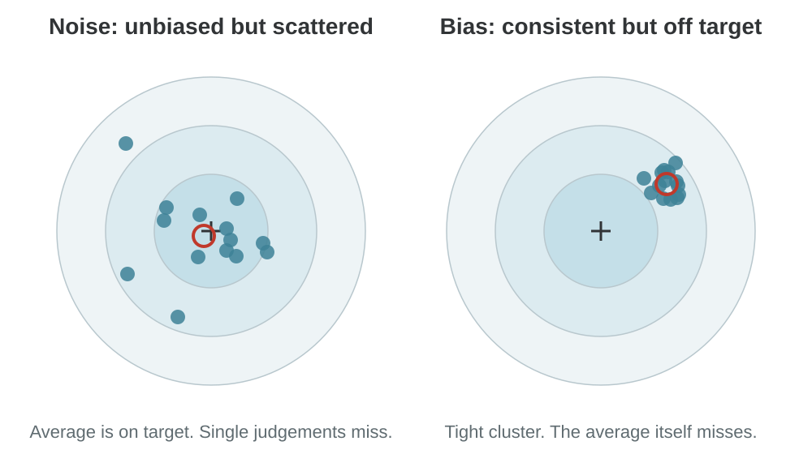

# Biases in Your Own Judgement

Behavioural Economics for Managers · Module 2

Seven shortcuts, the errors they produce, and the procedures that catch them

---

<!-- layout: agenda -->
## Outline
### Five parts in this module

1. **Outline:** the question this module answers
2. **Concepts:** seven shortcuts, and how to debias them
3. **Case 2.1:** Riya's notebook, June to December
4. **Case 2.2:** Valuation at Meridian Capital
5. **Close:** class activity, checklist and exit quiz

---

<!-- layout: compare -->
## Eight concepts in this module
### Seven shortcuts and one remedy

|||

### Shortcuts 1 to 4

1. Heuristics
2. Anchoring and adjustment
3. Availability
4. Representativeness

|||

### Shortcuts 5 to 7, and the remedy

5. Base rate neglect
6. Regression to the mean
7. Confirmation bias
8. Procedural debiasing

---

<!-- layout: table -->
## How the eight concepts fit together
### Three classic heuristics, the errors that follow, and one remedy

| Group | Concepts |
|---|---|
| The idea | 1. Heuristics (Simon, 1955; Kahneman and Frederick, 2002) |
| Three classic heuristics | 2. Anchoring, 3. Availability, 4. Representativeness (Tversky and Kahneman, 1974) |
| Errors that follow from representativeness | 5. Base rate neglect, 6. Ignoring regression to the mean |
| A bias in how we test beliefs | 7. Confirmation bias (Nickerson, 1998) |
| The remedy | 8. Procedural debiasing |

"Seven shortcuts" is shorthand. Strictly, three are heuristics. The others are errors and biases those shortcuts produce.

---

<!-- layout: callout -->
## The question this module answers
### Why do smart people make mistakes we can predict?

> Their shortcuts usually work. When a shortcut fails, it fails in the same direction every time. That repeated, one-directional error is a bias.

Every concept in this module is one shortcut and its bias, plus one way to catch it.

---

<!-- layout: section -->
# 2. Concepts

Heuristics, anchoring, availability, representativeness, base rates, regression, confirmation, and procedural debiasing

---

<!-- layout: callout -->
## Concept 1: Heuristics
### A mental shortcut

> A heuristic is a simple rule that gives a good-enough answer quickly, with little information and effort.

Herbert Simon (1955) explained why we need them. Attention, information and time are limited, so we cannot optimise every decision.

---

## How a heuristic works
### It swaps a hard question for an easy one

- We face a hard question we cannot answer quickly
- We answer an **easier, related question** instead
- We rarely notice the swap
- Kahneman and Frederick (2002) call this **attribute substitution**

---

<!-- layout: compare -->
## Heuristics: an everyday example
### Ordering dinner on Zomato

|||

### The hard question

"Which restaurant will give me the best meal tonight?"

### The easy question

"Which one has 4.5 stars and many reviews?"

|||

### Usually

The easy answer is good enough.

### Sometimes

A new, excellent restaurant with few reviews is ignored. **Every time.** That repeated miss is the bias.

---

## Why heuristics matter for managers
### Good shortcuts, predictable failures

- Shortcuts let busy managers decide fast
- They usually give a sound answer
- When they fail, they fail **in the same direction**
- A repeated, one-directional error is a **bias**

---

<!-- layout: image-right -->
## Two kinds of error
### Bias and noise

- **Noise:** judgements scatter. The average can still be right.
- **Bias:** judgements cluster in the wrong place. The average is wrong.
- The red ring marks the average judgement.

---

<!-- layout: equation -->
## Heuristics: the mathematics
### Total error = systematic error + random error

$$\text{MSE} = \text{Bias}^2 + \text{Variance}$$

**Bias** is the average error: judgement minus true value, always in the same direction. **Variance** is the spread of errors around that average: the random scatter, or noise.

---

<!-- layout: equation -->
## Each person's judgement
### A simple model

$$X_i = \theta + b + \varepsilon_i$$

$\theta$ is the true value. $b$ is a bias every person shares. $\varepsilon_i$ is each person's random error, with mean 0 and variance $\sigma^2$, independent across people.

---

<!-- layout: equation -->
## What happens when we average n people
### The noise shrinks. The bias stays.

$$\bar{X} = \theta + b + \tfrac{1}{n}\textstyle\sum_{i=1}^{n} \varepsilon_i$$

$$E(\bar{X}) - \theta = b \qquad \text{MSE}(\bar{X}) = b^2 + \sigma^2 / n$$

Adding people divides the noise by n. It does nothing to the bias b.

---

<!-- layout: table -->
## A biased rule can still win
### Two ways to forecast next year's sales (illustrative)

| Method | Bias | Spread (SD) | Total error = Bias² + SD² |
|---|---|---|---|
| Detailed model | 0 | 30 | 0 + 900 = **900** |
| Simple rule of thumb | 10 | 15 | 100 + 225 = **325** |

The rule is biased, but it wins because it is much less noisy.

---

<!-- layout: callout -->
## More people cut noise, not bias
### What this means for committees

> Reviewers, committees and second opinions reduce noise. They cannot reduce a bias everyone shares.

If everyone uses the same shortcut, a bigger group gives the same wrong answer with more confidence.

---

<!-- layout: compare -->
## Heuristics: the takeaway
### A heuristic is not good or bad in itself

|||

### Good

When the environment is too uncertain to estimate a complex model reliably.

|||

### Dangerous

When the environment changes and the rule does not.

---

<!-- layout: callout -->
## Concept 2: Anchoring and adjustment
### Tversky and Kahneman (1974)

> When people estimate a number, they start from a number already in front of them, the anchor, and adjust away from it. The adjustment is usually too small.

So the final answer stays too close to the anchor, even when the anchor is obviously random.

---

<!-- layout: compare -->
## Even a random anchor works
### The original experiment, Tversky and Kahneman (1974)

|||

### The set-up

A wheel of fortune is spun in front of people. Then they estimate the share of African countries in the UN.

|||

### The result

Those who saw **10** gave a median of **25%**. Those who saw **65** gave a median of **45%**.

The wheel told them nothing. It still moved the answer.

---

<!-- layout: compare -->
## Quick experiment: the anchor in this room
### Answer on paper. Do not discuss.

|||

### Group A

Is the population of Nashik more or less than **2 lakh**?

Now estimate the population.

|||

### Group B

Is the population of the same city more or less than **20 lakh**?

Now estimate the population.

---

## Why anchoring matters for managers
### The first number in the room has power

- Every price, budget, salary and valuation starts from a first number
- Negotiations, price tags and forecasts all carry an anchor
- Managers can **set** the anchor
- Or **protect** themselves from someone else's

---

<!-- layout: compare -->
## Anchoring: an everyday example
### A placement interview

|||

### What happens

HR says, "We are thinking around **₹12 lakh**."

You had privately decided you are worth **₹16 lakh**.

|||

### What most people do

They ask for something between 12 and 16.

It is closer to 12 than they intended.

---

<!-- layout: equation -->
## Anchoring: the mathematics
### A weighted average of the anchor and your own view

$$E = wA + (1 - w)V$$

$A$ is the anchor you heard. $V$ is what you would have said with no anchor. $w$ is the weight the anchor gets: 0 means no effect, 1 means you simply repeat the anchor.

---

<!-- layout: equation -->
## The placement example, in numbers
### A = ₹12 lakh, V = ₹16 lakh, w = 0.6 (illustrative)

$$E = 0.6 \times 12 + 0.4 \times 16 = 7.2 + 6.4 = 13.6$$

You ask for ₹13.6 lakh. HR's opening line cost you ₹2.4 lakh a year.

---

<!-- layout: case -->
## Real case: J.C. Penney, 2012
### Removing the anchor

**The change:** New CEO Ron Johnson replaced constant sales and coupons with "Fair and Square" everyday prices. Prices were often no higher than the old sale prices. But there was no longer an "original price" to compare against.

**The result:** In fiscal 2012 the company lost $985 million. Total sales fell 24.8% and comparable store sales fell 25.2%.

**The reversal:** Johnson called the policy a mistake. Sales and coupons came back.

---

<!-- layout: equation -->
## J.C. Penney, through the concept
### A shirt the customer values at ₹1,200, anchor weight 0.3 (illustrative)

$$E = 0.3 \times 2{,}999 + 0.7 \times 1{,}200 \approx 1{,}740$$

With a "was ₹2,999" tag, the shirt feels worth ₹1,740, so ₹1,499 feels like a bargain. With no tag it feels worth ₹1,200, and the same ₹1,499 feels expensive.

---

<!-- layout: callout -->
## What J.C. Penney teaches
### Price against how customers judge, not how a model says they should

> J.C. Penney removed the anchors customers used to judge value. The sense of a bargain disappeared with them.

The first number in the room is never neutral. Write your own number down before you hear theirs.

---

<!-- layout: callout -->
## Concept 3: Availability
### Tversky and Kahneman (1973)

> People judge how common or likely something is by how easily examples come to mind.

This usually works, because common events are usually easy to recall. It fails when something other than frequency makes an event memorable.

---

<!-- layout: compare -->
## What makes an event easy to recall
### Memory is not a random sample of what happened

|||

### Easy to recall

- **Vivid:** a crash, a fraud, a windfall
- **Recent:** last month, not last decade
- **Personal:** it happened to you or a friend

|||

### Also easy to recall

- **Influential:** someone you admire said it
- **Repeated:** you heard it many times
- None of these is the same as **frequent**

---

## Why availability matters for managers
### We overrate dramatic risks and underrate quiet ones

- Managers overinvest against **last year's crisis**
- They chase strategies with famous **success stories**
- They ignore risks they have **not personally seen**
- After a big cyberattack, the next one feels more likely

---

<!-- layout: compare -->
## Availability: an everyday example
### Flying after a crash in the news

|||

### What people feel

After a plane crash is in the news, flying feels dangerous. Many choose to drive.

|||

### What is true

Driving is far riskier per kilometre. The crash is vivid. Thousands of uneventful flights are not.

---

<!-- layout: equation -->
## Availability: the mathematics
### We estimate a rate from the cases that reach us

$$\text{Perceived rate} = \frac{s \, p_s}{s \, p_s + f \, p_f}$$

$s$ and $f$ are the true numbers of successes and failures. $p_s$ and $p_f$ are the chances that a success story or a failure story reaches you. If winners talk and losers stay quiet, $p_s > p_f$ and the rate looks too high.

---

<!-- layout: table -->
## A quick illustration
### 10 startups in 100 succeed. You hear about 80% of successes and 10% of failures.

| | True number | Share you hear about | Stories that reach you |
|---|---|---|---|
| Successes | 10 | 80% | 8 |
| Failures | 90 | 10% | 9 |
| **Perceived success rate** | | | 8 ÷ 17 = **47%** |

The true rate is 10%. The stories make it look like 47%. Illustrative numbers.

---

<!-- layout: case -->
## Real case: flood insurance in the US
### Gallagher (2014), American Economic Journal: Applied Economics

**The finding:** Flood insurance take-up spikes in the year after a flood. Then it declines steadily back to where it started.

**The puzzle:** The underlying flood risk has not changed. Insurance is always on offer, at much the same price.

**The spillover:** Communities that were not flooded, but shared the same TV news, also bought more, at about one-third the rate.

---

<!-- layout: compare -->
## Flood insurance, through the concept
### What an insurer who understands availability does

|||

### Why it happens

Right after a flood, examples are vivid, so people overrate the risk and buy.

As the memory fades, they underrate it and let policies lapse.

|||

### What to do

- Offer **multi-year policies** when demand peaks
- Use **local flood history** at renewal, not abstract odds
- Set risk models on **long-run data**, not last year

---

<!-- layout: callout -->
## Availability: the takeaway
### Count the full list, not the cases you remember

> What you remember first is not what happens most.

---

<!-- layout: callout -->
## Concept 4: Representativeness
### Kahneman and Tversky (1972)

> We judge how likely something is by how much it resembles our mental picture of that kind of thing.

We ask "Does this candidate look like a star?" instead of "How likely is this candidate to succeed?"

---

<!-- layout: steps -->
## Three ways resemblance misleads
### Resemblance is often useful, but it fails in predictable ways

1. **Resemblance that tells you nothing.** The trait may be just as common among people who fail.
2. **Small samples that look convincing.** Tversky and Kahneman (1971) call it the "law of small numbers".
3. **Detailed stories that feel likely.** Every added detail makes a story less likely, not more.

---

## Why representativeness matters for managers
### Similarity is not the same as probability

- We judge candidates by a **prototype** of a successful employee
- Similarity can outweigh statistical evidence and sample size
- Small samples can look representative when luck is large

---

<!-- layout: equation -->
## Representativeness: the mathematics (1)
### Does the trait actually tell you anything?

$$R = \frac{P(\text{trait} \mid \text{success})}{P(\text{trait} \mid \text{failure})}$$

Compare how common a trait is among people who succeeded and among people who failed. If R = 1, the trait tells you nothing, however impressive it looks. The bigger R is above 1, the stronger the evidence.

---

<!-- layout: table -->
## A quick illustration of R
### Is being an extrovert a sign of a good salesperson? (illustrative)

| | Good salespeople | Weak salespeople |
|---|---|---|
| Extroverts | 60 of 100 = 60% | 60 of 100 = 60% |
| **R** | | 60% ÷ 60% = **1.0** |

Extroverts look like salespeople. But they are just as common among the weak ones, so the trait tells you nothing here.

---

<!-- layout: equation -->
## Representativeness: the mathematics (2)
### Small samples swing much more than large ones

$$\text{Spread of an average} = \frac{\sigma}{\sqrt{n}}$$

Results vary by luck. Average 4 results and the spread halves. Average 100 and it falls to a tenth. A few strong results can come from luck alone.

---

<!-- layout: case -->
## Real case: Moneyball
### Michael Lewis (2003), on the Oakland Athletics

**The old way:** In the early 2000s, baseball teams picked players largely on scouts' judgement. Scouts were swayed by a player's body and presence. One scout called it "the Good Face".

**The constraint:** In 2002 Oakland spent about $40 million on player salaries. The New York Yankees spent about $125 million.

**The new way:** General manager Billy Beane used statistics to find what actually predicted winning, such as how often a player got on base.

---

<!-- layout: compare -->
## Moneyball, through the concept
### Scouts measured resemblance. Beane measured R.

|||

### What happened

Beane signed players who produced wins but did not look the part, so they were cheap.

Oakland won 103 games in 2002 and reached the playoffs in 2002 and 2003.

|||

### The lesson

The scouts judged by resemblance, often to traits with R close to 1.

Hiring someone because he "looks like a sales head" is the same mistake.

---

<!-- layout: callout -->
## Representativeness: the takeaway
### Score the traits that predict, not the traits that impress

> Looking like a winner is not evidence unless losers do not look like that too. And a small sample can look like anything.

---

<!-- layout: callout -->
## Concept 5: Base rate neglect
### Kahneman and Tversky (1973)

> The base rate is how often something happens in general, before you look at the specific case. Base rate neglect is giving it too little weight.

It is closely linked to representativeness. We judge by how much a case looks typical, and forget to ask how common that case is.

---

## Why base rates matter for managers
### Combine what usually happens with what this case looks like

- Hiring, lending, investing and launching all need **both**
- The specific case is vivid; the base rate is dull
- Ignoring the base rate gives **confident decisions that are badly off**
- First ask how often this happens at all

---

<!-- layout: compare -->
## Base rates: an everyday example
### The brilliant founder

|||

### The case

A startup founder is from IIT, confident and pitches brilliantly.

Most people judge the chance of success as high, because the founder looks like a winner.

|||

### The missing question

How often do startups succeed at all?

Without that number, the pitch tells you far less than it seems.

---

<!-- layout: table -->
## Base rates: the mathematics with counts
### 1% have a condition. A test catches 90% of them, but also flags 10% of healthy people.

| 10,000 people | Test positive | Test negative | Total |
|---|---|---|---|
| Have the condition | 90 | 10 | 100 |
| Do not have it | 990 | 8,910 | 9,900 |
| **Total** | **1,080** | 8,920 | 10,000 |

A positive result means the condition only 90 ÷ 1,080 = **8.3%** of the time, not 90%.

---

<!-- layout: equation -->
## Bayes' rule in odds form
### Start from the base rate, then update

$$\text{Posterior odds} = \text{LR} \times \text{Prior odds}$$

$$P = \frac{\text{odds}}{1 + \text{odds}}$$

LR is how much more often the evidence appears when the thing is true. Test example: prior odds 1 : 99, LR = 0.9 ÷ 0.1 = 9, posterior odds 9 : 99, P = 9 ÷ 108 = 8.3%.

---

<!-- layout: case -->
## Real case: Quibi, 2020
### $1.75 billion raised, shut down in six months

**What happened:** Quibi was a short-form video app founded by Jeffrey Katzenberg, former Disney and DreamWorks executive, and Meg Whitman, former eBay and HP chief. It raised $1.75 billion, launched in April 2020, and announced its closure six months later.

**Through the concept:** Investors judged Quibi by how much it looked like success: famous founders, Hollywood content, enormous funding. The first question should have been the base rate: how often do new consumer media platforms succeed at all?

---

<!-- layout: equation -->
## Quibi, in numbers
### Suppose 1 in 10 such ventures succeeds, and famous founders are twice as common among successes (illustrative)

$$\text{Odds} = 2 \times \tfrac{1}{9} = \tfrac{2}{9} \;\Rightarrow\; P = \tfrac{2}{11} = 18\%$$

The pedigree helped. It did not make success likely.

---

<!-- layout: callout -->
## Base rates: the takeaway
### Two questions, in this order

> First ask how often this usually happens. Then ask whether this case is different.

---

<!-- layout: callout -->
## Concept 6: Regression to the mean
### What goes up a lot usually comes partly back

> When a result is unusually high or low, the next result is likely to be closer to the average.

Every result mixes skill, which carries over, and luck, which does not. An extreme result usually contains extreme luck.

---

## The bias is ignoring regression
### Two common mistakes

- Treating an extreme result as the **new normal**
- Inventing a **cause** for a fallback that is just statistics
- Rewarding and punishing on **single periods**
- Chasing **last year's winners**

---

<!-- layout: compare -->
## Regression: an everyday example
### Your CAT mock scores

|||

### What happens

Your average mock percentile is **85**.

In one mock you score **98**. You expect 98 again.

|||

### What follows

Your next score is **91**.

Nothing went wrong. Part of the 98 was luck.

---

<!-- layout: equation -->
## Regression: the mathematics
### How much of a result should you expect to repeat?

$$\hat{y}_{\text{next}} = \mu + r\,(y - \mu)$$

$\mu$ is the long-run average and $y$ is this result. $r$ is how strongly one period predicts the next. With $r = 1$ results repeat exactly. With $r = 0$ it is pure luck, and the best forecast is always the average. CAT example with $r = 0.5$: 85 + 0.5 × (98 − 85) = 91.5.

---

<!-- layout: case -->
## Real case: the flight instructors
### Kahneman (2011), Thinking, Fast and Slow

**What they saw:** Instructors in the Israeli Air Force noticed that cadets praised for a very good landing usually did worse next time. Cadets shouted at for a very bad landing usually did better.

**What they concluded:** Praise makes cadets worse. Criticism makes them better.

**What was really happening:** Both patterns were regression to the mean. An unusually good or bad landing is partly luck, and the next one is closer to average whatever the instructor says.

---

<!-- layout: callout -->
## Regression: the takeaway
### Separate skill from luck before looking for a cause

> The skill repeats. The luck does not. Before looking for a cause, ask how much of the result was luck.

---

<!-- layout: callout -->
## Concept 7: Confirmation bias
### Seeing what we already believe

> We tend to seek, interpret and remember evidence that supports what we already believe.

Evidence against our view is discounted, explained away or never collected.

---

## Why confirmation bias matters for managers
### Why people stay committed to a wrong view

- It explains failed launches and deals that should have been dropped
- Strategies are held long after the market moved
- More data does not cure it if it is read through the old belief
- Teams become echo chambers when dissent looks like disloyalty

---

<!-- layout: compare -->
## Confirmation bias: everyday examples
### We find what we look for

|||

### Shopping

When we badly want to buy something, we read the positive reviews and skip the negative ones.

|||

### At work

A manager who believes a new product will succeed asks customers leading questions, and hears yes.

---

<!-- layout: equation -->
## Confirmation bias: the mathematics
### Honest updates go both ways

$$P(\text{all } n \text{ updates upward}) = 0.5^{\,n}$$

If you update honestly as new information arrives, each revision is as likely to go down as up, like a coin toss. Two upward in a row: 25%. Three: 12.5%. Four: 6.25%. Five: 3.1%.

---

<!-- layout: case -->
## Real case: Kodak and digital photography
### Its own invention, explained away

**What happened:** In 1975 Kodak engineer Steve Sasson built a digital camera. He later said executives were convinced nobody would want to look at their pictures on a television set.

**The belief:** Print had lasted over a hundred years. Prints were cheap, and nobody was complaining. Kodak did not want to hurt its film business and was slow to move to digital.

**The result:** Kodak filed for bankruptcy in 2012.

---

<!-- layout: steps -->
## Kodak, through the concept
### Evidence that fitted was accepted. Evidence against was explained away. Three fixes:

1. **Write down in advance** what evidence would change your mind
2. **Assign someone** to argue the opposite case, with the same data
3. **Track the direction** of revisions. If all go one way, apply the $0.5^n$ test

---

<!-- layout: callout -->
## Confirmation bias: the takeaway
### Decide in advance what would change your mind

> If every update goes your way, check who is doing the reading.

---

<!-- layout: callout -->
## Concept 8: Procedural debiasing
### Change the process, not the person

> Procedural debiasing reduces biases by changing how decisions are made, rather than by asking people to think better.

The procedure either stops the biased step from happening, or brings in an independent check the bias cannot reach.

---

## The key finding is negative
### Knowing about a bias does not switch it off

- Warning people, training them or asking them to try harder has **weak effects** (Fischhoff, 1982)
- Biases work **below awareness**
- What works is **structure** (Soll, Milkman and Payne, 2015)
- For managers, this is the most practical concept in the module

---

## The main procedures
### Each one targets a step the bias needs

| Procedure | What you do |
|---|---|
| Independent first estimates | Everyone writes a number before any discussion |
| Outside view | Start from how similar past cases turned out |
| Consider the opposite | Judge the evidence as if it pointed the other way |
| Pre-mortem | Imagine the project has failed, and write down why |
| Decision checklist | Review how a recommendation was produced, not just what it says |

---

<!-- layout: compare -->
## The inside view and the outside view
### Kahneman and Lovallo (1993)

|||

### Inside view

Build the forecast from this case: its plan, its people, its story. Each step feels reasonable. The result is usually too optimistic.

|||

### Outside view

Set the details aside first. Ask how similar past cases turned out, and start from that. Then adjust only for what is truly different.

---

<!-- layout: steps -->
## Reference class forecasting
### The outside view as a procedure (Lovallo and Kahneman, 2003)

1. **Pick the reference class:** past cases like this one
2. **Find the distribution:** how those cases actually turned out
3. **Place this case in it:** start from the middle, not the best outcome
4. **Adjust a little:** move away only for evidence specific to this case

---

<!-- layout: callout -->
## Why the pre-mortem works
### Mitchell, Russo and Pennington (1989)

> Imagining that an event has already happened led people to give about 30% more reasons for it.

"Imagine it failed: why?" surfaces more risks than "What could go wrong?" It also makes it safe to voice doubts.

---

<!-- layout: compare -->
## Debiasing in four stages
### Better decisions come from better-designed processes, not confidence

|||

### Before deciding

Define the question. Record an independent estimate. Specify the base rate.

### Seek disconfirmation

Ask what would prove the preferred view wrong. Assign someone to argue against it.

|||

### Use structure

Apply a common scorecard, decision criteria and pre-agreed thresholds.

### Review outcomes

Keep a decision log. Compare forecasts with outcomes. Update assumptions.

---

## Where these biases appear at work
### The same bias shows up in many decisions, and several act at once

| Decision | Where the biases enter |
|---|---|
| Hiring | A first impression anchors the interview. Resemblance to past stars drives representativeness. |
| Forecasting | Last year's number anchors the forecast. Recent events dominate through availability. |
| Investment | A favoured project attracts confirming evidence. Base rates for similar projects are ignored. |
| Negotiation | The opening offer becomes the reference point for the whole discussion. |

---

<!-- layout: section -->
# 3. Case 2.1: Riya's notebook

June to December, read through the concepts

---

<!-- layout: case -->
## Riya's notebook
### Annapurna Consumer Products, Pune

**Riya Deshmukh** finishes her MBA and joins Annapurna, a mid-sized packaged foods company in Pune, as a management trainee.

**Her mentor** is the CFO, Mr. Kulkarni, who has spent thirty years watching smart people make predictable mistakes.

**On her first day** he gives her a notebook and one instruction: "Every time you make a decision this year, write down what you were thinking. In December, we will read it together."

---

<!-- layout: case -->
## June: forty distributors
### Concept 1: heuristics

**The task:** Recommend three new distributors for Nashik, out of forty applicants. Each file is thick: turnover, credit history, warehouse size, references.

**The problem:** By the third day she has read six files and is exhausted.

**The rule:** Shortlist only firms with more than ten years in business and no payment defaults. In one afternoon she is down to five. She still worries she has missed a good one.

---

<!-- layout: compare -->
## June, through the concept
### Mr. Kulkarni: "You used a heuristic. Everyone does. The question is whether you know when it will let you down."

|||

### The swap

**Hard:** Which distributor will perform best?

**Easy:** Which have been around ten years with no defaults?

|||

### The bias

Will a strong new distributor, in business for six years, ever reach her shortlist? **It will not.**

Her rule is biased against new firms, every time.

---

<!-- layout: callout -->
## Back to Riya: June
### Bias, not noise

> Her rule is fast and consistent, so it has little noise. But it has a bias: new firms never get in. A second reviewer using the same rule would not catch it.

From now on she asks one question of every rule: who does it shut out?

---

<!-- layout: case -->
## July: the supplier's opening number
### Concept 2: anchoring and adjustment

**The deal:** Riya negotiates her first contract: 200 tonnes of chana dal. Before the meeting she estimates a fair price of about ₹45 a kg.

**The opening:** The supplier says, "Market is tight, madam. ₹60."

**The result:** After an hour they settle at ₹51. Riya feels she has done well. She pushed him down ₹9.

**Mr. Kulkarni:** "You started at ₹45. He started at ₹60. Who moved further?"

---

<!-- layout: equation -->
## July, through the concept
### A = ₹60, V = ₹45, w = 0.4 (illustrative)

$$E = 0.4 \times 60 + 0.6 \times 45 = 24 + 27 = 51$$

That is exactly where she settled. The supplier's opening line cost Annapurna ₹6 a kg above her own fair price: ₹12 lakh on 200 tonnes.

---

<!-- layout: callout -->
## Back to Riya: July
### Her own number first

> For the next contract, she writes her own target price on a card before the meeting, and does not move far from it.

---

<!-- layout: case -->
## August: "He looks like a sales head"
### Concept 4: representativeness

**The vacancy:** Annapurna needs an area sales manager for Vidarbha. Riya sits on the interview panel as note-taker, with the regional head and the HR head.

**The verdict:** After the interviews the regional head says, "Vikram is the obvious choice. He looks like a future sales head." The HR head nods.

---

<!-- layout: compare -->
## August: the two candidates
### Concept 4: representativeness

|||

### Vikram

- Top business school MBA
- Confident, sharp, well dressed
- Reminds the head of a legendary sales chief
- One pilot: 4 districts, sales up **40%**

|||

### Sunil

- B.Com, nine years in field sales
- Quiet and plain-spoken
- Has handled 30 districts across rural Vidarbha
- Sales grew **22%** across all 30

---

## August, through the concept: does the trait predict?
### Annapurna's last 20 area sales managers: 8 succeeded, 12 did not (illustrative)

| Trait | Among the 8 who succeeded | Among the 12 who did not | R |
|---|---|---|---|
| Top-tier MBA | 4 (50%) | 6 (50%) | **1.0** |
| Polished, confident interview | 6 (75%) | 6 (50%) | **1.5** |
| 5+ years of field sales | 6 (75%) | 3 (25%) | **3.0** |

The trait the panel loved most, the top MBA, told them nothing. The dull trait, field experience, was the strongest evidence.

---

## August: memory exaggerates the truth
### If memory weights each manager by how much they look like a winner (votes = R)

| Of 100 successful managers | Number | Votes each | Total votes |
|---|---|---|---|
| Polished | 75 | 75% ÷ 50% = 1.5 | 112.5 |
| Not polished | 25 | 25% ÷ 50% = 0.5 | 12.5 |
| **Total** | 100 | | **125** |

In memory, 112.5 ÷ 125 = **90%** of successful managers were polished. The real figure is 75%.

---

## August: Vikram's pilot and the law of small numbers
### Typical district growth is 10%, and one district varies by about 30 points (illustrative)

| | Vikram's pilot | Sunil's record |
|---|---|---|
| Districts | 4 | 30 |
| Spread of the average | 30 ÷ √4 = 15 points | 30 ÷ √30 = 5.5 points |
| What luck alone can produce | −20% to +40% | −1% to +21% |
| Actual result | +40% | +22% |
| What it means | At the edge of luck | Above what luck produces |

---

<!-- layout: callout -->
## Back to Riya: August
### "He looked like a sales head. That was the problem."

> Riya shows the panel the table from Annapurna's files and the luck range for Vikram's pilot. HR builds a scoring sheet from the three traits that actually predicted success. The panel rescores both candidates independently. Sunil comes out ahead.

---

<!-- layout: case -->
## September: the friend who got rich
### Concept 3: availability

**The story:** At a wedding, Riya's college friend Kabir shows her a screenshot: ₹3 lakh profit from options trading in one month. Two other friends say they have made money too.

**The decision:** Riya opens a trading account the next week.

**Mr. Kulkarni:** "How many friends told you they lost money?" None had.

---

## September, through the concept
### SEBI: 93% of over one crore individual F&O traders lost money, FY22 to FY24

| Out of 100 traders | True number | Share you hear about | Stories that reach Riya |
|---|---|---|---|
| Did not lose | 7 | 90% (winners talk) | 6.3 |
| Lost money | 93 | 10% (losers stay quiet) | 9.3 |
| **Perceived success rate** | | | 6.3 ÷ 15.6 = **40%** |

The real rate is 7%. What reached Riya made it feel like 40%. Nobody lied. Memory chose the sample. Recall rates are illustrative.

---

<!-- layout: callout -->
## Back to Riya: September
### Count the full list

> If her account is down after a month, the lesson goes in her notebook: "Nobody posts their losses."

---

<!-- layout: case -->
## October: the fraud alert
### Concept 5: base rate neglect

**The tool:** Annapurna installs an AI tool that flags suspicious supplier invoices. The vendor says it catches 95% of fraudulent invoices and wrongly flags only 5% of genuine ones.

**The flag:** In its first week it flags an invoice from a long-standing supplier. Riya's manager wants to suspend the supplier at once: "The tool is 95% accurate."

**Mr. Kulkarni:** "How many of our invoices are actually fraudulent?" The audit team's answer: about 2%.

---

<!-- layout: table -->
## October, through the concept: counts
### Out of 1,000 invoices, 2% are fraudulent: the base rate

| Actual status | Flagged | Not flagged | Total |
|---|---|---|---|
| Fraudulent | 19 | 1 | 20 |
| Genuine | 49 | 931 | 980 |
| **Total** | **68** | 932 | 1,000 |

Of 68 flagged invoices, only 19 are fraudulent: 19 ÷ 68 = **28%**. Fraud is rare, so even a small false-alarm rate produces many false alarms.

---

<!-- layout: equation -->
## October, through the concept: odds form
### The same answer with Bayes' rule

$$\text{Prior odds} = \tfrac{20}{980} = \tfrac{2}{98} \qquad \text{LR} = \tfrac{0.95}{0.05} = 19$$

$$\text{Posterior odds} = 19 \times \tfrac{2}{98} = 0.388$$

So P = 0.388 ÷ 1.388 = **28%**. A flagged invoice is still more likely to be genuine.

---

<!-- layout: callout -->
## Back to Riya: October
### A flag triggers a review, not a penalty

> The supplier is not suspended. A manual check shows the flagged invoice was genuine. Annapurna changes its rule: a flag triggers a review, not a penalty.

---

<!-- layout: case -->
## November: the star salesperson
### Concept 6: regression to the mean

**August:** Prakash, a sales officer in Riya's region, hits 140% of target. The regional head names him Star of the Month and gives him a public award.

**September:** Prakash hits 112%. The regional head says, "Praise made him complacent." A rep scolded for hitting 70% in August comes in at 95%: "See, pressure works."

**The data:** Riya looks at Prakash's last two years. His average is 102%.

---

<!-- layout: equation -->
## November, through the concept
### Average 102%, this month 140%, r = 0.25 (illustrative)

$$102 + 0.25 \times (140 - 102) = 102 + 9.5 = 111.5\%$$

He scored 112%. The award did not make him complacent. The formula predicted the fall almost exactly. The scolded rep's rise from 70% to 95% is the same effect in reverse.

---

<!-- layout: callout -->
## Back to Riya: November
### Reward the skill, not the luck

> Riya shows the regional head Prakash's two-year chart. Star of the Month is replaced by a rolling three-month average.

---

<!-- layout: case -->
## December: Riya's own product
### Concept 7: confirmation bias

**The product:** For three months Riya has championed a ready-to-eat millet breakfast.

**The evidence:** The first test-market report is mixed: good feedback in Pune, weak sales in Nagpur. She notes that Nagpur stores "had poor shelf placement". A second report shows repeat purchase below target. She notes "early days, awareness still building".

**The forecast:** Each time she revises her sales forecast, it goes up.

---

<!-- layout: equation -->
## December, through the concept
### Mr. Kulkarni: "Four revisions. All upward. What would have changed your mind?"

$$0.5^4 = 6.25\%$$

Four honest revisions all go up only 6.25% of the time.

Each bad report was explained away: poor shelf placement, early days. Evidence that fitted was accepted. Evidence against was given a reason.

---

<!-- layout: callout -->
## Back to Riya: December
### Decide in advance what would change your mind

> She writes three numbers on a card: the repeat-purchase rate, the Nagpur sales level, and the date by which the product must reach them. In February it misses two of the three. She recommends stopping it herself.

---

## Riya's fixes are procedures, not willpower
### Concept 8: procedural debiasing in the case

| Month | What Riya changed | Procedure |
|---|---|---|
| July | Her own price on a card first | Independent first estimate |
| August | A scoring sheet; independent rescoring | Common scorecard, independent estimates |
| October | A flag triggers a review | Outside view: start from the base rate |
| November | Rolling three-month average | Review outcomes over time |
| December | Stop thresholds set in advance | Pre-agreed thresholds |

---

<!-- layout: table -->
## Riya's notebook, read in December (1 of 2)
### Seven months, seven shortcuts

| Month | Decision | Shortcut | Now she |
|---|---|---|---|
| June | Distributors | Heuristics | Asks who a rule excludes |
| July | Dal contract | Anchoring | Sets her number first |
| August | Sales hire | Representativeness | Scores what predicts |
| September | F&O account | Availability | Counts the full list |

---

<!-- layout: table -->
## Riya's notebook, read in December (2 of 2)
### Seven months, seven shortcuts

| Month | Decision | Shortcut | Now she |
|---|---|---|---|
| October | Fraud alert | Base rate neglect | Asks how often it happens first |
| November | Star of the Month | Regression | Asks how much was luck |
| December | Millet launch | Confirmation | Sets stop rules in advance |

---

<!-- layout: section -->
# 4. Case 2.2: Valuation at Meridian Capital

A $102 million write-down, read through the module concepts

---

<!-- layout: case -->
## The write-down
### 11 September 2026

**The mark:** Meridian Capital Partners writes down its investment in Khandesh Foods by $102.4 million. It cost $343.4 million in November 2023. It is now carried at $241.0 million.

**The request:** Managing partner Anand Bhatia asks Nikhil Deshpande, who built the model as an associate in 2023, for a 40-minute post-mortem to the investment committee.

**The instruction:** Not a defence, and not an apology. And not a conclusion that the team should have been more careful.

---

<!-- layout: stat -->
## Three numbers frame the case
### $ million. The 2026 mark is $2.4 million above the model's first version.

|||

# 343.4

Paid, November 2023

|||

# 241.0

Carrying value, September 2026

|||

# 238.6

Version 1 of the model, July 2023

---

<!-- layout: case -->
## Meridian Capital Partners
### How decisions were made

**The firm:** A Mumbai mid-market private equity firm. Fund III closed in 2021 at $506.0 million. Khandesh was its biggest cheque. Its largest earlier write-down was $14.5 million.

**Two gates:** An investment committee of five approves diligence, then the final bid. The deal team was three people: Bhatia, principal Shruti Iyer, and Nikhil.

**Two features:** The deal team wrote the memo, and nobody was asked to argue against it. The model was one file, saved over itself; the committee saw only the latest version.

---

<!-- layout: stat -->
## Khandesh Foods, year to March 2023
### Packaged snacks and ready-to-cook mixes. Founded in Jalgaon in 1987.

|||

# $142m

Revenue

|||

# 12%

EBITDA margin ($17.1m)

|||

# 14%

Growth a year, three years

---

<!-- layout: compare -->
## What everyone knew, and what they did not
### Two facts were well understood. A third was touched but not pursued.

|||

### Well understood

- Brands strong in three states, unknown outside them
- Lower gross margins: a commodity-linked product mix
- 68% of sales through 410 distributors

|||

### Not pursued

- Growth since 2019 came mainly from one line
- Ready-to-cook, launched 2020, boomed in lockdown
- 29% of revenue, now growing 4% a year

---

## How a number entered the room
### The withdrawn listing, 2021 to 2023

| Date | Event |
|---|---|
| Nov 2021 | The family hires Trident Advisors to list the company |
| 2 Mar 2022 | The price band implies an enterprise value of $409.6 million: 31.5 times FY21 EBITDA |
| 10 Mar 2022 | The issue is withdrawn two days after opening. No investor buys a share. |
| Jun 2023 | The family decides to sell. Trident sends a six-page teaser to 11 private equity firms. |
| Teaser, page 2 | "Valuation Context" opens with the $409.6 million. No other figure appears. |

---

<!-- layout: callout -->
## What the $409.6 million was, and was not
### An asking price, never a price

> Nobody paid it. Nobody bid it. The seller's adviser set it, when the market for consumer listings in India was at its most forgiving in a decade.

Nikhil read the teaser on 14 June 2023 and thought the figure sounded high. He did not write down what he thought it should be.

---

## June to October 2023
### Twelve weeks, compressed by a rival nobody saw

| Date | Event |
|---|---|
| 7 Jul | First gate: range $313.3m to $361.4m, "the IPO figure with a discount" |
| 7 Jul | Bhatia, in the minutes: Khandesh "looked like Konkan in 2011" |
| Jul to Oct | Diligence: financial, commercial and legal |
| Aug | Trident reports a second bidder. Meridian never asks who. |
| 14 Oct | Nikhil's devil's advocate memo to Bhatia and Iyer |
| 20 Oct | Committee meets four hours before the deadline. Bid: $343.4m. |

---

## Exhibit 2: four versions of the model
### Every change had a reason. Every change raised the value.

| Version | Date | Growth | Margin, yr 5 | Terminal g | Discount | EV $m | Change |
|---|---|---|---|---|---|---|---|
| 1 | 28 Jul | 9.0% | 12.0% | 4.0% | 13.5% | 238.6 | |
| 2 | 16 Aug | **13.0%** | 12.0% | 4.0% | 13.5% | 278.3 | +39.7 |
| 3 | 12 Sep | 13.0% | **15.0%** | 4.0% | 13.5% | 315.7 | +37.4 |
| 4 | 18 Oct | 13.0% | 15.0% | **5.5%** | **12.5%** | 350.6 | +34.9 |

The memo presented Version 4 at 20.1 times EBITDA, "a 16% discount" to the 2022 listing multiple.

---

<!-- layout: steps -->
## The memo of 14 October
### Nikhil's devil's advocate note, sent only to Bhatia and Iyer

1. **The pattern:** $238.6m to $350.6m in 12 weeks, with no adverse news built in.
2. **The anchor:** the $409.6m was never tested. A discount to it is not evidence.
3. **The base rate:** one of three peers passed 8% from new states. The model assumed 22%.
4. **The proposal:** show the committee Versions 1 and 4 side by side.

---

<!-- layout: steps -->
## Bhatia's reply, the next morning
### "The right instinct", followed by three counter-points

1. A model always moves up in diligence: you learn what a business can do.
2. The 15% margin came from the man who will run it, not a survey of failures.
3. The committee needs one recommendation, not a menu.
4. If you believe the number is wrong, say so at the meeting.

---

<!-- layout: case -->
## 20 October: the committee
### Fifty minutes scheduled. Forty-five used.

**The agenda:** Growth assumptions, the family's role, the cousin's share dispute and financing. The valuation got about six minutes.

**The question on the table:** Was the right bid $343.4 million or $349.4 million?

**The memo:** Nikhil did not raise it. Raising $238.6 million then, he said, would have sounded like he had misunderstood the question. The memo is in the file. It is not in the minutes.

---

## Three years later: Exhibit 1
### The business grew. It did not grow as modelled. $ million.

| Year to March | Revenue, actual | Revenue, model | EBITDA, actual | EBITDA, model | Margin, actual | Margin, model |
|---|---|---|---|---|---|---|
| 2024 | 152.2 | 160.6 | 17.8 | 20.2 | 11.7% | 12.6% |
| 2025 | 162.8 | 181.6 | 18.8 | 24.0 | 11.5% | 13.2% |
| 2026 | 174.3 | 205.2 | 20.0 | 28.3 | 11.5% | 13.8% |

Revenue grew about 7% a year, against 13% in the model. By 2026, EBITDA was 29% below the model.

---

<!-- layout: steps -->
## What explains the gap
### Three causes, and all three were visible before the bid

1. **Expansion:** new states reached 9% of revenue by 2026, against 22% assumed by year 5. Shelf-space spend ate the procurement savings.
2. **Ready-to-cook:** 29% of revenue grew 3% a year. Nobody modelled it separately.
3. **The elder son left** in February 2025. The 15% margin rested on his conviction.

---

## Meridian through the module's concepts
### One case, six of the seven shortcuts

| Concept | Where it shows in Meridian |
|---|---|
| 2. Anchoring | The $409.6m on page 2 of the seller's teaser |
| 4. Representativeness | "Khandesh looks like Konkan in 2011" |
| 3. Availability | Konkan in every pitch deck; Godavari in no file |
| 5. Base rate neglect | 1 in 3 peers passed 8% in new states; model: 22% |
| 6. Regression | One 15.2% quarter; lockdown growth taken as normal |
| 7. Confirmation bias | Four revisions up; two warnings, no change |

---

<!-- layout: compare -->
## Anchoring: the $409.6 million
### Concept 2: the first number in the room

|||

### Where it entered

- Page 2 of the teaser: the only figure
- First gate range: the IPO figure, minus a discount nobody could explain
- The memo: "a 16% discount", used as reassurance

|||

### Why it was a poor anchor

- Never paid, never bid
- Set by the seller's paid adviser
- 31.5 times EBITDA, at a market peak
- Withdrawn within two days

---

<!-- layout: equation -->
## How strong was the pull?
### Take Version 1 as Meridian's own view (V) and the listing as the anchor (A)

$$w = \frac{E - V}{A - V} = \frac{343.4 - 238.6}{409.6 - 238.6} = 0.61$$

The bid sits as if 61% of the weight went on a number nobody paid. Riya's dal price had w = 0.4. Illustrative: it treats Version 1 as the unanchored view.

---

<!-- layout: table -->
## Each version moved toward the anchor
### Distance from $409.6 million, in $ million. No revision moved away from it.

| Version | Enterprise value | Gap to the anchor | Share of the gap closed |
|---|---|---|---|
| 1 | 238.6 | 171.0 | |
| 2 | 278.3 | 131.3 | 23% |
| 3 | 315.7 | 93.9 | 28% |
| 4 | 350.6 | 59.0 | 37% |

---

<!-- layout: callout -->
## The missing first estimate
### What Riya did in July, Nikhil did not do in June

> Nikhil thought $409.6 million sounded high. He never wrote down what he thought it should be, and later could not reconstruct it.

An independent number, written before reading page 2 of the teaser, is the cheapest defence against an anchor.

---

<!-- layout: compare -->
## Representativeness: "Khandesh looks like Konkan"
### Concept 4: judging by resemblance to a vivid success

|||

### Konkan Masala, 2011

- Bought 60% for $21.7 million
- Five new states: 31% of revenue by 2016
- Sold in 2017 for $93.4 million: 4.3 times cost

|||

### The resemblance Bhatia set out

- A founder in his seventies
- Brands strong in a few states, unknown elsewhere
- A family at the limit of what it could do alone

---

## Does the resemblance predict?
### Meridian's own record with regional consumer brands entering new states

| Deal | Regional brand, new states | Outcome |
|---|---|---|
| Konkan Masala, 2011 | Yes | New states reached 31% of revenue. Sold at 4.3 times cost. |
| Godavari Beverages, 2017 | Yes | Withdrew from both new states in 2020. Carried $10.8 million below cost. |

One success, one failure. On Meridian's own record the shared trait has R close to 1, and a sample of two is the law of small numbers.

---

<!-- layout: compare -->
## Availability: why Konkan came to mind and Godavari did not
### Concept 3: memory is not a random sample

|||

### Konkan

- Page 3 of every fund-raising deck since 2018
- Told to every recruit, including Nikhil
- Bhatia chaired its board for six years

|||

### Godavari

- Still held, $10.8 million below cost
- Not mentioned at the first gate
- Not anywhere in the Khandesh file

---

<!-- layout: compare -->
## Base rates: the expansion assumption
### Concept 5: what usually happens when regional players go national

|||

### The base rate

- The commercial study looked at three comparable regional players
- Only one passed 8% of revenue from new states after five years

|||

### The model

- New-state revenue from 6% to 22% in five years
- The warning sat in a footnote
- Actual by March 2026: 9%

---

## The outside view on price: Exhibit 3
### What the memo compared with, and what it should have

| Reference class | EV / EBITDA |
|---|---|
| Panel A: three listed companies, two of them national, trading multiples | 22.6 to 28.4 times; average 25.0 |
| Panel B: 12 Indian packaged food control deals, $48 to $361 million, 2019 to 2023 | Median 12.8 times; highest 19.8 times |
| Meridian's bid | 20.1 times |

The bid was above the highest of 12 comparable deals. Panel A was the wrong reference class: prices of listed national firms, not prices paid for regional businesses.

---

<!-- layout: table -->
## Panel B, applied to Khandesh
### FY23 EBITDA of $17.1 million

| Multiple | Implied value ($ million) |
|---|---|
| Median, 12.8 times | 219.0 |
| Third quartile, 14.9 times | 254.9 |
| Highest observed, 19.8 times | 338.8 |
| **Meridian paid, 20.1 times** | **343.4** |
| Carrying value in 2026, 14.1 times | 241.0 |

---

## The 15% margin: Exhibit 4
### Quarterly EBITDA margin, April 2020 to March 2023

| Financial year | Jun | Sep | Dec | Mar |
|---|---|---|---|---|
| 2021 | 12.8% | 12.4% | 11.6% | 10.8% |
| 2022 | 11.4% | 12.6% | 13.1% | 12.1% |
| 2023 | 10.4% | 10.9% | **15.2%** | 11.5% |

The average is 12.1%. Only one quarter in twelve passed 13.1%: December 2022, after edible oil and gram flour prices fell, in the festive season. Meridian had this table in September 2023.

---

<!-- layout: equation -->
## How unusual was 15.2%?
### Concepts 4 and 6: a sample of one, and regression to the mean

$$z = \frac{15.2 - 12.1}{1.3} \approx 2.4$$

The quarter sits about 2.4 standard deviations above the 12-quarter average. Falling input costs explain it, so it was luck more than skill. The very next quarter was 11.5%.

---

<!-- layout: compare -->
## Regression in the growth assumption too
### Version 2 treated the lockdown years as the normal rate

|||

### What the model used

The 14% three-year average, so 13% a year looked "demonstrated".

|||

### What that average contained

The lockdown surge in ready-to-cook. That line grew 4% a year after 2021, and 3% after the deal. Actual growth: about 7%.

---

<!-- layout: equation -->
## Confirmation bias: four revisions, all upward
### Concept 7: the $0.5^n$ test

$$0.5^4 = 6.25\%$$

Honest revisions go both ways. Four in a row upward would happen about 6% of the time. Meanwhile, two adverse findings produced no change at all.

---

<!-- layout: compare -->
## Evidence that fitted, and evidence that did not
### Concept 7: what was accepted, and what was explained away

|||

### Accepted

- The elder son's belief in 15%
- One strong quarter
- "Packaged food will outgrow GDP"
- "The business is less cyclical"

|||

### Explained away or ignored

- Ready-to-cook at 4%, in paragraph 34
- The 1-in-3 expansion record, in a footnote
- The other 11 quarters of Exhibit 4
- Nikhil's memo

---

<!-- layout: callout -->
## "A model always moves upwards during diligence"
### Bhatia's reply, read as a rule

> If diligence teaches what a business can do, it should also teach what it cannot. A rule that only ever moves one way is not learning.

His second point, the insider's view over the consultant's base rate, is base rate neglect stated as a principle.

---

<!-- layout: equation -->
## Version 4: two small changes, one large effect
### Terminal value moves with 1 ÷ (r − g)

$$\frac{1}{0.135 - 0.040} = 10.5 \qquad \frac{1}{0.125 - 0.055} = 14.3$$

One point off the discount rate and 1.5 points on terminal growth narrow r − g from 9.5 to 7.0 points. That alone lifts terminal value by about 36%. Both changes came after the unseen rival appeared, two days before the bid.

---

## The unseen rival and the deadline
### Pressure narrows attention to the deal in hand

- Trident reported a larger rival in August. Meridian **never asked who**, and saw no evidence it existed.
- Iyer later said asking "would have signalled weakness"
- The committee met **four hours** before the deadline and spent **six minutes** on valuation
- Time pressure leaves little room for System 2 to check (Module 1)
- In an auction, the winner is often the bidder who overestimated most: the **winner's curse** (Thaler, 1988)

---

<!-- layout: callout -->
## Eleven people, one bias
### Concept 1: more reviewers cut noise, not a shared bias

> Eleven people with forty years of combined experience reached the same number because they shared one anchor, one story and one memo.

Nobody made an independent estimate. Nobody was assigned to argue against. The committee saw only Version 4. The group added confidence, not accuracy.

---

<!-- layout: compare -->
## Was it a bad decision, or a bad outcome?
### Avoid outcome bias: judge the decision on what was knowable on 20 October 2023

|||

### In the file before the bid

- Exhibit 4, received in September 2023
- The commercial study's two warnings
- Transaction data for Panel B
- Nikhil's memo

|||

### Not knowable then

- The elder son leaving in 2025
- The true cost of new-state shelf space
- Where deal multiples would sit in 2026

---

<!-- layout: callout -->
## Outcome bias
### Baron and Hershey (1988)

> Outcome bias is judging a decision by how it turned out, rather than by what was known when it was made.

A good process can end badly, and a bad one can end well. Meridian's decision was poor because the warnings were in the file before the bid, not because of the write-down.

---

<!-- layout: discussion -->
## Question 1: take the four revisions one at a time. Was each justified by evidence in the case?

Then say what the pattern across all four tells you that no single revision does.

---

## Question 1: revisions 2 and 3, against the evidence
### Concepts 4, 5 and 6 applied to Exhibit 2

| Revision | Reason given | Evidence in the case | Verdict |
|---|---|---|---|
| V2: growth 9% to 13% | A professional owner speeds expansion | The 14% average included the lockdown surge. Only 1 in 3 peers passed 8% in new states. | **Not supported** |
| V3: margin 12% to 15% | The elder son's belief; one 15.2% quarter | 1 of 12 quarters passed 13.1%, and input costs explain it | **Not supported** |

---

## Question 1: revision 4, against the evidence
### Two changes, made after the rival bidder appeared, two days before the bid

| Revision | Reason given | Evidence in the case | Verdict |
|---|---|---|---|
| V4: terminal growth 4% to 5.5% | Packaged food outgrows nominal GDP | Plausible in direction, but it runs forever | **Weak** |
| V4: discount rate 13.5% to 12.5% | The business is less cyclical | Margins swung from 10.4% to 15.2% with commodity prices | **Contradicted** |

---

<!-- layout: callout -->
## Question 1: what the pattern tells you
### The history of a model is evidence too

> No single revision was absurd. The pattern is the evidence: four changes, all upward, all toward an untested anchor, while two adverse findings changed nothing.

That is why Nikhil asked to show Versions 1 and 4 side by side.

---

<!-- layout: discussion -->
## Question 2: what change to the process, not more care, would have put Panel B in front of the committee?

Meridian had the transaction data throughout 2023. Nobody assembled it, and nobody asked for it.

---

## Question 2: process changes that would have worked
### Concept 8: procedural debiasing at Meridian

| Change | Effect | Targets |
|---|---|---|
| Outside view from a separate team | Panel B in the pack by rule | Base rates |
| Independent first estimates | Own number recorded first | Anchoring |
| Full version history in the memo | The one-way pattern is visible | Confirmation |
| A named red team at the second gate | Someone argues against | Confirmation |
| Warnings modelled, not footnoted | Weak lines tested at base rates | Confirmation |

---

<!-- layout: callout -->
## Question 2: the strongest single change
### One rule answers the question

> No memo reaches the second gate without a valuation from actual comparable transactions, built by someone outside the deal team.

It needs nobody to be braver or more careful. It is a procedure, and Concept 8 says procedures are what work.

---

<!-- layout: discussion -->
## Question 3: it is 15 October 2023. You are Nikhil. You have Bhatia's reply. What do you do?

Answer in one line.

---

<!-- layout: compare -->
## Question 3: what a strong one-line answer does
### Put evidence in the committee pack, not courage in the meeting

|||

### Strong answers

- Use the five days left to build Panel B from Meridian's own databases
- Ask Iyer to table the side-by-side she agreed to
- Put Versions 1 and 4 in the pack, in writing

|||

### Weak answers

- "Speak up at the meeting" alone: by then the question is $343m or $349m
- "Be more careful next time"
- Stay silent because the reply was polite

---

## Three write-downs that were not invented
### Large acquisitions are written down by capable firms

| Deal | Write-down |
|---|---|
| Daiichi Sankyo and Ranbaxy, 2008 | ¥354.0 billion goodwill write-down, January 2009 |
| HP and Autonomy, 2011, $11.1 billion | $8.8 billion, November 2012. HP blamed most of it on accounting improprieties at Autonomy. |
| Microsoft and Nokia devices, 2014 | About $7.6 billion impairment, July 2015 |

---

<!-- layout: callout -->
## A caution on using these three
### Claim what the evidence supports, nothing more

> The price, the charge and the date are documented. What happened inside the room is not.

No public source shows that anchoring, or any other bias, produced these numbers. Autonomy's causes are contested and partly alleged fraud. Not every write-down is a valuation error.

---

<!-- layout: steps -->
## Meridian: what the post-mortem should conclude
### Not "be more careful"

1. **The anchor** came from the seller, on page 2 of the teaser.
2. **The base rate** was in the file, in a footnote.
3. **Every revision** went one way, toward the anchor.
4. **The fix** is a process the bias cannot reach.

---

<!-- layout: callout -->
## The last line of the case
### Version 1 was the outside view all along

> The 2026 mark was $2.4 million above Version 1, built in July 2023 before anybody told Nikhil what the business was really worth.

---

<!-- layout: activity -->
## Class activity: a ₹10 crore investment decision
### In groups. 10 minutes. Then a 60-second recommendation.

1. Your firm can invest ₹10 crore in a new product. The champion forecasts strong demand, citing a competitor's success and three enthusiastic customer interviews.
2. Comparable launches show only 2 in 10 reach the forecast sales level. Category growth has slowed.
3. Identify at least three possible biases. List the evidence you would request.
4. Recommend: invest, reject, or run a pilot? Separate the story from the evidence.

---

<!-- layout: steps -->
## A five-question decision checklist
### Use it for high-stakes, irreversible or unfamiliar decisions

1. What is my starting **anchor**, and is it relevant?
2. Am I reacting to a **vivid** example rather than the frequency?
3. What are the **base rates** for similar cases?
4. What evidence **contradicts** my preferred view?

---

<!-- layout: callout -->
## The fifth question
### And the aim of the whole module

> What independent estimate or structured process could reduce bias here?

The aim is calibrated judgement: use intuition, then test it.

---

## Exit quiz
### Answer on paper before you leave

| | Question |
|---|---|
| 1 | A first salary offer shapes the final negotiation. Which bias? |
| 2 | A manager overrates a rare risk after news coverage. Which heuristic? |
| 3 | A candidate "looks like" past stars, so base rates are ignored. What is happening? |
| 4 | A project leader seeks only supportive feedback. Which bias? |
| 5 | Name one procedure that reduces bias. |

---

<!-- layout: references -->
## Sources for this module (1 of 2)

- Simon, H. A. (1955). A behavioral model of rational choice. *Quarterly Journal of Economics*, 69(1), 99–118.
- Kahneman, D. and Frederick, S. (2002). Representativeness revisited. In *Heuristics and Biases*. Cambridge University Press.
- Tversky, A. and Kahneman, D. (1974). Judgment under uncertainty: Heuristics and biases. *Science*, 185, 1124–1131.
- Tversky, A. and Kahneman, D. (1973). Availability. *Cognitive Psychology*, 5(2), 207–232.
- Kahneman, D. and Tversky, A. (1972). Subjective probability. *Cognitive Psychology*, 3(3), 430–454.
- Tversky, A. and Kahneman, D. (1971). Belief in the law of small numbers. *Psychological Bulletin*, 76(2), 105–110.
- Kahneman, D. and Tversky, A. (1973). On the psychology of prediction. *Psychological Review*, 80(4), 237–251.

---

<!-- layout: references -->
## Sources for this module (2 of 2)

- Gallagher, J. (2014). Learning about an infrequent event. *American Economic Journal: Applied Economics*, 6(3), 206–233.
- SEBI (2024). Analysis of Profits and Losses in the Equity Derivatives Segment (FY22–FY24).
- Lewis, M. (2003). *Moneyball*. W. W. Norton.
- Kahneman, D. (2011). *Thinking, Fast and Slow*. Farrar, Straus and Giroux.
- Fischhoff, B. (1982). Debiasing. In *Judgment under Uncertainty*. Cambridge University Press.
- Soll, J. B., Milkman, K. L. and Payne, J. W. (2015). A user's guide to debiasing. In *The Wiley Blackwell Handbook of Judgment and Decision Making*.
- Mitchell, D. J., Russo, J. E. and Pennington, N. (1989). Back to the future. *Journal of Behavioral Decision Making*, 2(1), 25–38.
- Klein, G. (2007). Performing a project premortem. *Harvard Business Review*, 85(9), 18–19.
---

<!-- layout: references -->
## Sources for the debiasing procedures

- Kahneman, D., Sibony, O. and Sunstein, C. R. (2021). *Noise: A Flaw in Human Judgment*. Little, Brown Spark.
- Kahneman, D. and Lovallo, D. (1993). Timid choices and bold forecasts. *Management Science*, 39(1), 17–31.
- Baron, J. and Hershey, J. C. (1988). Outcome bias in decision evaluation. *Journal of Personality and Social Psychology*, 54(4), 569–579.
- Thaler, R. H. (1988). Anomalies: The winner's curse. *Journal of Economic Perspectives*, 2(1), 191–202.
- Lovallo, D. and Kahneman, D. (2003). Delusions of success. *Harvard Business Review*, 81(7), 56–63.
- Lord, C. G., Lepper, M. R. and Preston, E. (1984). Considering the opposite. *Journal of Personality and Social Psychology*, 47(6), 1231–1243.
- Kahneman, D., Lovallo, D. and Sibony, O. (2011). Before you make that big decision. *Harvard Business Review*, 89(6), 50–60.

---

<!-- layout: end -->
# Questions?

Dr. Pawan Ashok Kamble · BIMTECH
