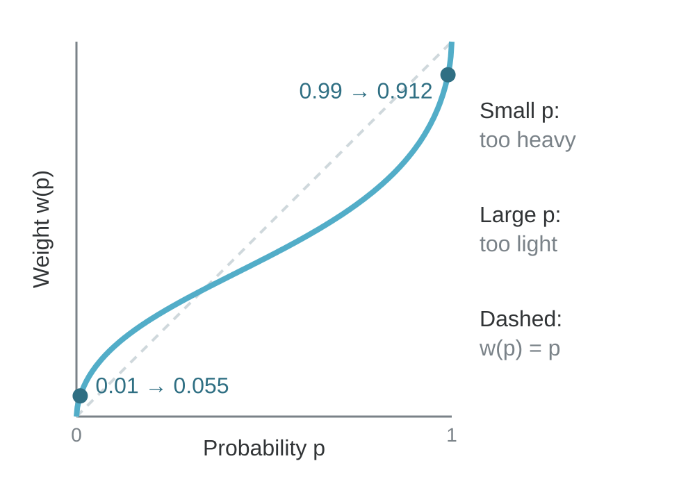
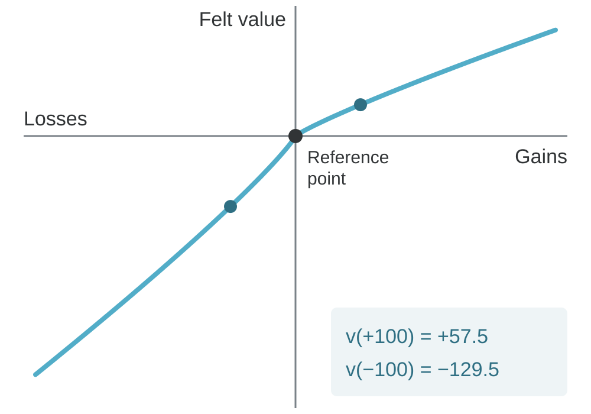

# Reference Points and Framing

Behavioural Economics for Managers · Module 3

Why the same outcome feels like a gain to one person and a loss to another

---

<!-- layout: agenda -->
## Outline
### Concepts in this module and their consequences

|||

### The theory

1. Reference points
2. Prospect theory
3. The value function
4. Loss aversion

|||

### What it explains

5. Endowment effect
6. Status quo bias
7. Gain and loss framing
8. Segregating and integrating outcomes

---
<!-- layout: compare -->
## Before we start: two choices
### Answer both on paper. Do not discuss.

|||

### Choice 1

- **A:** a sure gain of ₹500
- **B:** a 50% chance to gain ₹1,000, and a 50% chance of nothing

|||

---

<!-- layout: compare -->
## Before we start: two choices
### Answer both on paper. Do not discuss.

|||

|||

### Choice 2

- **C:** a sure loss of ₹500
- **D:** a 50% chance to lose ₹1,000, and a 50% chance of nothing

---
<!-- layout: compare -->
## Before we start: two choices
### Answer both on paper. Do not discuss.

|||

### Choice 1

- **A:** a sure gain of ₹500
- **B:** a 50% chance to gain ₹1,000, and a 50% chance of nothing

|||

### Choice 2

- **C:** a sure loss of ₹500
- **D:** a 50% chance to lose ₹1,000, and a 50% chance of nothing

---

<!-- layout: compare -->
## What most people choose
### Same expected value in every option: ₹500

|||

### Choice 1: most pick A

In gains, people take the sure thing. They are **risk averse**.

|||

### Choice 2: most pick D

In losses, people gamble to avoid a sure loss. They are **risk seeking**.

---

<!-- layout: callout -->
## The question this module answers
### Why does ₹100 not always feel like ₹100?

> People judge outcomes as gains or losses from a reference point. Losses hurt about twice as much as equal gains please.

Change the reference point, or the description, and you change the choice. The money stays the same.

---

<!-- layout: section -->
# Eight concepts

Each one: what it is, an everyday example, a real business situation, and what it means for managers

---

<!-- layout: callout -->
## Concept 1: Reference points
### The zero we measure from

> A reference point is the level against which we judge an outcome. Above it feels like a gain. Below it feels like a loss.

Where we put that zero decides whether the same outcome is good news or bad news.

---

<!-- layout: compare -->
## Reference points: an everyday example
### Two appraisal letters

|||

### Anil

Gets a **10%** raise. He expected 15%, and his team got 15%.

He feels he lost.

|||

### Bhavna

Gets a **5%** raise. She expected 3%, and her team got 3%.

She feels she won.

---

<!-- layout: equation -->
## Reference points: the mathematics
### The outcome minus the reference point

$$x = W - W_0$$

$W$ is the actual outcome. $W_0$ is the reference point. $x$ is the gain or loss the person feels. If $W > W_0$, it is a gain. If $W = W_0$, it is neutral. If $W < W_0$, it is a loss.

---

<!-- layout: equation -->
## Same salary, two reference points
### Two professors now earn ₹15 lakh. A earned ₹12 lakh before, B ₹18 lakh.

$$\text{Professor A:} \quad x = 15 - 12 = +3$$

$$\text{Professor B:} \quad x = 15 - 18 = -3$$

Same salary. A feels a gain of ₹3 lakh. B feels a loss of ₹3 lakh. This is reference dependence.

---

<!-- layout: table -->
## Where reference points come from

| Source | Example |
|---|---|
| Past experience | Last year's salary |
| Expectations | The bonus your manager hinted at |
| Social comparison | Your batchmate's placement package |
| Ownership | The price you paid for a share |
| Targets and aspirations | A monthly sales target |

---

<!-- layout: compare -->
## Two more reference points
### The zero is not always obvious

|||

### Salary and inflation

Your salary rises 5%. Prices rise 8%. The nominal figure is a gain. Your purchasing power is a loss.

|||

### The laptop

Bought for ₹80,000. Six months later it sells for ₹60,000. You have not sold it, yet it feels like a ₹20,000 loss. The purchase price is the reference point.

---

<!-- layout: case -->
## Business situation: the ₹5 biscuit pack
### Parle-G and the price point customers know

**The pressure:** For three decades, the cost of wheat, sugar, oil and packaging kept rising.

**What Parle did:** It kept the small pack at ₹4 until 2021, then moved to ₹5. The pack shrank from 100 g in 1994 to 55 g by 2022.

**The pattern:** Many FMCG firms protect the ₹5 and ₹10 price points and reduce grams instead. This is called shrinkflation.

---

<!-- layout: discussion -->
## Why did Parle cut grams for almost 30 years instead of raising the price by ₹1?

Use the idea of a reference point. Then ask: is this fair to the customer?

---

<!-- layout: compare -->
## Reference points: the takeaway
### Find the zero before you judge the reaction

|||

### For managers

Customers judge against the price they know. A new price is seen at once and felt as a loss. Fewer grams are hardly noticed.

|||

### The technical point

Felt value depends on the change, not the level: $v(x - r)$. Here $x$ is the outcome and $r$ is the reference point.

---

<!-- layout: callout -->
## Concept 2: Prospect theory
### Kahneman and Tversky (1979)

> Prospect theory describes how people actually choose between risky options. People weigh gains and losses from a reference point, not final wealth.

Kahneman received the 2002 Nobel Prize in Economics largely for this work.

---

<!-- layout: table -->
## Traditional economics and prospect theory

| | Traditional approach | Prospect theory |
|---|---|---|
| What is judged | Final wealth | Gains and losses |
| Value | Utility of wealth | Felt value of changes |
| Probabilities | Used as given | Decision weights |
| Preferences | Assumed consistent | Reversals explained |

---

<!-- layout: equation -->
## From expected utility to prospect theory

$$EU = \sum_i p_i \, U(W_i)$$

$$V = \sum_i w(p_i) \, v(x_i)$$

Final wealth $W$ becomes a change $x$. The probability $p$ becomes a decision weight $w(p)$, also written $\pi(p)$.

---

<!-- layout: steps -->
## Four features of prospect theory
### Each one breaks a rule of standard theory

1. **Reference dependence:** outcomes are gains or losses from a zero.
2. **Diminishing sensitivity:** each extra rupee matters less.
3. **Loss aversion:** losses weigh about twice as much as gains.
4. **Probability weighting:** small chances feel bigger, near-certainty smaller.

---

<!-- layout: image-right -->
## Probability weighting
### Kahneman and Tversky (1979); refined in 1992

- A 1% chance feels like about 5.5%
- A 99% chance feels like about 91%
- This explains lottery tickets, insurance and fear of rare disasters

---

<!-- layout: compare -->
## The value function and decision weights
### Prospect theory has two parts

|||

### How much is it worth?

The **value function** $v(x)$ turns a gain or loss into a feeling. Concepts 3 and 4 explain its shape.

|||

### How likely does it feel?

The **weighting function** $w(p)$ turns a probability into a decision weight. Small chances are overweighted.

---

<!-- layout: table -->
## The opening choices, explained
### Prospect theory values, Tversky and Kahneman (1992)

| Option | What it offers | Felt value |
|---|---|---|
| A | Sure gain of ₹500 | **237.2** |
| B | 50% chance of ₹1,000 | 183.8 |
| C | Sure loss of ₹500 | −533.7 |
| D | 50% chance to lose ₹1,000 | **−445.9** |

A beats B, and D beats C. That is what most people chose.

---

<!-- layout: case -->
## Business situation: the trader who doubled up
### Barings Bank, 1995

**The loss:** Nick Leeson, a Barings trader in Singapore, hid his losses in an error account. By the end of 1994 they were over £200 million.

**What he did:** He did not close the positions and book the loss. He made bigger bets to win it back. The Kobe earthquake of January 1995 sent the market lower.

**The result:** Losses reached £827 million. Barings, Britain's oldest merchant bank, collapsed in February 1995 and was sold to ING for £1.

---

<!-- layout: discussion -->
## Leeson faced a sure loss of £200 million. Why did he gamble instead of stopping?

Link your answer to Choice 2 at the start of class. Then ask: what should Barings' managers have done?

---

<!-- layout: compare -->
## Prospect theory: the takeaway
### Watch the people who are behind

|||

### For managers

People facing a sure loss turn into risk seekers. Units behind target and projects over budget are the most likely to gamble. Controls matter most there.

|||

### The technical point

The value of an option is $V = \sum w(p)\,v(x)$. For losses, $v$ is convex, so a gamble feels less bad than a sure loss.

---

<!-- layout: callout -->
## Concept 3: The value function
### How much a change feels like

> The value function turns a change in money into felt value. It is concave for gains, convex for losses, and steeper for losses.

Read it as: how happy, or unhappy, does this change make me?

---

<!-- layout: image-right -->
## The value function in a picture
### Tversky and Kahneman (1992)

- The curve passes through the reference point
- It flattens as gains grow
- It drops more steeply into losses

---

<!-- layout: table -->
## The value function in numbers
### Gains: $v(x) = x^{0.88}$. Losses: $v(x) = -2.25(-x)^{0.88}$.

| Change (₹) | Gain feels like | Loss feels like |
|---|---|---|
| 10 | 7.6 | −17.1 |
| 100 | 57.5 | −129.5 |
| 1,000 | 436.5 | −982.2 |

Ten times the money gives only 7.6 times the feeling. A loss feels 2.25 times as large.

---

<!-- layout: table -->
## The parameters of the value function
### $v(x) = x^{\alpha}$ for gains, $v(x) = -\lambda(-x)^{\beta}$ for losses

| Parameter | Meaning | Typical value |
|---|---|---|
| $x$ | Gain or loss from the reference point | |
| $\alpha$ | Curvature for gains | 0.88 |
| $\beta$ | Curvature for losses | 0.88 |
| $\lambda$ | Loss aversion coefficient | 2.25 |

$0 < \alpha, \beta < 1$ gives diminishing sensitivity. $\lambda > 1$ gives loss aversion.

---

<!-- layout: equation -->
## Why the gain side is concave
### For $x > 0$: $v(x) = x^{\alpha}$

$$v'(x) = \alpha x^{\alpha - 1} > 0$$

$$v''(x) = \alpha(\alpha - 1)\,x^{\alpha - 2} < 0$$

Since $\alpha < 1$, the term $(\alpha - 1)$ is negative. In ₹ thousand: the first ₹1,000 adds 1.00 of value. The second adds only 0.84.

---

<!-- layout: equation -->
## Why the loss side is convex
### For $x < 0$: $v(x) = -\lambda(-x)^{\beta}$

$$v'(x) = \lambda \beta (-x)^{\beta - 1} > 0$$

$$v''(x) = \lambda \beta (1 - \beta)(-x)^{\beta - 2} > 0$$

Each extra rupee lost hurts a little less. In ₹ thousand: the first ₹1,000 lost feels like −2.25. The eleventh adds only −1.49.

---

<!-- layout: compare -->
## The value function: an everyday example
### Two ₹500 savings

|||

### A ₹1,000 phone cover

Save ₹500 by visiting a shop 15 minutes away. Most people go.

|||

### A ₹50,000 phone

Save the same ₹500 at the same shop. Most people do not bother.

---

<!-- layout: case -->
## Business situation: add-ons at the car showroom
### A common sales practice

**The moment:** A customer is paying ₹10 lakh for a new car.

**The offer:** At the desk, the dealer adds an extended warranty, a coating package and accessories, about ₹40,000 in all.

**What happens:** Many buyers accept. The same ₹40,000, asked for on its own, would feel large. Electronics stores and airlines use the same timing.

---

<!-- layout: discussion -->
## Why does ₹40,000 feel small at the car desk? Is selling add-ons at that moment fair to the customer?

Use the shape of the value function in your answer.

---

<!-- layout: compare -->
## The value function: the takeaway
### The same rupees feel smaller on a big base

|||

### For managers

Customers judge a cost against what they are already paying. Expect small add-ons to sell best next to a big purchase, and expect them to be questioned later.

|||

### The technical point

With $v(x) = x^{0.88}$, ₹40,000 added to ₹10 lakh feels about 40% smaller than ₹40,000 paid on its own.

---

<!-- layout: callout -->
## Concept 4: Loss aversion
### Losses loom larger than gains

> Loss aversion is the tendency to feel a loss more strongly than a gain of the same size. The coefficient λ measures how much more.

Across 607 estimates from 150 studies, the average λ is about 2 (Brown et al., 2024).

---

<!-- layout: discussion -->
## A coin flip: heads you win X, tails you lose ₹100. What is the smallest X that makes you accept?

Write down your number before the next slide.

---

<!-- layout: compare -->
## The coin flip, explained
### A fair bet needs only ₹100

|||

### What people ask for

Most people ask for about twice the loss, around ₹200 or more.

|||

### Why

A loss of ₹100 is felt λ times as strongly. With λ = 2.25, the win must be about ₹225 to feel equal.

---

<!-- layout: equation -->
## A fair bet most people reject
### Heads: win ₹2,000. Tails: lose ₹2,000. Values in ₹ thousand.

$$EMV = 0.5(2) + 0.5(-2) = 0$$

$$V = 0.5(1.84) + 0.5(-4.14) = -1.15$$

Here $v(2) = 1.84$ and $v(-2) = -4.14$. Fair in money, negative in feeling, so most people say no.

---

<!-- layout: table -->
## Loss aversion is not risk aversion
### A common exam question

| | Loss aversion | Risk aversion |
|---|---|---|
| Meaning | Losses hurt more than equal gains please | Dislike of uncertainty |
| About | Gains against losses | Sure outcomes against risky ones |
| In the model | λ, the steeper loss side | The curvature of the value function |

---

<!-- layout: table -->
## Loss aversion in markets: the disposition effect
### An investor holds two shares

| Share | Bought at | Price now | Feels like | What investors often do |
|---|---|---|---|---|
| A | ₹1,000 | ₹1,500 | A gain | Sell quickly |
| B | ₹1,000 | ₹500 | A loss | Hold on |

Selling B makes the loss real. Loss aversion is one explanation. Taxes and beliefs about future prices also matter.

---

<!-- layout: case -->
## Business situation: the Netflix price rise
### United States, 2011

**The change:** In July 2011, Netflix split its DVD and streaming plans. The combined plan rose from $9.99 to $15.98 a month, a 60% rise.

**The reaction:** Customers flooded its blog with complaints. Netflix lost about 800,000 US subscribers in the third quarter, falling from 24.6 to 23.8 million.

**The aftermath:** The share price fell sharply. The CEO, Reed Hastings, publicly apologised for how the change was announced.

---

<!-- layout: discussion -->
## Customers lost about $6 a month. Why was the reaction so much bigger than the money?

How would you have announced the same change?

---

<!-- layout: compare -->
## Loss aversion: the takeaway
### Count the loss side twice

|||

### For managers

A price rise is a loss to existing customers. Expect a reaction about twice what the money suggests. Pair it with a gain, or protect loyal customers.

|||

### The technical point

$v(-x) = -\lambda\,x^{0.88}$. With $\lambda \approx 2$, a ₹100 rise hurts about as much as a ₹200 cut pleases.

---

<!-- layout: callout -->
## Concept 5: The endowment effect
### Thaler (1980)

> The endowment effect is the tendency to value something more once you own it. Giving it up feels like a loss.

So the price to sell is higher than the price to buy, for the same person and the same good.

---

<!-- layout: compare -->
## Endowment: an everyday example
### Selling your old scooter on OLX

|||

### As the seller

"It has been reliable. I will not take less than ₹45,000."

|||

### As a buyer of the same scooter

"It is five years old. ₹32,000 at most."

---

<!-- layout: table -->
## Willingness to pay and to accept
### A classroom mug test. Illustrative figures.

| Group | Question | Average answer |
|---|---|---|
| Owners | Lowest price at which you would sell | ₹500 |
| Non-owners | Highest price you would pay | ₹250 |

For owners, selling is a loss. For non-owners, buying is a gain. Loss aversion opens the gap: WTA ≈ λ × WTP.

---

## Where the endowment effect shows up
### Ownership changes the reference point

- Home owners ask more than buyers will pay
- Employees resist losing benefits they already have
- Investors grow attached to shares they own
- Consumers value products they own more than new ones

---

<!-- layout: case -->
## Business situation: the free month
### Trials, test drives and home try-ons

**The offer:** Music, video and software apps often unlock the premium plan free for a month.

**The switch:** At the end, the question is no longer "Do you want to buy this?" It becomes "Do you want to lose this?" Going back means giving up downloads, settings and features.

**The pattern:** Car test drives, home try-ons and money-back guarantees work the same way. The customer owns it first.

---

<!-- layout: discussion -->
## Offer 1: "Premium for ₹199 a month." Offer 2: "Premium free for 30 days, then ₹199." Which sells more, and why?

Then ask: what makes a free trial honest?

---

<!-- layout: compare -->
## Endowment: the takeaway
### Ownership moves the reference point

|||

### For managers

A trial turns "gain if I buy" into "loss if I leave". End it with a clear choice, not a hidden charge.

|||

### The technical point

Selling price ≈ λ × buying price. In the Cornell mug test, owners asked $7.12 and buyers offered $2.87, a ratio of 2.5.

---

<!-- layout: callout -->
## Concept 6: Status quo bias
### Samuelson and Zeckhauser (1988)

> Status quo bias is a preference for the current state of affairs. People stick with what they have, or with the default, more than the options justify.

The default wins not because people chose it, but because they did not choose.

---

## Why people stay with the status quo
### Plan B pays more. Many stay in Plan A anyway.

- **Loss aversion:** every switch has something to give up
- **Uncertainty:** the new option feels less known
- **Inertia:** deciding takes effort, so people put it off
- **Endorsement:** the current option looks recommended

---

<!-- layout: compare -->
## The default effect
### Two ways to run a pension plan

|||

### System A: opt in

Employees must sign up to join. Many never do.

|||

### System B: opt out

Employees join automatically and can leave. Participation is usually much higher.

---

## Defaults in public policy
### Governments use defaults to encourage

- Pension participation and retirement savings
- Health insurance enrolment
- Organ donor registration
- Energy-efficient choices

---

<!-- layout: compare -->
## Status quo: an everyday example
### India's income tax regime

|||

### Before FY 2023-24

The old regime applied unless you chose the new one.

|||

### From FY 2023-24

The new regime is the default. You must opt out to stay in the old one.

---

<!-- layout: case -->
## Business situation: the pre-filled cart
### India's rules on dark patterns, 2023

**The practice:** Some apps added travel insurance, a donation or an extra item to the cart at checkout. The customer had to spot it and remove it.

**Why it worked:** Most people keep what is already there. Removing an item takes effort and feels like giving something up.

**The rule:** The Central Consumer Protection Authority notified its Dark Patterns Guidelines on 30 November 2023. They name 13 dark patterns, including "basket sneaking".

---

<!-- layout: discussion -->
## Most customers keep the default. When is a default good design, and when is it a trap?

Give one default you would set for your own product.

---

<!-- layout: compare -->
## Status quo bias: the takeaway
### Defaults are decisions

|||

### For managers

Whoever sets the default chooses for most people. Make it the option customers would pick if they compared.

|||

### The technical point

People switch only if $G > \lambda L + c$: the gain beats the loss times λ, plus effort. Giving up ₹1,000 needs a gain above ₹2,250.

---

<!-- layout: callout -->
## Concept 7: Gain and loss framing
### Tversky and Kahneman (1981)

> A framing effect occurs when two true descriptions of the same outcome lead to different choices. A gain frame or a loss frame moves the reference point.

The facts do not change. The reference point does.

---

<!-- layout: compare -->
## Framing: an everyday example
### 600 people are at risk from a disease

|||

### Frame 1: lives saved

A: 200 will be saved.

B: 1/3 chance all 600 are saved.

|||

### Frame 2: lives lost

C: 400 will die.

D: 1/3 chance nobody dies.

---

<!-- layout: stat -->
## The disease problem: the result
### A and C are the same. So are B and D.

|||

# 72%

Chose A, the sure option, when told "saved"

|||

# 78%

Chose D, the gamble, when told "die"

---

<!-- layout: table -->
## The disease problem, side by side
### Same outcomes, different words

| | Gain frame | Loss frame | Outcome |
|---|---|---|---|
| Sure option | A: 200 saved | C: 400 die | 200 live for sure |
| Risky option | B: 1/3 chance 600 saved | D: 1/3 chance nobody dies | 1/3 chance all 600 live |

$A = C$ and $B = D$. People are risk averse in the gain frame and risk seeking in the loss frame.

---

<!-- layout: table -->
## Framing in management
### Illustrative examples

| Area | Gain frame | Loss frame |
|---|---|---|
| Advertising | "Save ₹5,000 with our product" | "Without our product, you lose ₹5,000" |
| Pricing | Cash discount | Card surcharge |
| Tax compliance | "File early, get your refund sooner" | "File late, pay a penalty" |
| Investment | "80% chance of a profit" | "20% chance of a loss" |

---

<!-- layout: case -->
## Business situation: card fee or cash discount?
### Thaler (1980)

**The situation:** US shops wanted to charge card users more than cash users, because card firms take a fee.

**Two labels for the same gap:** a "surcharge for card users", or a "discount for cash users".

**What the card industry wanted:** the discount label. A surcharge is a loss added to the price. A missed discount only feels like a missed gain.

---

<!-- layout: discussion -->
## Your shop adds 2% for card payments. Write the sign two ways. Which one would you put up, and why?

Then ask: are both signs honest?

---

<!-- layout: compare -->
## Framing: the takeaway
### There is no neutral description

|||

### For managers

Choose the frame on purpose. Use a loss frame only when it is true, and when the customer would accept it if shown both.

|||

### The technical point

Frames act before evaluation: they set what counts as a gain or a loss. Teachers paid upfront raised scores 0.2 to 0.4 SD; a year-end bonus, about 0.05.

---

<!-- layout: callout -->
## Concept 8: Segregating and integrating outcomes
### Thaler (1985), mental accounting

> People react to how outcomes are grouped. Several outcomes can be felt one by one, segregated, or as a single total, integrated.

The value function tells us which grouping feels better.

---

## Thaler's four rules

| Outcomes | Best presented as | Why |
|---|---|---|
| Several gains | Separate | Each gain starts on the steep part of the curve |
| Several losses | Together | Losses flatten as they grow |
| Large gain, small loss | Together | The loss disappears into the gain |
| Large loss, small gain | Separate | A "silver lining" |

---

<!-- layout: equation -->
## Rules 1 and 2 in numbers
### Two bonuses or two losses of ₹5,000. Values in ₹ thousand.

$$v(5) + v(5) = 8.24 > v(10) = 7.59$$

$$v(-5) + v(-5) = -18.55 < v(-10) = -17.07$$

Top line, gains: two bonuses feel better than one. Bottom line, losses: two losses feel worse than one combined loss.

---

<!-- layout: equation -->
## Rules 3 and 4 in numbers
### A ₹10,000 bonus and a ₹1,000 penalty, then the reverse

$$v(9) = 6.91 > v(10) + v(-1) = 5.34$$

$$v(-10) + v(1) = -16.07 < v(-9) = -15.56$$

Top line: Rule 3 holds. Bottom line: Rule 4 fails with λ = 2.25: a silver lining helps only when the loss is about 300 times the gain. The rules are predictions, not laws.

---

<!-- layout: compare -->
## Segregating: an everyday example
### Two ways to win ₹500

|||

### Two lottery wins

₹300 on Monday and ₹200 on Friday.

Most people say this feels better.

|||

### One lottery win

₹500 on Monday.

Same money, one moment of joy.

---

<!-- layout: case -->
## Business situation: the mobile recharge plan
### Gains apart, costs together

**Segregate the gains:** Indian prepaid plans list each benefit on its own line: daily data, unlimited calls, SMS and OTT subscriptions.

**Integrate the cost:** The customer sees one price for the whole bundle, not a price for each benefit.

**The other side:** Some hotels and ticket sellers showed a low price and added fees at checkout. Since 12 May 2025, a US FTC rule requires them to show the total price upfront.

---

<!-- layout: discussion -->
## Why do telecom firms list five benefits but show one price? Why do regulators want the total price shown first?

Use Thaler's rules in your answer.

---

<!-- layout: compare -->
## Segregating and integrating: the takeaway
### Package outcomes on purpose

|||

### For managers

Spread out good news and benefits. Bundle costs into one honest total. Deliver bad news in one meeting, not drip by drip.

|||

### The technical point

Gains of ₹50 and ₹25 feel like 48.3 apart, but 44.7 as one ₹75. Losses of the same size feel like −108.6 apart, but −100.5 together.

---

<!-- layout: table -->
## Putting the module together: the framework

| Step | The question it answers |
|---|---|
| 1. Reference point | Where am I starting from? |
| 2. Gains and losses | Am I gaining or losing? |
| 3. Value function | How much do I value the outcome? |
| 4. Probability weighting | How likely does it feel? |
| 5. Decision | What do I choose? |

It explains endowment, status quo bias, framing and hedonic editing.

---

<!-- layout: section -->
# Case: Kaveri Fibre

A regional broadband provider must raise its price. Read the case, then use the eight concepts to decide how.

---

<!-- layout: case -->
## Kaveri Fibre, Mysuru
### A teaching case. The firm, its people and all figures are fictional.

**The firm:** A fibre broadband provider founded in 2016 by Prakash Gowda. It serves Mysuru and nearby towns, including Mandya and Hunsur.

**The person:** Shalini Rao, Head of Pricing. She reports to Gowda, the CEO.

**The date:** September 2026. A new bandwidth contract starts on 1 January 2027.

---

<!-- layout: callout -->
## A hundred rupees
### 2 September 2026

> "Our rivals already charge ₹899. Our customers are sensible people. They will compare, and they will stay." Prakash Gowda, CEO

He asks Rao for a recommendation at the board meeting on 30 September. His last words: "Do not bring me a price. Bring me a plan."

---

<!-- layout: stat -->
## Exhibit 1: Kaveri Fibre today
### August 2026. Main plan: 100 Mbps, price includes GST, unchanged since 2021.

|||

# 1,20,000

Subscribers

|||

# ₹799

Per month

|||

# 1.8%

Monthly churn

---

<!-- layout: table -->
## Exhibit 1, continued

| Item | Value |
|---|---|
| Annual plan | ₹9,588 a year |
| Revenue a year at ₹799 | ₹115.1 crore |
| Revenue at ₹899, if no one leaves | ₹129.5 crore |
| Extra cost from January | About ₹70 a subscriber a month |
| Rivals' comparable plan | About ₹899 a month |

---

## The cost problem
### Why the price must rise

- The new contract adds about ₹10.1 crore a year
- Gowda wants every customer on **₹899** from 1 January
- He expects few to leave, since rivals charge ₹899
- His other idea: rise ₹50 in January, ₹50 in July

---

<!-- layout: case -->
## An offer from the network team
### Manjunath K., Head of Network

**The offer:** The fibre already in the ground can carry 200 Mbps to every home. Moving all customers from 100 Mbps to 200 Mbps would cost Kaveri very little.

**The survey:** In May 2026, households said they would value 200 Mbps at about ₹300 a month more than 100 Mbps.

**The open question:** Nobody has decided whether to announce the upgrade with the price rise, separately, or later.

---

## Exhibit 2: two pilot towns, March to May 2026
### Each town had about 6,000 subscribers on ₹799. Both returned to ₹799 in June.

| Town | Change | Monthly churn before | Monthly churn during the pilot |
|---|---|---|---|
| Hunsur | Price cut of ₹50, to ₹749 | 1.80% | 1.60% |
| Mandya | Price rise of ₹50, to ₹849 | 1.80% | 2.25% |

---

## Exhibit 3: speed trial, June to August 2026
### Two random groups of 10,000 customers each

| Group | What they received | Result |
|---|---|---|
| Direct offer | 300 Mbps offered for ₹200 more a month | 5% accepted |
| Free trial | 300 Mbps free for 30 days, then asked to keep it for ₹200 more | 17% kept it |
| Direct offer, survey | Most they would pay each month for 300 Mbps | Median ₹120 |
| Free trial, survey | Monthly discount needed to give 300 Mbps back | Median ₹280 |

---

## Exhibit 4: plan page survey, June to August 2026
### In-app survey. Four random groups of 5,000. Draft prices: ₹899 a month (₹10,788 a year) or ₹9,588 a year.

| What was tested | Version | Chose the annual plan |
|---|---|---|
| Message | "Choose annual and save ₹1,200 a year" | 18% |
| Message | "Stay monthly and lose ₹1,200 a year" | 24% |
| Default | Monthly plan selected when the page opens | 22% |
| Default | Annual plan selected when the page opens | 58% |

---

## Exhibit 5: proposals on Rao's desk (1 of 2)
### September 2026

| From | Proposal |
|---|---|
| Gowda, CEO | One price of ₹899 for all customers, old and new |
| Gowda, CEO | Or two rises of ₹50, in January and July |
| Finance | A churn forecast. Assume extra churn lasts three months. |
| Manjunath K., Network | Move everyone to 200 Mbps from 1 January |
| Vikram Hegde, Sales | Advertise the plan as "Was ₹1,099, now ₹899" |

---

## Exhibit 5: proposals on Rao's desk (2 of 2)
### From Farah Ali, Head of Marketing

| Idea | Proposal |
|---|---|
| Plan page | Use the "lose ₹1,200" message. Pre-select the annual plan. |
| Speed trial | 300 Mbps free for 30 days, then ₹1,099 unless the customer opts out |
| New bill | Each benefit on its own line with its value. All charges as one total. |
| Promotion | ₹10 cashback on every bill, or a monthly draw: 1 in 1,000 wins a free year (₹10,788) |

---

## The new bill, as Farah Ali drew it
### Benefits of the January plan, each on its own line

| Benefit | Value shown on the bill |
|---|---|
| 200 Mbps speed | ₹300 a month |
| OTT streaming pack | ₹149 a month |
| Wi-Fi router, rented by rivals | ₹100 a month |
| **All charges** | **One total: ₹899** |

---

<!-- layout: callout -->
## Rao's task
### Two weeks to the board meeting

> Turn the tests and the proposals into one plan. It must work for the board. Rao also wants a plan she can defend to Kaveri's customers.

Some ideas are clever. Some are probably effective. A few, she suspects, are effective and wrong.

---

<!-- layout: section -->
# Case questions

Work in groups. Use the concepts from this module and the numbers in the exhibits.

---

<!-- layout: discussion -->
## Q1. Gowda says existing customers will compare ₹899 with rivals, as new customers do. Do you agree?

Which customers will feel ₹899 as a loss, and which will not?

---

<!-- layout: discussion -->
## Q2. In Exhibit 2, a ₹50 cut and a ₹50 rise did not move churn by the same amount. Why?

What does this tell you about Kaveri's customers?

---

<!-- layout: discussion -->
## Q3. Estimate monthly churn after a ₹100 rise. Does the rise still pay?

Use finance's assumption: the extra churn lasts three months.

---

<!-- layout: discussion -->
## Q4. One rise of ₹100, or two of ₹50? With the speed upgrade, or separately?

Write the announcement you would send to customers.

---

<!-- layout: discussion -->
## Q5. In Exhibit 4, is the gap between 18% and 24% large enough to trust? Should Kaveri use the "lose ₹1,200" message?

Each version went to 5,000 customers.

---

<!-- layout: discussion -->
## Q6. Why did 17% keep 300 Mbps after a free trial, when only 5% took the direct offer?

Compare the two survey medians. What is the trial worth to Kaveri in a year?

---

<!-- layout: discussion -->
## Q7. Should the annual plan be selected by default? When would that be fair to customers?

Use Exhibit 4.

---

<!-- layout: discussion -->
## Q8. Do you support Farah Ali's new bill?

Why do benefits listed one by one, and one total for charges, change how the same money feels?

---

<!-- layout: discussion -->
## Q9. Cashback or lucky draw? They cost about the same. Which would customers value more?

What would you check before running a lucky draw?

---

<!-- layout: discussion -->
## Q10. Look at Exhibit 5 again. Which proposals would you accept, change or reject?

For each one you reject, name the concept it misuses.

---

<!-- layout: discussion -->
## Q11. Write Rao's recommendation to the board in five points.

State the price, when and how it is announced, and what else Kaveri should change.

---

## The eight concepts on one page

| Concept | One line | Business situation |
|---|---|---|
| Reference point | Gains and losses from a zero | Parle-G ₹5 pack |
| Prospect theory | Gamble to avoid sure losses | Barings Bank |
| Value function | Same rupees feel smaller on a big base | Car add-ons |
| Loss aversion | Losses count about double | Netflix 2011 |
| Endowment, status quo | Giving up what you have is a loss | Free trials, pre-filled carts |
| Framing, packaging | Words move the zero and the grouping | Card fees, recharge plans |

---

<!-- layout: steps -->
## A checklist for any price, policy or pay change
### Four questions before you announce

1. What is the other person's **reference point**?
2. Which parts will they feel as a **loss**? Count those twice.
3. What is the **default**, and would they choose it if they compared?
4. How should gains and losses be **grouped**, honestly?

---

## Exit quiz
### Answer on paper before you leave

| | Question |
|---|---|
| 1 | An investor will not sell a share below the price she paid. Which concept? |
| 2 | Losing ₹500 feels as bad as gaining how much feels good, with λ = 2.25? |
| 3 | 80% of staff stay in the pension plan they were enrolled in. Which bias? |
| 4 | Should a ₹200 fee be shown on its own or inside a ₹5,000 total? Why? |
| 5 | Give one test that separates framing from manipulation. |

---

<!-- layout: references -->
## Sources for this module (1 of 2)

- Kahneman, D. and Tversky, A. (1979). Prospect theory: An analysis of decision under risk. *Econometrica*, 47(2), 263–291.
- Tversky, A. and Kahneman, D. (1981). The framing of decisions and the psychology of choice. *Science*, 211(4481), 453–458.
- Tversky, A. and Kahneman, D. (1992). Advances in prospect theory. *Journal of Risk and Uncertainty*, 5(4), 297–323.
- Thaler, R. H. (1980). Toward a positive theory of consumer choice. *Journal of Economic Behavior and Organization*, 1(1), 39–60.
- Thaler, R. H. (1985). Mental accounting and consumer choice. *Marketing Science*, 4(3), 199–214.
- Kahneman, D., Knetsch, J. L. and Thaler, R. H. (1990). Experimental tests of the endowment effect and the Coase theorem. *Journal of Political Economy*, 98(6), 1325–1348.
- Samuelson, W. and Zeckhauser, R. (1988). Status quo bias in decision making. *Journal of Risk and Uncertainty*, 1(1), 7–59.

---

<!-- layout: references -->
## Sources for this module (2 of 2)

- Brown, A. L., Imai, T., Vieider, F. M. and Camerer, C. F. (2024). Meta-analysis of empirical estimates of loss aversion. *Journal of Economic Literature*, 62(2), 485–516.
- Fryer, R. G., Levitt, S. D., List, J. and Sadoff, S. (2022). Enhancing the efficacy of teacher incentives through framing. *AEJ: Economic Policy*, 14(4), 269–299.
- Outlook Business. ₹5, ₹10 pack maths no longer adds up for FMCG majors (Parle-G grammage).
- Reserve Bank of Australia (1995). Implications of the Barings collapse for bank supervisors. *Bulletin*, November.
- Associated Press (2011). Netflix loses 800,000 US subscribers in tough third quarter. 24 October.
- Central Consumer Protection Authority (2023). Guidelines for Prevention and Regulation of Dark Patterns, 2023.
- US Federal Trade Commission (2025). Rule on Unfair or Deceptive Fees, 16 C.F.R. Part 464.

---

<!-- layout: references -->
## Reference books for this module

- Kahneman, D. (2011). *Thinking, Fast and Slow*. Farrar, Straus and Giroux. Part IV, "Choices".
- Thaler, R. H. (2015). *Misbehaving: The Making of Behavioral Economics*. W. W. Norton.
- Wilkinson, N. and Klaes, M. (2017). *An Introduction to Behavioral Economics*, 3rd ed. Palgrave.
- Cartwright, E. (2024). *Behavioral Economics*, 4th ed. Routledge.

---

<!-- layout: end -->
# Questions?

Dr. Pawan Ashok Kamble · BIMTECH
