# Macroeconomic Issues and Measuring Output

### Module 1

Dr. Pawan Ashok Kamble \
Assistant Professor \
Faculty Cabin: F63 (First Floor)

---
<!-- layout: agenda -->
## Topics

1. Key macroeconomic questions and indicators
2. A short history of macroeconomics: classical, Keynesian and modern views
3. Economic growth: India and the world
4. Circular flow of income and national income accounting
5. GDP by the production, income and expenditure methods
6. GDP, GNI, NNI, GVA and personal income
7. Saving, investment, budget and trade identities
8. Real vs nominal GDP and the GDP deflator
9. Business cycle, GDP gap and limits of GDP

---
<!-- layout: stat -->
## India at a Glance, 2026

|||

# 7.8%

Real GDP growth, Q1 2026-27

|||

# 5.5%

CPI inflation, September 2026

|||

# 5.0%

Unemployment rate, September 2026

Note:
Other numbers: nominal GDP about US$ 4.15 trillion; repo rate 5.50% since 7 October 2026; exchange rate about ₹95 per US$.
Sources: NSO (MoSPI) GDP release, 29 August 2026; MoSPI CPI release, 12 October 2026; PLFS monthly bulletin, September 2026; RBI Monetary Policy Statement, 7 October 2026.

---
<!-- layout: discussion -->
## Is the Indian Economy Doing Well?

### Growth is strong, but inflation is rising

- Real GDP growth: **7.8%**, among the fastest in the world.
- CPI inflation: **5.5%**, up from 4.8% in August, above RBI's 4% target.
- RBI raised the repo rate to **5.50%** on 7 October.
- The rupee has weakened to about **₹95 per US$**.

Discuss with your neighbour for two minutes: is this a good economic situation? What else would you want to know?

Note:
Good answers mention that growth and inflation must be read together, that a weaker rupee raises import costs, and that higher rates may slow investment.
The point: no single number tells us whether the economy is doing well. That is the question for the next slide.

---
<!-- layout: steps -->
## Why Can't We Look at Only One Number?

### Macro variables push and pull on each other

1. **Growth**: GDP ↑, income ↑, demand ↑
2. **Prices**: strong demand pushes inflation ↑
3. **Policy**: RBI raises interest rates
4. **Investment**: borrowing costs ↑, capex ↓
5. **Trade**: rupee and exports react

> **Key idea:** macroeconomics studies how these forces interact.

Note:
Chain 1: GDP up, income up, consumption up, demand for goods and services up.
Chain 2: Inflation up, interest rate up, capital expenditure down, GDP growth down.
Chain 3: Inflation up, interest rate up, exchange rate changes, net exports down, GDP growth down.
A manager who watches only GDP will miss the interest-rate and exchange-rate effects on the firm.

---
## What Is Macroeconomics?

### The behaviour of the economy as a whole

> Macroeconomics covers booms and recessions, total output and its growth, inflation, unemployment and external stability.

This course is built on four connected questions:

1. How much is the economy producing? **GDP and growth**
2. How many people are working? **Employment and unemployment**
3. What is happening to prices? **Inflation**
4. What can policymakers do? **Fiscal and monetary policy**

Note:
The goal of macroeconomic policy is stability: steady growth with low inflation and low unemployment.
All other macro variables (interest rates, money supply, taxes, exchange rates) are tools. The government and RBI combine them into a policy mix.

---
<!-- layout: steps -->
## How Macroeconomics Developed

### Five turning points

1. **1776**: Adam Smith, markets and growth
2. **1929**: the Great Depression
3. **1936**: Keynes, demand matters
4. **1958-68**: Phillips curve and expectations
5. **1970s**: stagflation and modern macro

Note:
Each turning point came from an event the old theory could not explain. The Depression broke the classical view; stagflation broke the simple Phillips curve.

---
<!-- layout: image-right -->
## History of Macroeconomics: Adam Smith

### 1776: *The Wealth of Nations*

- **Division of labour:** specialisation raises productivity.
- **Invisible hand:** self-interest and markets coordinate decisions without central direction.
- **Competition:** pushes firms towards efficiency.
- **Limited government:** defence, justice and public works.

Note:
Smith explained how economies grow through specialisation, trade and markets.
Key variables in his world: demand, supply, prices, output and employment. Markets were expected to clear on their own.

---
<!-- layout: image-right -->
## History of Macroeconomics: The Great Depression

### 1929: markets did not fix themselves

- US stock market crash, then bank failures.
- Investment and production fell, so jobs and incomes fell.
- Lower income cut consumption, which cut production again.
- US unemployment reached about **25%** by 1933.

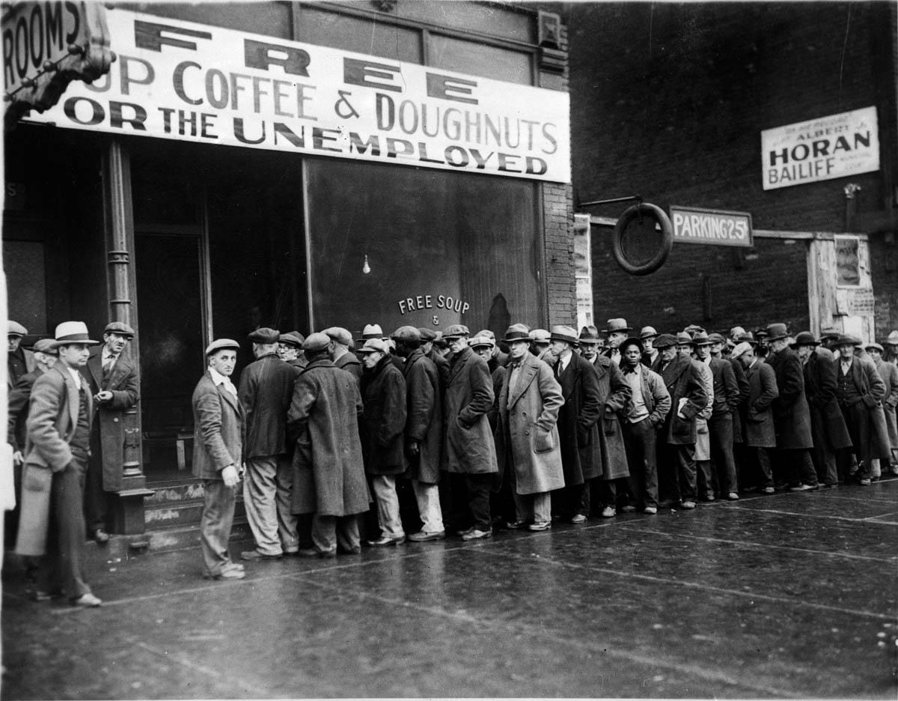

Note:
This was a vicious cycle: falling demand led to falling output, which led to falling income and even lower demand.
US real GDP fell by about a quarter between 1929 and 1933. Classical theory, which expected markets to return to full employment quickly, could not explain a slump this deep and long.

---
<!-- layout: image-right -->
## History of Macroeconomics: Keynes

### 1936: *The General Theory of Employment, Interest and Money*

- **Classical view:** prices adjust, so the economy returns to full employment.
- **Keynes:** it may not, or not quickly.
- **Demand matters:** a fall in demand cuts output, jobs and income.
- **Policy:** government can lift aggregate demand.

Note:
The Keynesian spiral: demand down, production down, employment down, income down, demand down again.
Keynes gave us the idea of studying the economy as a whole, and of separating the short run, medium run and long run.

---
<!-- layout: image-right -->
## History of Macroeconomics: Phillips

### 1958: wage inflation and unemployment

- A. W. Phillips studied UK data from 1861 to 1957.
- Unemployment ↓ → wage inflation ↑
- Unemployment ↑ → wage inflation ↓
- A **short-run trade-off** between unemployment and wage inflation.

Note:
Paper: "The Relation between Unemployment and the Rate of Change of Money Wage Rates in the United Kingdom, 1861-1957", Economica, 1958.

---
## History of Macroeconomics: 1960s

### From a trade-off to the role of expectations

**1. Samuelson and Solow (1960)**
- Turned Phillips's wage curve into a price inflation vs unemployment trade-off for the US.
- Seen as a policy menu: accept more inflation to get less unemployment.

**2. Friedman and Phelps (late 1960s)**
- People learn and form expectations about inflation.
- Workers demand higher wages, so the employment gain disappears.

> **Short run:** a trade-off can exist. **Long run:** no trade-off; unemployment returns to its natural rate.

Note:
Samuelson and Solow, "Analytical Aspects of Anti-Inflation Policy", American Economic Review, 1960.
Friedman-Phelps chain: AD up, unemployment down, inflation up. Workers realise prices are rising faster and demand higher wages. Firms face higher labour costs, and unemployment rises back.
Friedman's 1967 AEA presidential address made this argument a year before stagflation proved it.

---
<!-- layout: image-right -->
## History of Macroeconomics: Stagflation

### 1970s: the oil shock

- 1973-74: oil supply was disrupted after the Arab-Israeli War.
- Oil prices roughly **quadrupled**.
- Costs ↑ → prices ↑ → inflation ↑
- Output ↓ → employment ↓ → unemployment ↑

> Inflation and unemployment rose **together**: stagflation.

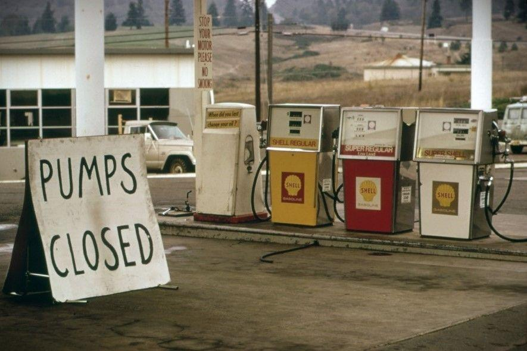

Note:
The simple Phillips curve could not explain this. A supply shock shifts the short-run curve up, so both inflation and unemployment rise.
US inflation passed 11% in 1974, and unemployment reached about 9% in 1975.

---
<!-- layout: callout -->
## Modern Macroeconomics

### Post 1970s

> The relationship between inflation and unemployment is not a permanent trade-off. It depends on **expectations, supply shocks** and how the economy adjusts over time.

So economists think in three time frames: the **short run**, the **medium run** and the **long run**.

Note:
After the 1970s: rational expectations (Lucas), real business cycle models, then New Keynesian models with sticky prices. Central banks moved to inflation targeting. India adopted flexible inflation targeting in 2016.

---
<!-- layout: image-right -->
## Classical View of Macroeconomics

### Output is set by aggregate supply

- The labour market is always at full employment.
- Output is at potential GDP, **Y\***.
- The AS curve is **vertical** (panel b): supply does not depend on the price level.
- Panel (a) is the Keynesian contrast: a flat AS curve.

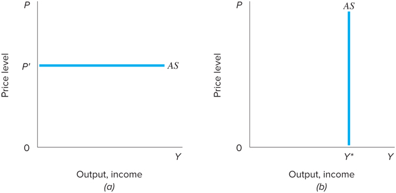

---
<!-- layout: image-right -->
## Classical View: Growth in Y*

### Potential output grows over time

- Y\* rises as the economy gains capital, labour and better technology.
- Panel (a): output rises over time.
- Panel (b): the vertical AS curve shifts right, from AS₀ to AS₃.
- Y\* does not depend on the price level.

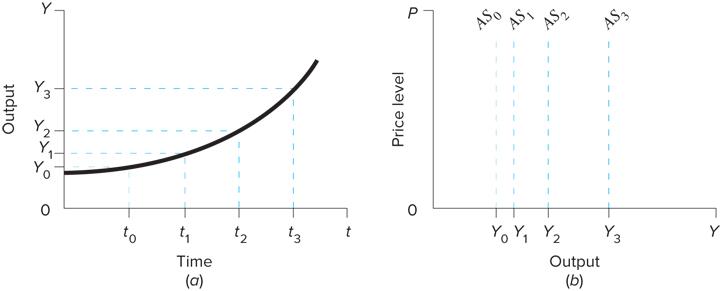

---
<!-- layout: image-right -->
## Classical View: A Rise in Demand

### Prices rise, output does not

- AD shifts right to AD′.
- With a vertical AS, output stays at Y\*.
- The price level rises from P₀ to P′.
- Demand policy only changes prices.

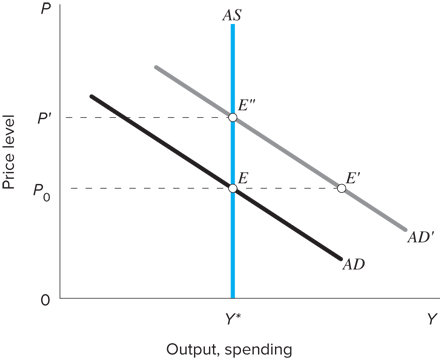

Note:
At the old price P₀, demand would be at E′, above what the economy can produce. Prices rise until the economy reaches E″.
This is why classical economists saw no role for demand policy in raising output.

---
<!-- layout: image-right -->
## Classical View: AS and AD over Time

### US, 1970 to 2010

- Both AS and AD shifted right each decade.
- Points A to E trace the actual path.
- Output grew because AS grew.
- Prices rose because AD grew faster than AS.

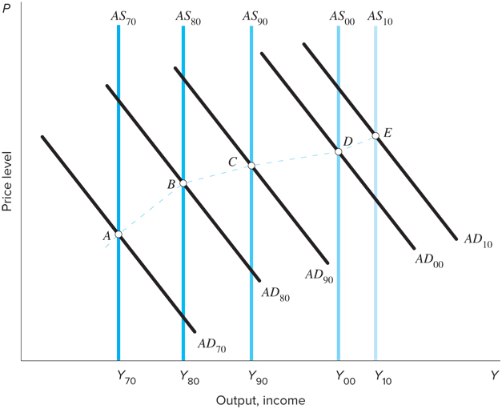

---
## Keynesian View: Three Time Frames

### How output is set depends on the time horizon

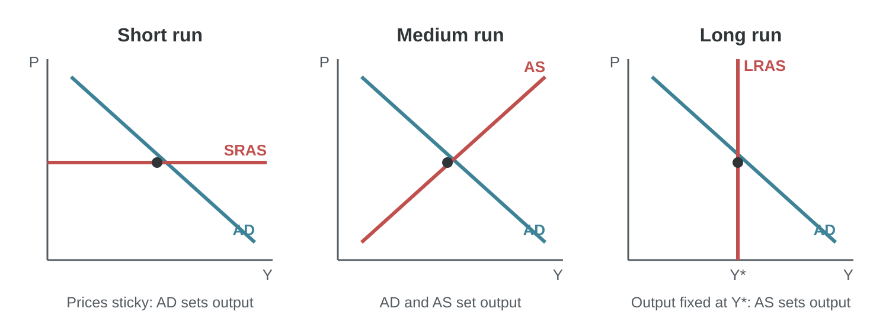

Note:
Short run: prices are sticky. Firms change output, not prices, so the AS curve is flat and AD decides output. A fall in demand cuts output and jobs.
Medium run: prices and wages start to adjust, so AS slopes upward. Both AD and AS decide output.
Long run: prices are fully flexible. The economy is at full employment, AS is vertical at Y*, and only AS decides output. This is the classical case.

---
<!-- layout: compare -->
## Classical vs Keynesian View

|||

### Classical

- Prices and wages are flexible
- Markets clear quickly
- AS is vertical at Y*
- Output set by supply
- Demand policy only raises prices

|||

### Keynesian

- Prices and wages are sticky
- Slumps can last
- AS is flat in the short run
- Output set by demand
- Fiscal and monetary policy can help

Note:
Modern macroeconomics combines both: Keynesian in the short run, classical in the long run.

---
<!-- layout: table -->
## Course Outline

### Seven modules

| Module | Title |
|---|---|
| 1 | Macroeconomic Issues, Framework and Measuring Output |
| 2 | Production, Growth and Loanable Funds |
| 3 | Inflation and Unemployment |
| 4 | The Monetary System |
| 5 | IS-LM Model and Aggregate Demand |
| 6 | International Flow of Goods and Capital |
| 7 | Aggregate Supply, Phillips Curve and Policy Mix |

Note:
Module 2: productivity, the Solow model, saving and investment, the market for loanable funds, budget deficits.
Module 4: money aggregates, money creation, CRR, SLR, repo and OMO, quantity theory, Fisher effect.
Module 6: net exports and net capital outflow, S − I = NCO = NX, balance of payments, exchange rates, PPP.

---
<!-- layout: table -->
## Assessment

### Total 100 marks

| No. | Component | Marks | Weight |
|---|---|---|---|
| 1 | Quiz 1 | 10 | 10% |
| 2 | Group activity (presentation) | 15 | 15% |
| 3 | Quiz 2 | 10 | 10% |
| 4 | Group activity (report) | 15 | 15% |
| 5 | End term | 50 | 50% |

Report: all members get equal marks. Presentation: marks may vary with each member's presentation and viva. Quizzes include current Indian economic events, so read the newspaper.

---
## Nobel Prize in Economic Sciences 2026

|||

**Robert E. Hall and Michael Woodford**

*"for microeconomic foundations of macroeconomic stabilisation"*

|||

**Robert E. Hall**
- Stanford University
- Born 1943, Palo Alto, California

|||

**Michael Woodford**
- Columbia University
- Born 1955, Chicopee, Massachusetts

Note:
Announced on 12 October 2026.
Hall is known for work on consumption, labour markets and the measurement of business cycles. Woodford's book Interest and Prices (2003) is the foundation of modern New Keynesian monetary policy and inflation targeting.

---
<!-- layout: steps -->
## Nobel 2026: What Does It Mean?

### Individual decisions add up to aggregate outcomes

1. **Micro decisions**: households consume and save; firms produce, invest, hire and set prices
2. **Macro outcomes**: these add up to output, jobs, inflation and investment
3. **Policy**: central banks and governments use rates, spending and communication to smooth fluctuations

> Policy works by changing the forward-looking decisions of households and firms.

---
<!-- layout: steps -->
## Nobel 2026: From Shock to Policy

### How a shock moves through the economy

1. **Shock**: for example, energy prices jump
2. **Reaction**: households and firms adjust spending, prices and hiring
3. **Outcome**: inflation, output and jobs change
4. **Policy**: RBI moves rates; government acts
5. **Feedback**: expectations shape the final effect

> **India, 2026:** oil and food prices rose with the West Asia conflict. CPI inflation rose to 4.82% in August and 5.54% in September. On 7 October, RBI raised the repo rate to 5.50%.

---
## Economic Growth

### Why growth matters

**1. Definition**
- The increase in an economy's output of goods and services over time, measured by the growth of real GDP or real GDP per capita.

**2. Living Standards**
- People can only consume what the economy produces. Lasting gains come from higher output per person, which depends on productivity.

> Growth is the best single indicator of the health of an economy.

---
<!-- layout: stat -->
## The Power of Compounding

|||

# 10

Years for India's GDP to double at 7% growth

|||

# 35

Years for US GDP to double at 2% growth

|||

# 2×

Income gap after 35 years from a 2-point growth gap

Note:
Rule of 70: years to double = 70 ÷ growth rate.
1.07^10 ≈ 1.97 and 1.02^35 ≈ 2.0. Small differences in growth rates become very large differences in living standards over a generation.

---
<!-- layout: image-right -->
## India's Growth Rate

### Among the fastest-growing major economies

- Q1 2026-27 real GDP growth: **7.8%** (6.9% a year earlier).
- IMF, October 2026: **7.0%** for 2026-27 and 2027-28.
- COVID-19: GDP fell **5.8%** in 2020-21.
- Growth before COVID-19 averaged about 6% to 8%.

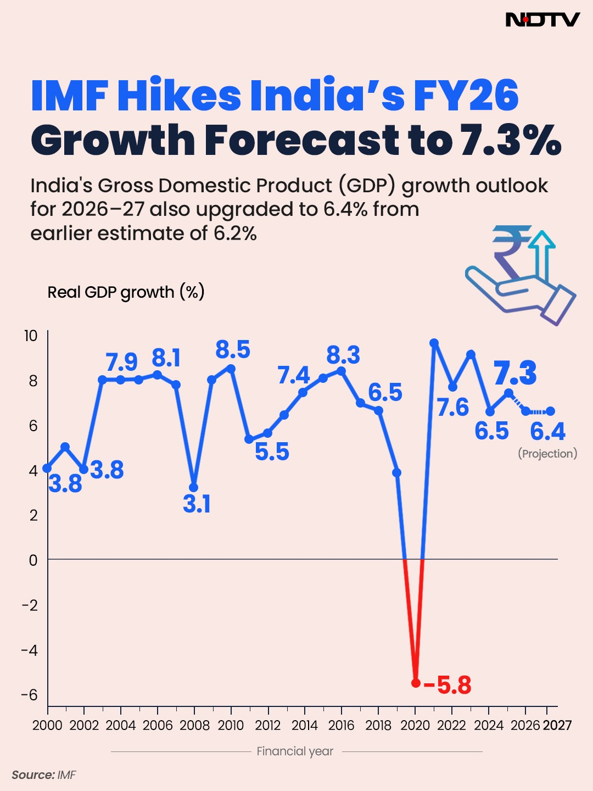

Note:
The chart is from January 2026, when the IMF raised India's 2025-26 forecast to 7.3%. In October 2026 it raised its 2026-27 forecast to 7.0%.
IMF data for India are on a fiscal-year basis (April to March).

---
<!-- layout: table -->
## Economic Growth: Advanced Economies

### IMF projections, real GDP growth (%)

| Economy | 2025 | 2026 | 2027 |
|---|---|---|---|
| **World** | 3.5 | 3.1 | 3.4 |
| **Advanced economies** | 2.0 | 2.1 | 1.8 |
| United States | 2.3 | 2.3 | 2.3 |
| Euro area | 1.2 | 1.1 | 1.2 |
| Germany | 0.2 | 1.3 | 1.1 |
| Japan | 1.2 | 0.7 | 0.7 |
| United Kingdom | 1.2 | 1.3 | 1.2 |

Source: IMF, World Economic Outlook, October 2026.

---
<!-- layout: table -->
## Economic Growth: Emerging Economies

### IMF projections, real GDP growth (%)

| Economy | 2025 | 2026 | 2027 |
|---|---|---|---|
| **Emerging and developing economies** | 4.5 | 3.7 | 4.4 |
| Emerging and developing Asia | 5.6 | 5.1 | 4.9 |
| China | 5.0 | 4.5 | 4.0 |
| **India** | **7.8** | **7.0** | **7.0** |
| Brazil | 2.3 | 2.2 | 1.9 |
| Middle East and Central Asia | 3.7 | −0.3 | 6.3 |
| Sub-Saharan Africa | 4.5 | 4.5 | 4.5 |

Source: IMF, World Economic Outlook, October 2026. India on a fiscal-year basis.

Note:
The Middle East figure for 2026 is negative because of the West Asia conflict. Saudi Arabia: 4.6, −3.3 and 7.9.
On a calendar-year basis, the IMF projects India at 7.4% for 2026 and 7.0% for 2027.

---
## Why Do Emerging Economies Grow Faster?

### The catch-up effect

**1. Diminishing returns to capital**
- One more machine adds a lot where capital is scarce, and little where it is plentiful.

**2. Borrowing technology is cheaper than inventing it**
- Poorer countries adopt existing technology, such as mobile phones and digital payments.

**3. Structural shift**
- Workers move from low-productivity farming to industry and services.

**4. Demographics and base effect**
- Young, growing workforces. The same increase is a bigger % on a smaller base.

Note:
Base effect example: India adding US$250 billion of output is about 6% growth. The US adding the same is under 1%.
Catch-up is not automatic. It needs investment, education, institutions and openness. Many poor countries have not caught up.

---
<!-- layout: table -->
## GDP Data: Who Measures It?

### International: World Bank, IMF, United Nations, OECD

| Agency in India | Role |
|---|---|
| National Statistics Office (NSO) | Estimates and publishes GDP and national income |
| MoSPI | Ministry responsible for official national accounts |
| State Directorates of Economics and Statistics | Compile state GDP (GSDP) with NSO |
| Reserve Bank of India | Supplies financial data; publishes analysis and forecasts |
| Other ministries | Data on agriculture, industry, transport and government spending |

Note:
Release calendar: NSO publishes quarterly GDP estimates about two months after each quarter ends (end of February, May, August and November). Annual estimates are revised several times as better data arrive.

---
## National Income Accounting

### Three methods, one answer

|||

**Production**
- What value was created?
- Sum of GVA across all producers

|||

**Income**
- Who received it?
- Wages, rent, interest, profit, mixed income

|||

**Expenditure**
- Who bought it?
- C + I + G + (X − M)

Note:
National income accounting is the systematic measurement of a country's total economic activity over a period, usually one financial year.
Good accounting turns data into information about growth and the size of the economy. The three methods must give the same answer, because every rupee spent is a rupee of income for someone.

---
## Models of the Circular Flow

### Income = Output = Expenditure

- **National income:** the value of all final goods and services produced by a country's residents in a period, usually one year.
- **Key assumption:** every rupee spent is a rupee of income for someone.

**Circular flow models**
1. Two sector: households and firms
2. Three sector: adds government
3. Four sector: adds the foreign sector

---
## Circular Flow of Income: Four Sectors

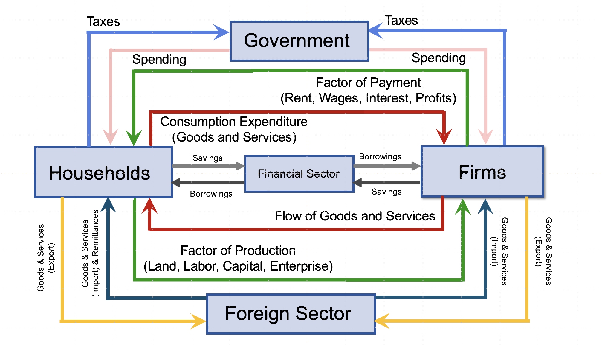

Note:
Inner loop: households supply factors of production (land, labour, capital, enterprise) to firms and receive factor payments (rent, wages, interest, profits). They spend this income on goods and services, which flow back from firms.
Financial sector: households and firms save and borrow through banks and markets.
Government: collects taxes from households and firms and spends on both.
Foreign sector: goods and services are exported and imported; India also receives large remittances.

---
<!-- layout: compare -->
## Leakages and Injections

|||

### Leakages (out of the flow)

- **Savings (S):** income not spent
- **Taxes (T):** paid to government
- **Imports (M):** spending on foreign goods

|||

### Injections (into the flow)

- **Investment (I):** firms' spending on capital
- **Government spending (G)**
- **Exports (X):** foreign spending on our goods

Note:
The flow is stable when leakages equal injections: S + T + M = I + G + X.
If leakages exceed injections, spending falls and output shrinks. If injections exceed leakages, output expands.
Rearranged, this is the same identity we derive later: (S − I) = (G − T) + (X − M).

---
<!-- layout: table -->
## Gross Domestic Product

### Market value of all final goods and services produced in a country in a period

| Term | Meaning | Example |
|---|---|---|
| **Market value** | Goods added up at market prices | T-shirt, MRP ₹2,000 |
| **All** | Everything produced and sold legally | Not illegal trade or home cooking |
| **Final** | Only goods sold to the end user | Bread, not the flour in it |
| **Goods and services** | Tangible and intangible | Bikes and haircuts |
| **Produced** | Made in this period, not resold | Not a used-car resale |
| **Within a country** | Inside the domestic territory | Includes foreign firms in India |
| **In a given period** | A quarter or a year | India: financial year, April to March |

---
## Types of Goods in GDP

|||

**Consumer goods**
- Non-durable goods
- Durable goods
- Services

|||

**Capital goods**
- Machines, buildings
- Used to produce other goods
- Wear out: depreciation

|||

**Inventories**
- Planned inventories
- Unplanned inventories
- Count when produced

Note:
Capital goods are final goods in GDP, because they are not used up in a single production cycle. The machine counts in investment; its wear and tear is depreciation.
Unplanned inventories pile up when sales fall short of output. They are an early sign of a slowdown.

---
<!-- layout: table -->
## Is It in India's GDP?

### Apply "produced within the domestic territory"

| Transaction | In India's GDP? |
|---|---|
| A US company makes cars in Chennai | Yes |
| An Indian company makes garments in Bangladesh | No |
| A new house built in 2026, sold in 2027 | Yes, in 2026 |
| A dealer's commission on selling an old car | Yes (the commission only) |
| Cleaning your own home | No |
| A paid domestic help cleans your home | Yes |
| A foreign tourist's hotel stay in Goa | Yes |

Note:
More cases: Apple designs software in India for US operations (yes, produced in India). A student pays tuition to an Indian university (yes). An Indian student pays tuition to a US university (no, it is an import of a service).
The unsold house counts in 2026 as investment (inventory). When it is sold in 2027, the sale is not new production.

---
<!-- layout: table -->
## GDP: Borderline Cases

### Domestic territory includes embassies, consulates and military bases abroad

| Transaction | In India's GDP? |
|---|---|
| Salaries of Indian staff at the Indian Embassy in the USA | Yes |
| Salaries of US staff at the US Embassy in New Delhi | No |
| A farmer grows vegetables on his own farm for his family | Yes (imputed) |
| A person cleans their own home | No |

Note:
Embassy premises count as part of the home country's economic territory.
Own-account farm output is imputed in GDP because it is a large part of rural production in India. Household services for own use, such as cooking and cleaning, are not.

---
## GDP: Product (Value Added) Method

### What value does each producer create?

$$
\text{GVA} = \text{Value of output} - \text{Intermediate consumption}
$$

- **Value of output:** the value of goods and services produced in the period.
- **Intermediate consumption:** goods and services used up in production.
- Adding value added across producers avoids double counting.

$$
\text{GDP} = \text{GVA} + \text{Product taxes} - \text{Product subsidies}
$$

Note:
GVA is measured sector by sector and then added up. It shows each producer's and industry's contribution.

---
## Valuation: Factor Cost, Basic Price, Market Price

### GVA is calculated at basic prices

- **Factor cost:** the total paid to land, labour, capital and enterprise.
- **Basic price:** what the producer receives, excluding product taxes but including product subsidies.
- **Market price:** what the buyer pays.

$$
\text{Basic price} = \text{Factor cost} + \text{Production taxes} - \text{Production subsidies}
$$

$$
\text{Market price} = \text{Basic price} + \text{Product taxes} - \text{Product subsidies}
$$

Note:
Production taxes are not linked to units sold, for example property tax or professional tax. Product taxes are per unit, for example GST and excise duty.
India moved from GDP at factor cost to GVA at basic prices in the 2011-12 series, following the UN System of National Accounts (SNA) 2008.

---
<!-- layout: table -->
## Product Method: Example 1

### Wheat to bread

| Stage | Sells for (₹) | Buys inputs for (₹) | GVA (₹) |
|---|---|---|---|
| Farmer grows wheat | 100 | 0 | 100 |
| Miller makes flour | 150 | 100 | 50 |
| Baker makes bread | 250 | 150 | 100 |
| **Total** | 500 | | **250** |

> Total GVA = ₹250 = the price of the bread, the final good. Adding all sales (₹500) would count the wheat three times.

---
<!-- layout: table -->
## Product Method: Sectoral GVA

### Measure each sector, then add them up

| Sector | Activities | Share of GVA, Q1 2026-27 |
|---|---|---|
| **Primary** | Farming, forestry, fishing, mining | 18.9% |
| **Secondary** | Manufacturing, electricity, construction | 25.7% |
| **Tertiary** | Trade, transport, finance, real estate, IT, public administration | 55.4% |

India has millions of farms, factories, shops and offices, so NSO estimates GVA sector by sector.

Note:
Shares are calculated from constant-price GVA for April to June 2026 (NSO, 29 August 2026).
Services make up more than half of India's GVA, but agriculture still employs the largest share of workers. This gap is a key feature of India's structure.

---
<!-- layout: activity -->
## Product Method: Example 2

### Kumar Furniture Works, one year (₹ lakh). Find GVA.

| Item | ₹ lakh | Item | ₹ lakh |
|---|---|---|---|
| Sales | 200 | Wages paid to workers | 40 |
| Increase in stock of furniture | 10 | Rent of workshop | 12 |
| Wood and raw materials used | 80 | Interest on loan | 4 |
| Electricity | 10 | Purchase of a new cutting machine | 30 |
| Freight paid to transporter | 6 | Depreciation | 5 |

---
<!-- layout: steps -->
## Product Method: Example 2 Solution

### GVA = Value of output − Intermediate consumption

1. **Output**: sales 200 + stock 10 = **210**
2. **Inputs**: wood 80 + electricity 10 + freight 6 = **96**
3. **GVA**: 210 − 96 = **114**
4. **Exclude**: wages, rent and interest are factor payments; the machine is investment

Note:
Value added at basic prices = ₹114 lakh. Net value added = 114 − depreciation 5 = ₹109 lakh.
Wages, rent and interest are payments to factors of production, so they are part of value added, not inputs. The income method on a later slide splits the same 114 among the factors.
The new machine (₹30 lakh) is a capital good. It counts in investment (gross capital formation), not in intermediate consumption.
Note on rent: Indian school textbooks treat rent as a factor payment. In the UN SNA, rent paid for a building is intermediate consumption. We follow the factor-payment treatment so that the product and income methods give the same answer.

---
<!-- layout: table -->
## India's GVA by Sector

### Q1 (April to June), constant prices, ₹ crore

| Sector | Q1 2025-26 | Q1 2026-27 | Growth (%) |
|---|---|---|---|
| Primary | 13,56,557 | 13,96,196 | 2.9 |
| Secondary | 17,44,684 | 18,94,802 | 8.6 |
| of which manufacturing | 9,38,374 | 10,24,417 | 9.2 |
| Tertiary | 37,19,880 | 40,91,454 | 10.0 |
| **GVA at basic prices** | 68,21,121 | 73,82,453 | **8.2** |
| Net taxes on products | 7,25,108 | 7,53,700 | 3.9 |
| **GDP** | 75,46,230 | 81,36,153 | **7.8** |

Source: NSO, MoSPI, 29 August 2026.

Note:
GDP = GVA + net product taxes: 73,82,453 + 7,53,700 = 81,36,153.
Fastest growth: financial, real estate and professional services (12.1%). Mining fell 2.4%, and agriculture grew 3.6%.
GDP grew more slowly than GVA because net product taxes grew only 3.9%.

---
<!-- layout: table -->
## GDP: Income Method

### Who receives the value created by firms?

Gross value added = Compensation of employees + Operating surplus + Mixed income + Depreciation

| Component | What it includes |
|---|---|
| **Compensation of employees** | Wages, salaries, bonus, employer's PF and pension contributions, perks |
| **Operating surplus** | Rent, interest and profit (dividends, corporate tax, retained earnings) |
| **Mixed income** | Income of the self-employed |
| **Depreciation** | Wear and tear of machines and buildings |

Note:
Mixed income is large in India because most workers are self-employed, for example farmers and shopkeepers. Their income mixes a return to their labour and to their capital, so it cannot be split.

---
<!-- layout: table -->
## Income Method: Example

### Kumar Furniture Works created GVA of ₹114 lakh. Where did it go?

| Paid to | Form of income | ₹ lakh |
|---|---|---|
| Workers | Wages | 40 |
| Landlord | Rent | 12 |
| Lender | Interest | 4 |
| Machines (wear and tear) | Depreciation | 5 |
| Owner | Profit | 53 |
| **Total** | | **114** |

> Same answer as the product method: GVA = ₹114 lakh.

---
## GDP: Expenditure Method

### Who bought it?

- **Production method:** what value was created?
- **Income method:** who received it?
- **Expenditure method:** who bought it?

The farmer, miller and baker created GVA of ₹250. The consumer spends ₹250 on the bread. Same answer, for every good and service.

$$
\text{GDP} = C + I + G + (X - M)
$$

Note:
In India, the expenditure side is the most watched for demand, because it shows whether growth comes from consumption, investment or exports.

---
<!-- layout: table -->
## Expenditure Method: Components

### GDP = C + I + G + (X − M)

| Symbol | What it covers | Name in India's accounts |
|---|---|---|
| **C** | Household spending on food, clothes, phones, fees, medical care | Private Final Consumption Expenditure (PFCE) |
| **I** | New machines, buildings, roads, change in stocks, valuables | Gross Capital Formation (GCF) |
| **G** | Government salaries and purchases of goods and services | Government Final Consumption Expenditure (GFCE) |
| **X** | Indian goods and services bought by foreigners | Exports |
| **M** | Foreign goods and services bought by Indians | Imports |

---
## Expenditure Method: C and I

|||

**Consumption (C)**
- Household spending on goods and services.
- Excludes purchases of new housing.
- Renters: rent paid.
- Owners: imputed rent, not the price or EMI.

|||

**Investment (I)**
- Goods used to produce more goods in future.
- Business capital: buildings, equipment, software.
- Residential capital: new houses.
- Inventories: produced but not yet sold.
- **Not** stocks and bonds.

Note:
Buying shares is a transfer of ownership, not new production, so it is not investment in GDP. The firm's spending on a new factory with that money is.

---
## Expenditure Method: G and NX

|||

**Government purchases (G)**
- Goods and services bought by central, state and local governments.
- Excludes transfer payments, such as pensions, PM-KISAN and subsidies.
- Transfers buy no goods or services.

|||

**Net exports (NX = X − M)**
- Exports: foreign spending on our goods and services.
- Imports: the parts of C, I and G spent on foreign goods.
- NX < 0 is a trade deficit.

$$
Y = C + I + G + NX
$$

---
<!-- layout: table -->
## India's GDP by Expenditure

### Q1 (April to June) 2026-27, constant prices, ₹ crore

| Component | Q1 2026-27 | Share of GDP (%) | Growth (%) |
|---|---|---|---|
| Private consumption (PFCE) | 44,74,278 | 55.0 | 7.1 |
| Government consumption (GFCE) | 8,54,877 | 10.5 | 4.3 |
| Fixed investment (GFCF) | 27,95,605 | 34.4 | 11.9 |
| Exports | 19,13,790 | 23.5 | 12.0 |
| Imports | 19,50,544 | 24.0 | −1.1 |
| **GDP** | **81,36,153** | 100 | **7.8** |

Source: NSO, MoSPI, 29 August 2026.

Note:
The table leaves out change in stocks (1,23,063), valuables (31,090) and discrepancies (−1,06,005). With them, the components add up to GDP.
Growth in Q1 was led by investment (11.9%) and exports (12.0%), while imports fell slightly. Private consumption, the largest component, grew 7.1%.

---
## From GDP to National Income

### How the measures are linked

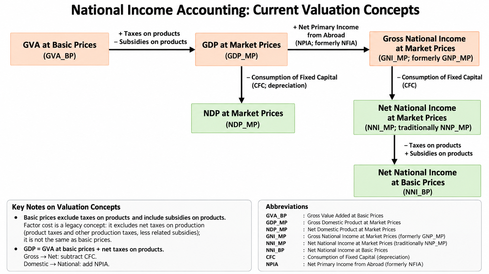

Note:
NPIA (net primary income from abroad) = primary income received from abroad − primary income paid abroad. It replaces the older term NFIA (net factor income from abroad).
Gross to net: subtract depreciation (consumption of fixed capital). Domestic to national: add NPIA.

---
<!-- layout: table -->
## Other Measures of National Income

### Each measure answers a different question

| Measure | Formula | Why it matters |
|---|---|---|
| **GDP (MP)** | GVA (BP) + product taxes − product subsidies | Headline output and growth |
| **GNI (MP)** | GDP (MP) + NPIA | Income earned by residents |
| **NNI (MP)** | GNI (MP) − depreciation | Income after maintaining capital |
| **NNI (BP)** | NNI (MP) − product taxes + product subsidies | Core income for welfare and policy |
| **GNDI** | GNI (MP) + net current transfers from abroad | Matters for remittance-heavy India |

Note:
India's NPIA is negative: Indian residents pay more income abroad (interest, dividends, profits of foreign firms) than they receive. So India's GNI is slightly less than its GDP.
India is the world's largest recipient of remittances, so GNDI is well above GNI.

---
## Personal and Disposable Income

### How much national income reaches households?

**1. Personal Income (PI)**
- Income households actually receive, before personal taxes.
- Subtract: corporate tax, retained profits, social security contributions.
- Add: transfers to households (pensions, scholarships, welfare).

**2. Personal Disposable Income (PDI)**
- PDI = PI − personal direct taxes − fees and fines.
- Households either spend or save it: **PDI = C + S**.

Note:
PI = NNI at factor cost − corporate tax − retained profits − social security contributions + transfer payments to households (including interest and dividends received).
PDI drives consumption and saving decisions, so it links national accounts to the consumption function in Module 5.

---
## Important Identities

### A simple economy: households and firms only

$$
Y \equiv C + I \qquad \text{(output is bought by consumers or invested)}
$$

$$
Y \equiv C + S \qquad \text{(income is consumed or saved)}
$$

$$
C + I \equiv Y \equiv C + S \;\Rightarrow\; I \equiv S
$$

In a closed economy with no government, **investment equals saving**.

Note:
The left side shows the components of demand. The right side shows how income is used. Output produced equals output sold, and the value of output equals income received.
This is an identity: it holds by definition, not because of any behaviour.

---
## Identities with Government and Trade

### Linking output to disposable income

Disposable income: YD ≡ Y + TR − TA, and YD ≡ C + S

$$
C + S - TR + TA \equiv C + I + G + NX
$$

$$
S - I \equiv (G + TR - TA) + NX
$$

TR = transfers to households, TA = taxes.

Note:
Steps: start with Y ≡ C + I + G + NX. Replace Y with Y_D − TR + TA, and Y_D with C + S. Cancel C on both sides and rearrange.

---
## Saving, Investment, Budget and Trade

### S − I ≡ (G + TR − TA) + NX

- **G + TR − TA** is the government budget deficit (BD).
- BD > 0: budget deficit. BD < 0: budget surplus.
- NX > 0: trade surplus. NX < 0: trade deficit.

> Excess private saving (S − I) must finance either the budget deficit or a trade surplus.

**Example:** S − I = 2% of GDP, budget deficit = 5% of GDP, so NX = 2 − 5 = **−3% of GDP** (a trade deficit).

Note:
Twin deficits: if private saving does not rise, a bigger budget deficit means a bigger trade deficit.
India runs a budget deficit and a trade deficit, so private saving is not enough to fund both government borrowing and private investment. The gap is filled by foreign capital.

---
## Real vs Nominal: The Idea

### Money is a poor measuring rod

- **Nominal value:** measured in current rupees.
- **Real value:** removes the effect of price changes, so it measures quantity or purchasing power.
- A rupee in 2026 buys less than a rupee in 2016, so raw rupee figures mislead.

**Why it matters**
1. To measure true change in output and income.
2. Decisions are made on real values.
3. To avoid money illusion.

Note:
Money illusion: thinking in nominal terms. A 6% pay rise with 6% inflation leaves real income unchanged.

---
<!-- layout: table -->
## Real vs Nominal Across Variables

### The same rule applies to output, interest, money and wages

| Variable | Nominal | Real | Deflated by | Used in |
|---|---|---|---|---|
| Output | GDP at current prices | GDP at base-year prices | GDP deflator | Growth |
| Interest rate | i | i − π | Expected inflation | IS curve, monetary policy |
| Money | M | M/P | Price level | LM curve, money neutrality |
| Wages | W | W/P | CPI | Labour market, aggregate supply |

---
## Real GDP vs Nominal GDP

### Separating prices from quantities

**1. Nominal GDP**
- This year's output at this year's prices. It rises if output rises, prices rise, or both.

**2. Real GDP**
- This year's output at fixed base-year prices. It rises only if quantities rise.

$$
\text{GDP deflator} = \frac{\text{Nominal GDP}}{\text{Real GDP}} \times 100
$$

Note:
India's current base year for real GDP is 2011-12. MoSPI is revising the series to a newer base year.

---
## The GDP Deflator

### Three uses

**1. Separate prices from quantities**
- It pulls the price part out of nominal GDP, so real GDP shows true growth.

**2. Convert nominal values into real values**
- Real value = Nominal value ÷ Deflator × 100.

**3. Measure economy-wide inflation**
- CPI covers only what households buy. The deflator covers all domestic output, including capital goods and government services. It is the broadest measure of inflation.

Note:
Deflator inflation = (Deflator this year − Deflator last year) / Deflator last year × 100.
The deflator excludes imports, so oil price changes affect it less than they affect CPI.

---
<!-- layout: table -->
## India: Nominal vs Real GDP

### Q1 (April to June), ₹ crore

| Year (Q1) | Nominal GDP | Real GDP | GDP deflator | Deflator inflation (%) |
|---|---|---|---|---|
| 2024-25 | 74,03,137 | 70,61,843 | 104.83 | – |
| 2025-26 | 80,00,192 | 75,46,230 | 106.02 | 1.14 |
| 2026-27 | 88,26,871 | 81,36,153 | 108.49 | 2.33 |

> Q1 2026-27: nominal GDP grew **10.3%**, real GDP **7.8%**. The gap (about 2.3%) is price change.

Note:
108.49 means the price level of domestic output is 8.49% above the base level used in this table. That is not the inflation rate for 2026-27 alone.
Deflator inflation of 2.33% is well below CPI inflation, because wholesale and producer prices rose much less than consumer food prices.
Source: NSO, MoSPI, 29 August 2026.

---
<!-- layout: image-right -->
## Business Cycle and the GDP Gap

### Actual output moves around potential

$$
\text{Output gap} = \frac{Y - Y^{*}}{Y^{*}} \times 100
$$

- **Positive gap:** boom, inflation rises.
- **Negative gap:** recession, unemployment rises.
- Okun's Law links the gap to unemployment.

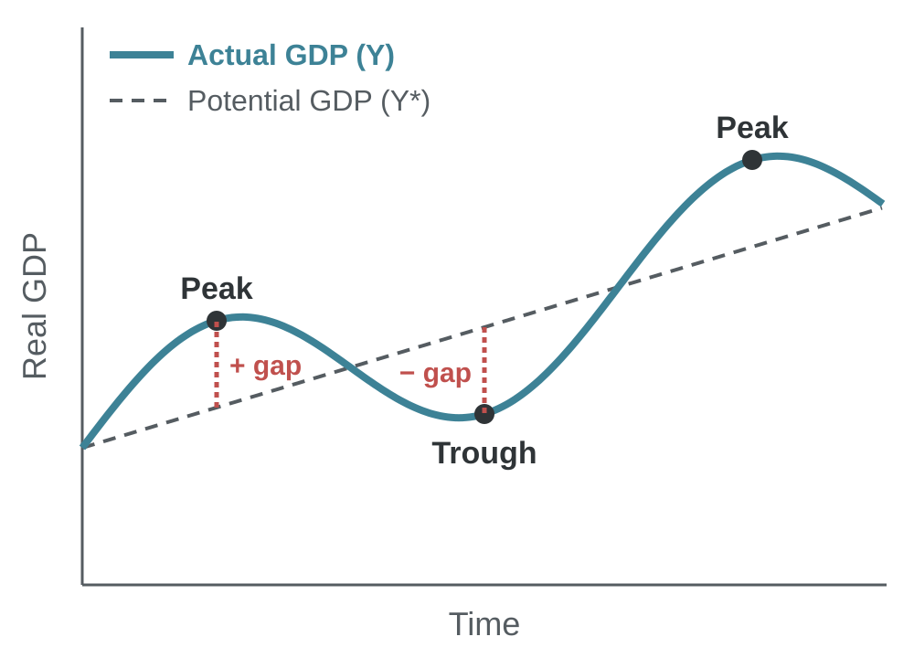

Note:
Phases: expansion, peak, contraction, trough.
Potential output Y* cannot be observed directly. It is estimated with statistical filters or production functions, so estimates of the gap differ.
India example: in 2020-21 real GDP fell 5.8%, a large negative gap. RBI monitors the output gap when setting the repo rate.
Recession: often defined as two consecutive quarters of falling real GDP.

---
<!-- layout: compare -->
## Is GDP a Good Measure?

|||

### What GDP does well

- Higher GDP per person goes with longer lives, more schooling and less poverty
- Timely and comparable across countries
- Consistent over time

|||

### What GDP misses

- Leisure, household and volunteer work
- Pollution and resource depletion
- How income is shared

Note:
Alternatives: Human Development Index (HDI), Gross National Happiness (Bhutan), green GDP.
Robert Kennedy (1968): GDP "measures everything, in short, except that which makes life worthwhile."
India is the world's fourth- or fifth-largest economy by total GDP, but ranks around 140th in GDP per capita.
The Stiglitz-Sen-Fitoussi Commission (2009) recommended measuring well-being alongside GDP.

---
<!-- layout: table -->
## Challenges of Measuring GDP

### Why GDP estimates are uncertain, especially in India

| Challenge | Why it matters |
|---|---|
| **Informal sector** | Most Indian workers are informal; output is estimated from proxies |
| **Unpaid work** | Household and care work, mostly by women, is excluded |
| **Quality and new goods** | Free apps and better products are hard to value |
| **Revisions and base year** | Early estimates change; old base years miss new sectors |
| **Discrepancies** | Production and expenditure totals differ (−1.3% of GDP in Q1 2026-27) |

Note:
In Q1 2026-27, the "discrepancies" item in the expenditure table was −₹1,06,005 crore, about 1.3% of GDP.
Illegal activity, such as smuggling, is excluded but still uses resources.

---
<!-- layout: takeaways -->
## Takeaways

### Six ideas to remember

- Macroeconomics studies output, growth, inflation and unemployment together, because they interact.
- Views changed from classical (markets self-correct) to Keynesian (demand matters) to modern (expectations matter).
- GDP measures the market value of final goods and services produced within a country in a period.
- The production, income and expenditure methods give the same GDP.
- S − I ≡ (G + TR − TA) + NX links saving, investment, the budget and trade.
- Real GDP removes price changes; the GDP deflator measures economy-wide inflation.

---
<!-- layout: references -->
## References

### Textbooks and sources

- Dornbusch, R., Fischer, S. and Startz, R. *Macroeconomics*. McGraw Hill.
- Mankiw, N. G. *Principles of Economics*. Cengage.
- Mankiw, N. G. *Macroeconomics*. Worth Publishers.
- National Statistics Office, MoSPI. Estimates of GDP for Q1 2026-27, 29 August 2026.
- International Monetary Fund. *World Economic Outlook*, October 2026.
- Reserve Bank of India. Monetary Policy Statement, 7 October 2026.
- Nobel Prize Outreach. The Prize in Economic Sciences 2026. nobelprize.org

---
<!-- layout: end -->
# Questions?

Dr. Pawan Ashok Kamble · BIMTECH
