# Production, Growth and Loanable Funds

### Module 2

Dr. Pawan Ashok Kamble \
Assistant Professor \
Faculty Cabin: F61

---
<!-- layout: agenda -->
## Topics

1. Living standards and growth around the world
2. Productivity and its determinants
3. The production function and growth accounting
4. The Solow growth model: steady state, saving, population and technology
5. The catch-up effect and growth policies
6. Saving, investment and the financial system
7. The market for loanable funds and budget deficits

---
## Variations in Living Standards

### Two ways to compare

**1. Across countries**
- Average income in a rich country (US, Japan, Germany) is about 10 times that of a poor country (India, Nigeria, Bangladesh).
- The gap shows up in nutrition, housing, health care and life expectancy.

**2. Within a country, over time**
- US real GDP per person has grown about 2% a year for 100 years.
- At 2% a year, income rises about **7 times** in a century (1.02¹⁰⁰ ≈ 7.2).

Note:
Small growth rates add up. A typical American today is about seven times richer than a century ago, with the same 2% a year.

---
<!-- layout: table -->
## Three Countries, Three Living Standards

### Mankiw's comparison, 2014

| Indicator | United Kingdom | Mexico | Mali |
|---|---|---|---|
| Income per person (US$ a year) | 39,040 | 16,640 | 1,510 |
| Child mortality (per 1,000) | 4 | 13 | 115 |
| Access to modern sanitation | Almost all | 85% | 25% |
| Enrolled in higher education | 60% | 30% | 7% |

> UK income per person is about **26 times** Mali's, and a Malian child is about **29 times** more likely to die young.

Note:
Source: Mankiw, Principles of Economics, chapter "Production and Growth" (2014 data, adjusted for differences in the cost of living).
The next slide shows a typical family in each country, photographed with all their belongings.

---
<!-- layout: image-grid -->
## A Typical Family in the UK, Mexico and Mali

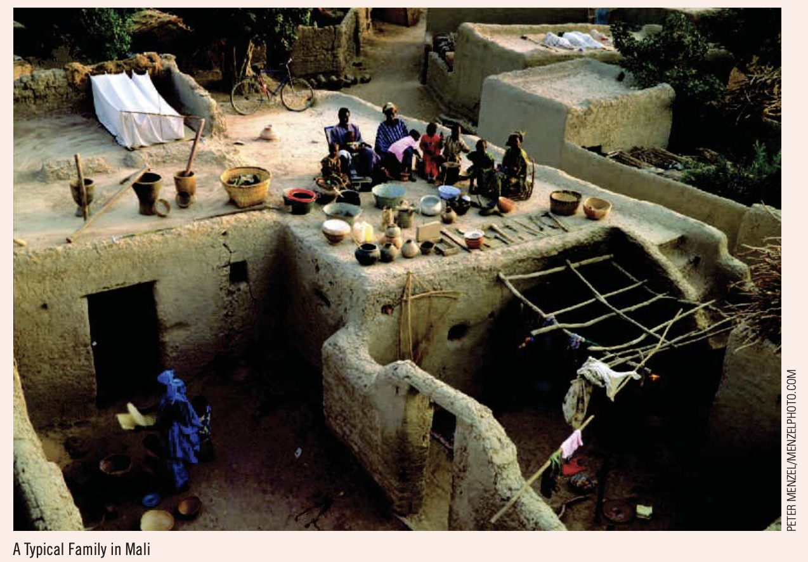

Note:
Ask students to list what they see: housing, consumer durables, clothing, transport. Each difference reflects a difference in productivity.

---
## Growth Can Change Fortunes

### Two contrasting cases

**1. China**
- From 2000 to 2014, GDP per person grew about 11% a year.
- Average income more than **quadrupled** in 14 years: poor to middle income in one generation.

**2. Zimbabwe**
- From 2000 to 2014, GDP per person **fell** by about 13% in total.
- The average citizen became poorer.

> What explains such different experiences? This is the central question of this module.

Note:
Check the arithmetic: 1.11^14 ≈ 4.3, so income rises by about 330%.
Zimbabwe's decline came with land seizures, collapsing farm output and the hyperinflation of 2008 that we studied in the inflation module.

---
<!-- layout: table -->
## Growth of Countries Today

### Real GDP and income per person

| Country | Real GDP (US$ trillion) | Real GDP per capita (US$) | Real GDP growth (%) |
|---|---|---|---|
| United States | 23.223 | 67,946 | 2.2 |
| Japan | 4.764 | 38,619 | 1.2 |
| Germany | 3.686 | 44,147 | 0.2 |
| **India** | **3.694** | **2,523** | **7.6** |
| Sweden | 0.583 | 55,014 | 1.5 |
| Norway | 0.470 | 83,813 | 1.1 |

> India's economy is as large as Germany's, but its income per person is about **1/27** of the US level.

Note:
Values in constant 2015 US$ (World Bank, World Development Indicators).
Total size and income per person tell different stories. India is big because it has 1.4 billion people, not because each worker is highly productive.

---
<!-- layout: image-right -->
## Income per Person over Time

### Rich countries pulled away; Asia is catching up

- The US, Germany, Norway and Sweden have grown steadily for decades.
- China and India started far behind, but have grown faster since the 1990s.
- Faster growth in poorer countries closes the gap slowly.

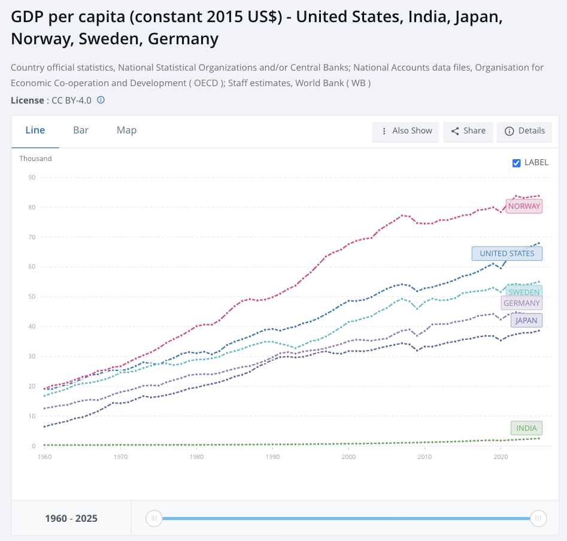

---
<!-- layout: table -->
## Incomes and Growth around the World

### Real GDP per person in 2020 dollars

| Country | Period | Start | 2020 | Growth (% a year) |
|---|---|---|---|---|
| China | 1900-2020 | 834 | 17,312 | 2.56 |
| Japan | 1890-2020 | 1,751 | 42,197 | 2.48 |
| Brazil | 1900-2020 | 907 | 14,836 | 2.36 |
| Germany | 1870-2020 | 2,544 | 53,694 | 2.05 |
| **India** | **1900-2020** | **786** | **6,454** | **1.77** |
| United States | 1870-2020 | 4,668 | 63,544 | 1.76 |
| Pakistan | 1900-2020 | 859 | 4,877 | 1.46 |
| United Kingdom | 1870-2020 | 5,601 | 44,916 | 1.40 |

Source: Mankiw, *Principles of Economics*.

Note:
Other rows in Mankiw's table: Mexico 2.22%, Indonesia 2.07%, Canada 1.92%, Argentina 1.72%, Bangladesh 1.64%.
Growth rate = (end ÷ start)^(1 / years) − 1. For China: (17,312 ÷ 834)^(1/120) − 1 = 2.56%.
The UK was the richest country in 1870 and has the slowest growth in the table. Japan was poor in 1890 and is now rich.

---
## Economic Growth around the World

### Rankings change because growth rates differ

- **Poor countries are not doomed to poverty.** Japan was poor in 1890; today it is rich.
- **Rich countries cannot take their status for granted.** The UK was the richest country in 1870; it has grown the slowest since.
- **The puzzle:** what explains these differences, and how do rich countries keep their standard of living?

> The answer starts with **productivity**.

---
## Productivity

### Why it matters

**1. Definition**
- Productivity (Y/L) is the quantity of goods and services produced from each unit of labour.

**2. The key to living standards**
- An economy's income equals its output. A country can enjoy a high standard of living only if it produces a large quantity of goods and services.

**3. The key to growth**
- When productivity grows fast, so do living standards.

Note:
Robinson Crusoe example: Crusoe's standard of living depends on how many fish he catches and coconuts he gathers. The same logic holds for a nation.

---
<!-- layout: steps -->
## From Productivity to Living Standards

### How productivity growth raises welfare

1. **Productivity ↑**: workers produce more per hour with better tools and skills
2. **Production ↑**: more goods and services from the same resources
3. **Real GDP ↑**: output rises
4. **Income per person ↑**: higher wages, profits and other incomes
5. **Living standards ↑**: more consumption, better health and education

---
<!-- layout: table -->
## Determinants of Productivity

### Four inputs, each measured per worker

| Determinant | What it is | Per worker | Example |
|---|---|---|---|
| **Physical capital, K** | Equipment and structures used in production | K/L | Machines, roads, ports |
| **Human capital, H** | Knowledge and skills from education, training and experience | H/L | Engineers, trained nurses |
| **Natural resources, N** | Inputs provided by nature | N/L | Land, rivers, minerals |
| **Technology, A** | Society's knowledge of the best ways to produce | A | UPI payments, new seeds |

> An increase in K/L, H/L, N/L or A raises output per worker, Y/L.

Note:
Natural resources can be renewable (forests) or non-renewable (oil). Japan is rich despite few natural resources, because it trades for them and has high K, H and A.

---
## Technological Knowledge

### Different from human capital

**1. Two types of technology**
- **Common knowledge:** once one person uses it, everyone can. Example: crop rotation.
- **Proprietary:** known only to the firm that discovers it. Example: a patented drug.

**2. Technology vs human capital**
- Technology is society's understanding of how the world works.
- Human capital is the resources spent passing that understanding to workers.

> Technology is the quality of society's textbooks; human capital is the time people spend reading them.

---
<!-- layout: equation -->
## The Production Function

### Output depends on inputs and technology

$$
Y = A \, F(L, K, H, N)
$$

**Where:**
- Y = output, L = labour, K = physical capital
- H = human capital, N = natural resources
- A = level of technology; a higher A gives more output from the same inputs

Note:
F(·) shows how inputs combine to produce output. A multiplies the whole function, so better technology raises output from any mix of inputs.

---
<!-- layout: equation -->
## Productivity from the Production Function

### With constant returns to scale, divide every input by L

$$
\frac{Y}{L} = A \, F\left(1, \frac{K}{L}, \frac{H}{L}, \frac{N}{L}\right)
$$

Output per worker depends on technology (A), physical capital per worker (K/L), human capital per worker (H/L) and natural resources per worker (N/L).

Note:
Constant returns to scale: doubling all inputs doubles output. So F(xL, xK, xH, xN) = x F(L, K, H, N). Set x = 1/L to get the per-worker form.
Policy link: higher productivity → higher GDP → higher growth → higher living standards. So policy should raise K/L, H/L and A.

---
## Growth Accounting

### Two sources of growth: more inputs and better technology

Assume L and K are the only inputs. A typical economy follows a **Cobb-Douglas** production function:

$$
Y = A \, K^{\theta} L^{1-\theta}
$$

- A is **total factor productivity (TFP)**: technology and efficiency.
- θ is capital's share of income; (1 − θ) is labour's share.

Note:
Cobb-Douglas has constant returns to scale: θ + (1 − θ) = 1.
Typical values: θ is about 0.3 to 0.4. In India, labour's share is lower than in rich countries because much of the workforce is self-employed.

---
<!-- layout: equation -->
## The Growth Accounting Equation

### Growth comes from labour, capital and TFP

$$
g_Y = (1-\theta)\,g_L + \theta\,g_K + g_A
$$

**Where:**
- gY = output growth; gL = labour growth; gK = capital growth
- gA = TFP growth, also called technical progress
- Each input contributes its growth rate times its income share

Note:
g_A is measured as a residual: the part of growth not explained by more labour and capital. It is called the "Solow residual".

---
<!-- layout: activity -->
## Growth Accounting: Example

### Calculate the growth rate of GDP

| Variable | Value |
|---|---|
| Labour growth, gL | 2% |
| Capital growth, gK | 5% |
| TFP growth, gA | 1% |
| Capital share, θ | 0.4 |

---
<!-- layout: table -->
## Growth Accounting: Solution

### gY = (1 − 0.4)(2%) + (0.4)(5%) + 1% = **4.2%**

| Source | Calculation | Contribution | Share of growth |
|---|---|---|---|
| Labour | 0.6 × 2% | 1.2% | 29% |
| Capital | 0.4 × 5% | 2.0% | 48% |
| TFP | | 1.0% | 24% |
| **GDP growth** | | **4.2%** | 100% |

> Capital accumulation explains about half of growth here; technology explains about a quarter.

---
## GDP Growth or GDP per Capita?

### Living standards depend on output per person

Let y = Y/L (output per worker) and k = K/L (capital per worker). Then:

$$
\frac{\Delta y}{y} = \theta \, \frac{\Delta k}{k} + \frac{\Delta A}{A}
$$

- Growth in output per worker comes from **capital deepening** (more k) and **technology** (A).
- **Example:** if θ = 0.25, a 1% rise in k raises y by only **0.25%**.

Note:
Derivation: ΔY/Y = Δy/y + ΔL/L and ΔK/K = Δk/k + ΔL/L. Substitute into the growth accounting equation: ΔY/Y − ΔL/L = θ(ΔK/K − ΔL/L) + ΔA/A, which gives the result.
India example: if GDP grows 7% and population about 1%, GDP per person grows about 6%.

---
## The Growth Puzzle

### Why don't rich countries grow fastest?

- Rich countries have the most capital, so we might expect them to grow fastest.
- **But** Germany and Japan grew faster than the US after World War II.
- **And** India and China grow faster than the US today.

> The Solow model explains why.

---
## The Solow Growth Model

### Robert Solow, 1956 (Nobel Prize, 1987)

- Explains growth through **capital accumulation**, and its link to **saving**.
- Saving finances investment, which builds capital per worker (k), which raises output per worker (y).
- **Diminishing returns** to capital mean growth from saving alone slows down.
- Only **technological progress** gives lasting growth in living standards.

Note:
Solow's model is the starting point for modern growth theory. It explains differences in income levels across countries, and why growth from capital alone eventually fades.

---
## Solow Model: Assumptions

### A simple economy

1. Closed economy, no government: Y = C + I.
2. Households save a constant share **s** of income.
3. Population (labour) grows at a constant rate **n**.
4. Capital depreciates at a constant rate **d**.
5. Production has **diminishing returns** to capital per worker.
6. To start, no technological progress.

Variables per worker: y = Y/L and k = K/L.

---
<!-- layout: image-right -->
## Solow Model: The Production Function

### y = f(k): output per worker rises with capital per worker

- More k raises y: the marginal product of capital (MPK) is **positive**.
- But each extra unit of k adds less output: **diminishing MPK**.
- So the curve gets flatter as k rises.

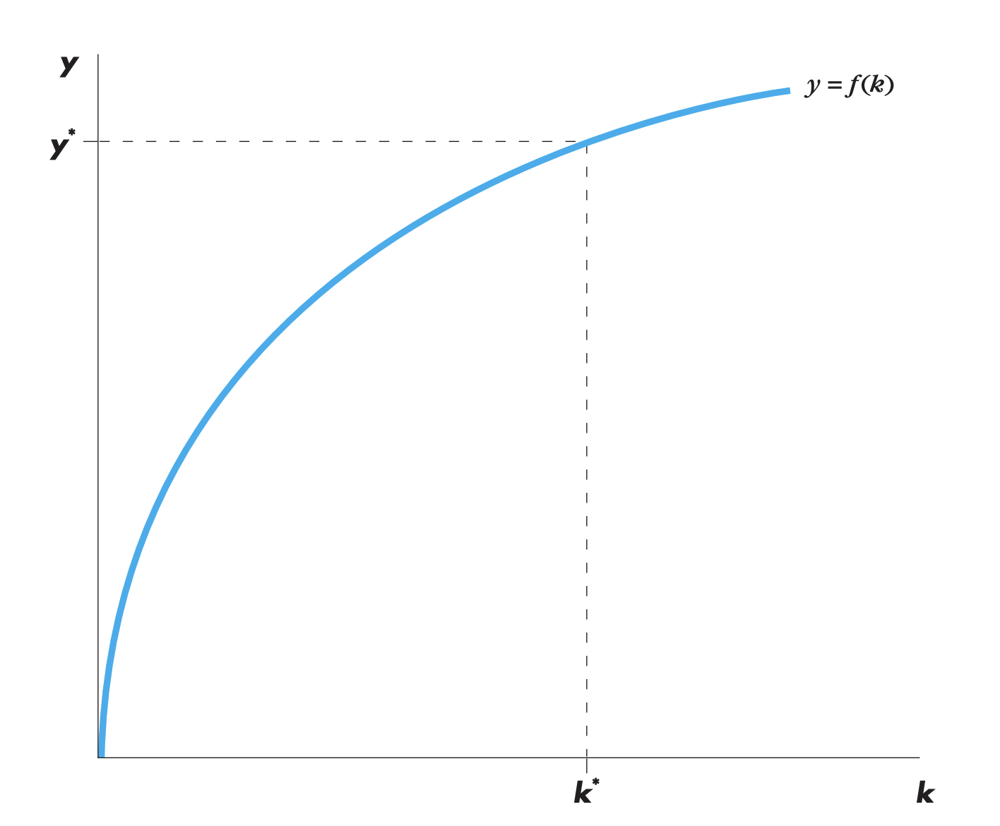

Note:
Example: f(k) = √k. Going from k = 1 to k = 4 raises y from 1 to 2. Going from k = 4 to k = 9 raises y only from 2 to 3, even though k rises by more.

---
<!-- layout: equation -->
## Solow Model: Saving and Investment

### Investment per worker equals saving per worker

$$
i = s\,y = s\,f(k)
$$

Since income equals output, y = f(k). Households save a share s of income, and in a closed economy saving equals investment.

Note:
Consumption per worker is c = (1 − s) f(k). On the diagram, the gap between f(k) and s·f(k) is consumption.

---
<!-- layout: equation -->
## Solow Model: Break-even Investment

### Investment needed just to keep k constant

$$
\text{Break-even investment} = (n + d)\,k
$$

- **d·k** replaces capital that wears out.
- **n·k** equips new workers with the same capital as existing workers.

Note:
If investment is less than (n + d)k, capital per worker falls. If it is more, capital per worker rises.

---
<!-- layout: equation -->
## The Key Solow Equation

### How capital per worker changes

$$
\Delta k = s\,f(k) - (n + d)\,k
$$

- If s·f(k) > (n + d)k, **k rises**.
- If s·f(k) < (n + d)k, **k falls**.
- **Steady state:** Δk = 0, so s·f(k\*) = (n + d)k\*.

---
<!-- layout: image-right -->
## The Steady State

### Where saving just covers break-even investment

- At k\*, Δk = 0: capital and output per worker stop changing.
- Below k\* (point A): saving > break-even, so k rises.
- Above k\*: saving < break-even, so k falls.
- The economy moves to k\* and y\* from any starting point.

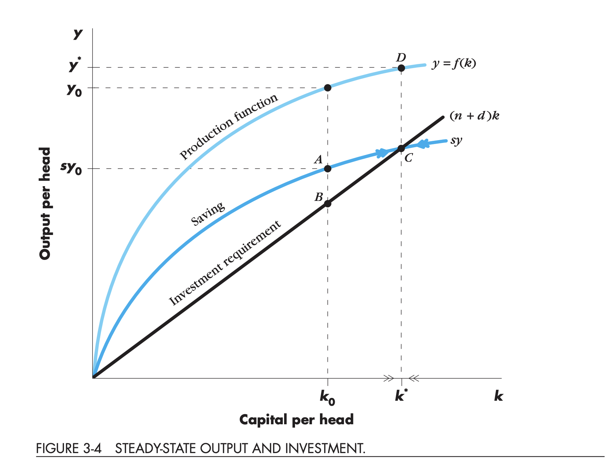

Note:
The steady state is stable. This is why it is called the long-run equilibrium of the model.
Figure from Dornbusch, Fischer and Startz, Macroeconomics.

---
<!-- layout: table -->
## Solow Model: A Numerical Example

### f(k) = √k, s = 0.3, n + d = 0.1, start at k = 4

| Year | k | y = √k | c = 0.7y | i = 0.3y | (n + d)k | Δk |
|---|---|---|---|---|---|---|
| 0 | 4.000 | 2.000 | 1.400 | 0.600 | 0.400 | 0.200 |
| 1 | 4.200 | 2.049 | 1.435 | 0.615 | 0.420 | 0.195 |
| 2 | 4.395 | 2.096 | 1.467 | 0.629 | 0.439 | 0.189 |
| 3 | 4.584 | 2.141 | 1.499 | 0.642 | 0.458 | 0.184 |
| ... | | | | | | |
| **Steady state** | **9** | **3** | **2.1** | **0.9** | **0.9** | **0** |

Note:
Steady state: 0.3√k = 0.1k, so √k = 3, k* = 9, y* = 3, c* = 2.1.
Notice that Δk gets smaller each year: growth slows as the economy approaches the steady state.
General formula for f(k) = k^θ: k* = (s / (n + d))^(1/(1 − θ)).

---
<!-- layout: interactive -->
## Interactive: The Solow Model

@[Solow growth model](/interactives/solow.html)

Note:
Suggested sequence for class:
1. Raise s from 25% to 35%. k* and y* rise. Switch to "Time path": growth jumps, then slows back to g. A level effect, not a growth effect.
2. Raise n. The break-even line gets steeper and k* falls.
3. Raise g. The long-run growth of output per worker rises. Only technology gives lasting growth.
4. Click "Golden rule". Consumption per worker is at its highest when s = θ.

---
<!-- layout: image-right -->
## An Increase in the Saving Rate

### Higher saving raises the level of income, not its long-run growth

- s·f(k) shifts up, so k\* and y\* rise.
- Growth is **faster during the transition**.
- In the new steady state, growth returns to its old rate.
- **Level effect**, not a growth effect.

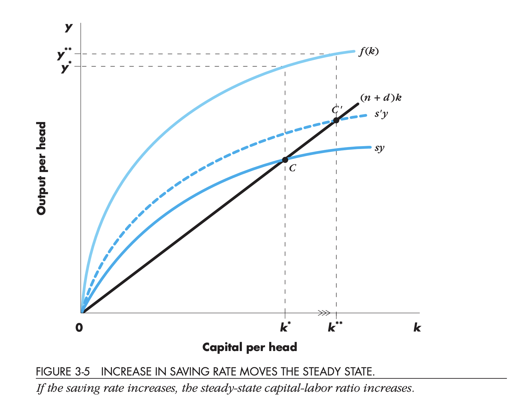

Note:
This answers the puzzle: a country that saves more becomes richer, but cannot grow faster forever by saving alone, because of diminishing returns.
India's gross saving rate rose to about 35% of GDP in 2024-25. High saving helps explain India's rising income level.

---
## The Golden Rule of Capital

### Which saving rate maximises consumption?

$$
c^* = f(k^*) - (n + d)\,k^*
$$

- Too little saving: low k\*, low output, low consumption.
- Too much saving: high k\*, but too much output goes to maintaining capital.
- **Golden rule:** MPK = n + d. With Cobb-Douglas, the golden-rule saving rate equals θ.

> **Example:** with f(k) = √k (θ = 0.5) and n + d = 0.1, s = 0.5 gives k = 25, y = 5 and c = **2.5**, more than the 2.1 at s = 0.3.

Note:
Edmund Phelps named this the golden rule (1961): "do unto future generations as you would have them do unto you."
Moving towards the golden rule from below needs lower consumption today for higher consumption later.

---
## Population Growth in the Solow Model

### Faster population growth lowers income per person

- Higher n makes the break-even line (n + d)k **steeper**.
- k\* and y\* **fall**: capital is spread over more workers.
- **The paradox:** total GDP grows faster (at rate n), but income **per person** is lower.

> Countries with fast population growth tend to have lower income per person.

Note:
Steady state with population growth: total output Y grows at n, while output per worker y is constant.
Population can also lower productivity by stretching natural resources (Malthus) and diluting human capital, because more spending goes to educating more children.

---
## Population and Technology: A Second Paradox

### More people can also mean more ideas

- **Solow view:** faster population growth dilutes capital per worker.
- **Ideas view:** more people means more inventors and more ideas (Michael Kremer, 1993).
- Over history, the most populous regions often had the fastest technological progress.

**India's demographic dividend**
- A large, young working-age population can raise growth, if workers get **jobs, skills and capital**.
- Without jobs, a large workforce adds to unemployment instead.

Note:
Malthus (1798) predicted that population growth would always push incomes back to subsistence. He was wrong because technology grew faster than population.

---
<!-- layout: image-right -->
## Growth with Technological Change

### Technology is the source of lasting growth

- Technology A grows at rate g each year.
- y = A f(k): the production function shifts up every year.
- Steady state: s f(k\*) = (g + n + d) k\*.
- Output per worker grows at **g** in the long run.

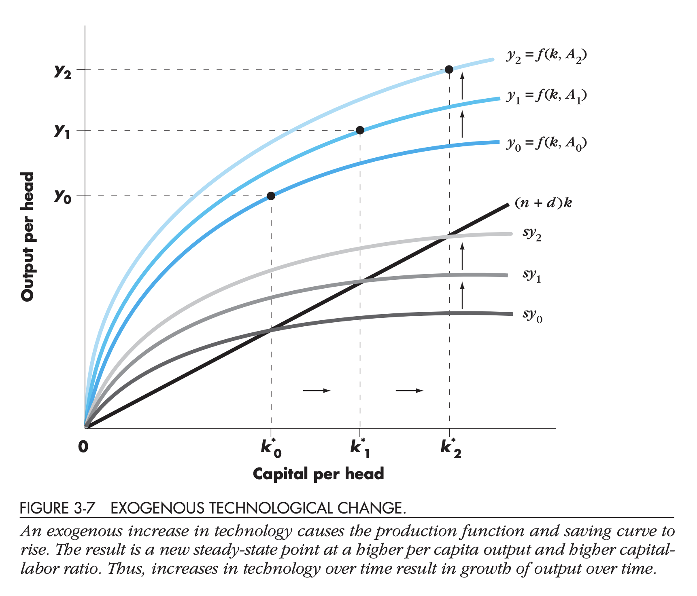

Note:
Example: A = 1 in year 0 and g = 1%. Year 1: y = (1.01) f(k). Year 2: y = (1.01)^2 f(k).
In this version, k and y are measured per effective worker (A × L), so break-even investment includes g.

---
<!-- layout: table -->
## Steady-State Growth Rates in the Solow Model

### With population growth n and technology growth g

| Variable | Symbol | Steady-state growth rate |
|---|---|---|
| Capital per effective worker | k = K/(AL) | 0 |
| Output per effective worker | y = Y/(AL) | 0 |
| Output per worker | Y/L | **g** |
| Total output | Y | **n + g** |

> Only technological progress explains sustained growth in living standards.

---
<!-- layout: image-right -->
## The Catch-Up Effect

### Diminishing returns help poor countries grow faster

- Workers with **little** capital: extra capital raises output a lot.
- Workers with **lots of** capital: the same extra capital raises output a little.
- So with the same investment, poor countries grow faster.

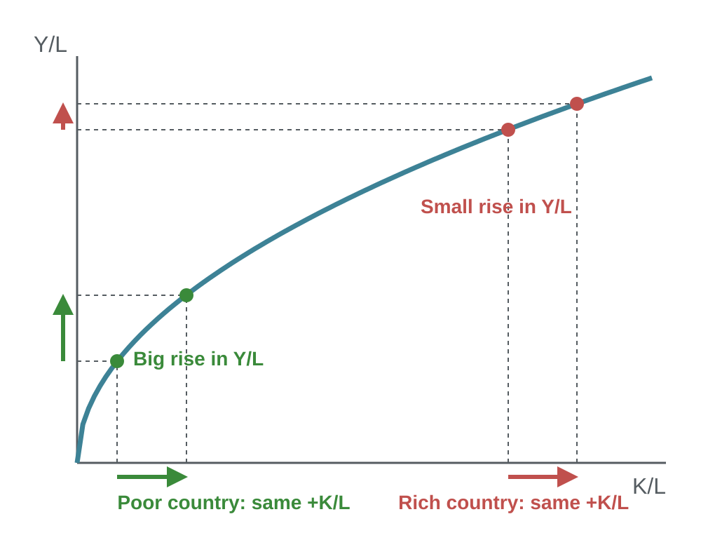

---
## The Catch-Up Effect: Evidence

### Countries that start poor tend to grow faster

**South Korea vs the United States, 1960-1990**
- Both invested a similar share of GDP.
- Expectation: similar growth.
- Actual: Korea grew **over 6%** a year; the US about **2%**.
- Reason: in 1960, Korea's K/L was far smaller than the US level.

> Catch-up is **conditional**: poor countries converge only if they save, educate and keep institutions stable.

Note:
Germany and Japan after World War II are another example: capital was destroyed in the war, so k was far below its steady state and growth was rapid.
Many poor countries have not caught up, because their steady states are low (low saving, weak institutions, high population growth).

---
<!-- layout: table -->
## Public Policy for Growth (1)

### What governments can do

| Policy | How it raises growth | India example |
|---|---|---|
| **Saving and investment** | More capital per worker | Infrastructure capex, PLI schemes |
| **Investment from abroad** | Foreign capital and know-how | FDI in electronics and autos |
| **Education** | More human capital | National Education Policy 2020 |
| **Health and nutrition** | Healthier, more productive workers | Ayushman Bharat, POSHAN |

Note:
Foreign direct investment (FDI) is capital owned and run by a foreign firm, such as a car plant. Foreign portfolio investment (FPI) is foreign purchase of shares and bonds.
Education has positive externalities: an educated person can generate ideas that others use.

---
<!-- layout: table -->
## Public Policy for Growth (2)

### Institutions, trade and ideas

| Policy | How it raises growth | India example |
|---|---|---|
| **Property rights and stability** | People invest when contracts are enforced | Insolvency and Bankruptcy Code (2016) |
| **Free trade** | Specialisation and access to technology | Post-1991 liberalisation |
| **Research and development** | More technology (A) | R&D spending is under 1% of GDP |
| **Population** | Slower n raises k\* | Fertility rate about 2.0 (NFHS-5) |

Note:
India's growth jump after 1991 came after trade and industrial liberalisation, an example of how institutions and openness affect growth.
India's R&D spending, at under 1% of GDP, is low compared with China (about 2.5%) and South Korea (nearly 5%).

---
## Saving, Investment and the Financial System

### Moving saving to investment

- The **financial system** matches people who save with people who want to invest.
- **Financial markets:** savers lend directly to borrowers.
- **Financial intermediaries:** savers lend indirectly, through a middleman.

> Saving finances the capital that the Solow model says raises income per person.

---
<!-- layout: table -->
## Financial Institutions in India

### Markets and intermediaries

| Type | Institution | How it works | India example |
|---|---|---|---|
| **Market** | Bond market | Borrowers sell IOUs with interest | Government securities, corporate bonds |
| **Market** | Stock market | Firms sell ownership shares | NSE, BSE |
| **Intermediary** | Banks | Take deposits, make loans | SBI, HDFC Bank |
| **Intermediary** | Mutual funds | Pool savings into a portfolio | SIPs in equity funds |

Note:
Bonds: the buyer is a creditor; the issuer pays interest and repays the principal. Riskier borrowers pay higher interest (credit risk); longer bonds usually pay more (term risk).
Stocks: the buyer is an owner and shares in profits, but takes more risk.
Monthly SIP inflows into Indian mutual funds have become a major channel for household saving.

---
## Saving and Investment in National Accounts

### In a closed economy, saving equals investment

$$
Y = C + I + G \;\Rightarrow\; Y - C - G = I \;\Rightarrow\; S = I
$$

National saving splits into two parts:

$$
S = \underbrace{(Y - T - C)}_{\text{private saving}} + \underbrace{(T - G)}_{\text{public saving}}
$$

- T − G > 0: budget surplus. T − G < 0: **budget deficit** (public saving is negative).

Note:
Saving vs investment in economics: buying shares or putting money in a bank is saving. Investment means buying new capital, such as a machine or a building.

---
<!-- layout: activity -->
## Activity: National Saving

### Find private, public and national saving

An economy has: Y = ₹1,000, C = ₹600, T = ₹150, G = ₹200.

1. Private saving = ?
2. Public saving = ?
3. National saving = ?
4. Investment = ?

Note:
Answers: private saving = 1,000 − 150 − 600 = 250. Public saving = 150 − 200 = −50 (a budget deficit). National saving = 250 − 50 = 200. Investment = 200, because S = I in a closed economy.

---
<!-- layout: image-right -->
## The Market for Loanable Funds

### The real interest rate balances saving and investment

- **Supply:** saving. Higher r means more reward for saving.
- **Demand:** investment. Higher r makes borrowing for investment costlier.
- **Price:** the real interest rate, r.
- Equilibrium: r\* where saving = investment.

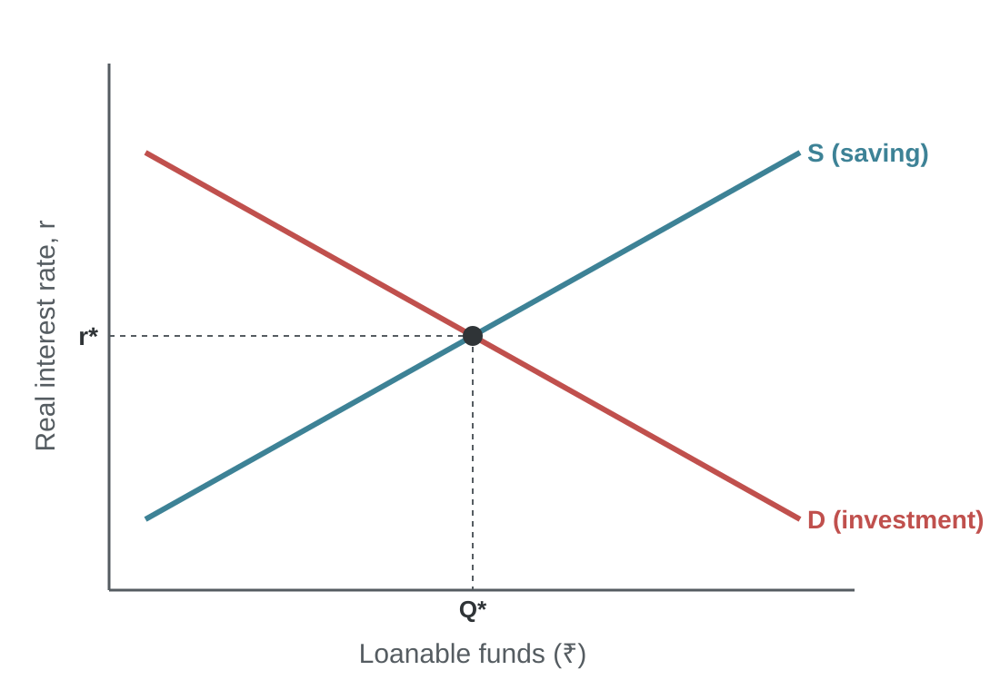

Note:
We use the real interest rate because savers and investors care about the return after inflation.
This is a simplification: one market and one interest rate for the whole financial system.

---
<!-- layout: image-right -->
## Policy 1: Saving Incentives

### Tax breaks for saving shift supply right

- Example: tax deductions for PPF and ELSS (Section 80C).
- Supply shifts right: S₀ to S₁.
- Real interest rate **falls**: r₀ to r₁.
- Investment **rises**: Q₀ to Q₁.

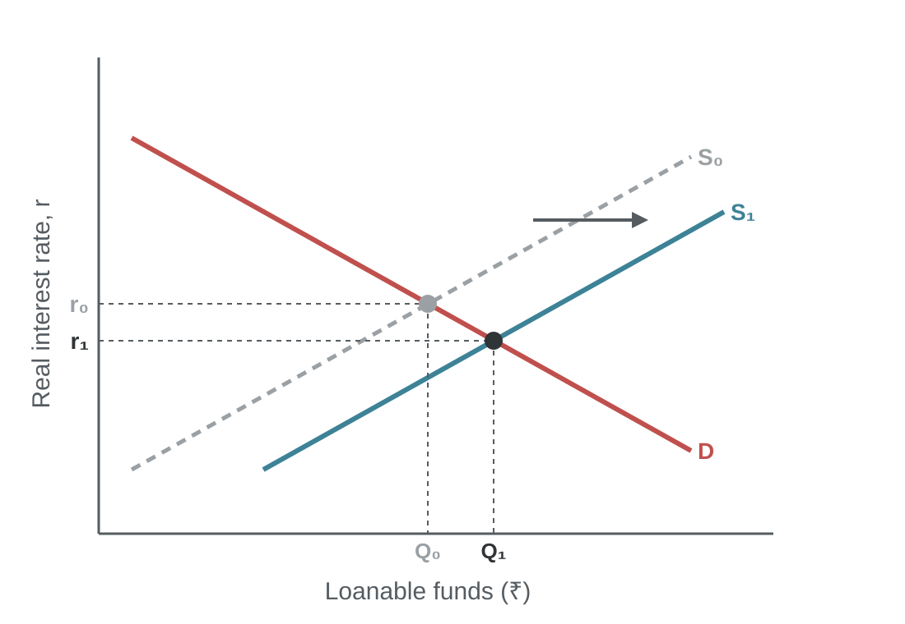

---
<!-- layout: image-right -->
## Policy 2: Investment Incentives

### Subsidies for investment shift demand right

- Example: production-linked incentives (PLI) or an investment tax credit.
- Demand shifts right: D₀ to D₁.
- Real interest rate **rises**: r₀ to r₁.
- Saving and investment **rise**: Q₀ to Q₁.

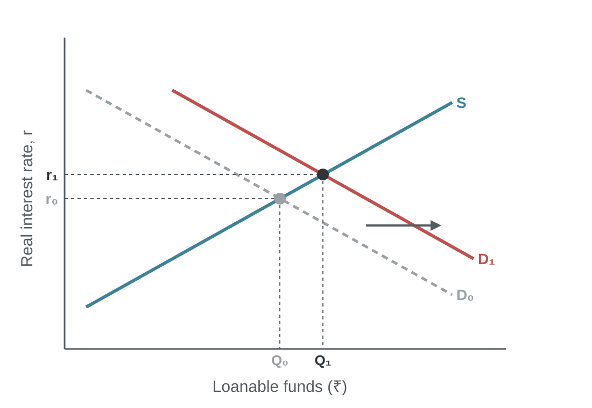

---
<!-- layout: image-right -->
## Policy 3: A Budget Deficit

### Government borrowing reduces national saving

- A deficit means negative public saving.
- Supply shifts left: S₀ to S₁.
- Real interest rate **rises**: r₀ to r₁.
- Investment **falls**: Q₀ to Q₁.

> This fall in private investment is **crowding out**.

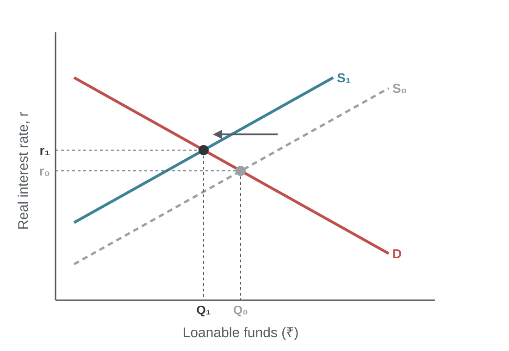

Note:
Crowding out reduces capital accumulation, so in the Solow model a lasting deficit lowers the steady-state level of income.
A budget surplus works the other way: it adds to saving, lowers r and raises investment.

---
<!-- layout: stat -->
## India: Saving and the Budget

|||

# 34.9%

Gross saving, % of GDP, 2024-25

|||

# 4.3%

Central fiscal deficit target, % of GDP, 2026-27

|||

# ₹17.2 L cr

Gross market borrowing (lakh crore), 2026-27

Note:
Household net financial saving was 7.1% of GDP in 2024-25, up from 5.9% in 2023-24 (new GDP series, base 2022-23).
Government borrowing of ₹17.2 lakh crore competes with private firms for the same pool of saving. This is why bond yields often rise when deficits are larger than expected.
Sources: MoSPI national accounts, new series (February 2026); Union Budget 2026-27 (1 February 2026).

---
<!-- layout: discussion -->
## Should India Cut Its Fiscal Deficit Faster?

### Weigh growth today against capital for tomorrow

- **For:** lower deficits free saving for private investment and lower interest rates.
- **Against:** public capex on roads, rail and power raises productivity, and may attract private investment.

Discuss for three minutes: does government borrowing crowd out or crowd in private investment in India today?

Note:
Crowding in: when public investment raises the return on private investment (a new highway makes a factory nearby more profitable), private investment can rise even with higher interest rates.
The answer depends on what the deficit pays for. Borrowing for capital spending is less harmful than borrowing for current spending such as subsidies.

---
<!-- layout: takeaways -->
## Takeaways

### Seven ideas to remember

- Living standards depend on productivity: output per worker.
- Productivity depends on physical capital, human capital, natural resources and technology.
- Growth accounting splits growth into labour, capital and TFP.
- In the Solow model, higher saving raises the level of income, not its long-run growth.
- Faster population growth lowers income per person; only technology gives lasting growth.
- Poor countries can catch up, but only if they save, educate and build institutions.
- Budget deficits reduce national saving, raise interest rates and crowd out investment.

---
<!-- layout: references -->
## References

### Textbooks and sources

- Mankiw, N. G. *Principles of Economics*. Cengage. Chapters on production and growth, and saving, investment and the financial system.
- Mankiw, N. G. *Macroeconomics*. Worth Publishers. Chapters on the Solow growth model.
- Dornbusch, R., Fischer, S. and Startz, R. *Macroeconomics*. McGraw Hill.
- Solow, R. M. (1956). "A Contribution to the Theory of Economic Growth". *Quarterly Journal of Economics*, 70(1), 65-94.
- World Bank. World Development Indicators.
- MoSPI. National accounts, new series with base year 2022-23 (February 2026).
- Government of India. Union Budget 2026-27.

---
<!-- layout: end -->
# Questions?

Dr. Pawan Ashok Kamble
