# Inflation & Unemployment

### Module 3

Dr. Pawan Ashok Kamble \
Assistant Professor \
Faculty Cabin - F61

---
<!-- layout: section -->
# Part 1: Inflation

---
<!-- layout: agenda -->
## Topics

1. Measuring the cost of living: CPI, WPI and the inflation rate
2. Problems with measuring the cost of living
3. GDP deflator vs CPI
4. Correcting for inflation
5. Interest rates: real vs nominal
6. Hyperinflation and deflation

---
<!-- layout: image-right -->
## What Is Inflation?

### Each rupee buys less

- A sustained rise in the general price level of goods and services.
- Each unit of money buys fewer goods.
- So inflation is a fall in purchasing power.
- RBI's target: 4% CPI inflation, band 2% to 6%.

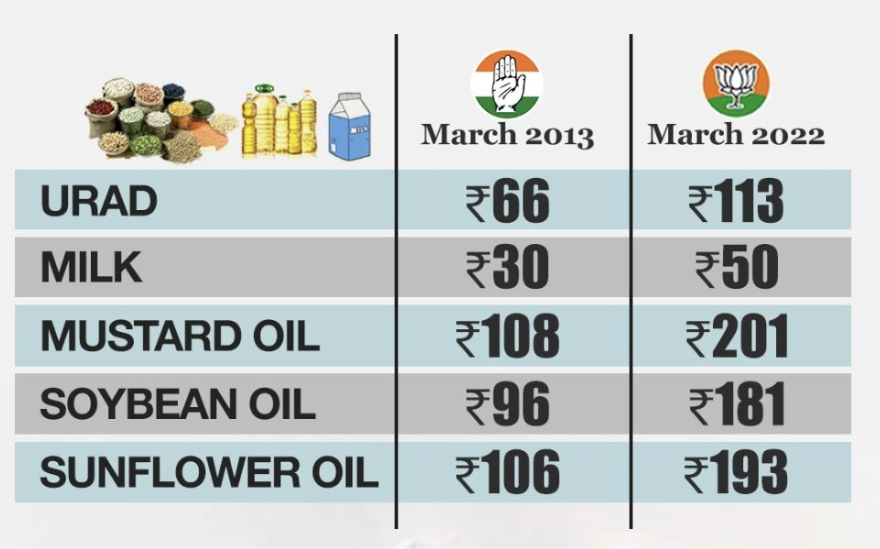

Note:
Inflation means a sustained rise in the general price level, not a one-time jump in one price. A rise in the price of onions alone is a relative price change.
The image shows retail prices in March 2013 and March 2022. Urad rose from Rs. 66 to Rs. 113 a kg, about 71% in nine years.
Since 2016, RBI follows flexible inflation targeting. The government sets the target: 4% CPI inflation, with a tolerance band of 2% to 6%. The Monetary Policy Committee (MPC) sets the repo rate to meet it.

---
## What Causes Inflation?

### Three main drivers

**1. Demand-Pull Inflation**
- Spending runs ahead of capacity, for example in a credit boom.

**2. Cost-Push Inflation**
- Higher input costs pass into prices, as in the 2022 oil and food shock.

**3. Expectations (Wage-Price Loop)**
- Expected inflation raises wage demands, and then prices.

Note:
In the long run, Milton Friedman's point applies: "Inflation is always and everywhere a monetary phenomenon." Sustained inflation needs sustained money growth.

---
<!-- layout: image-right -->
## Demand-Pull Inflation

### Spending runs ahead of capacity

- Total spending exceeds potential output.
- AD shifts right, so prices rise.
- Drivers: easy money and credit, expansionary fiscal policy, wealth booms.

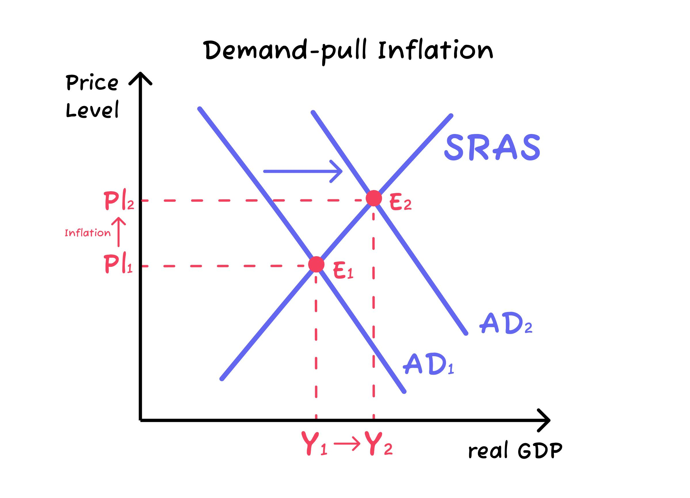

Note:
In the diagram, AD shifts from AD1 to AD2. The economy moves from E1 to E2: the price level rises from P1 to P2 and output rises from Y1 to Y2.
So demand-pull inflation comes with higher output and lower unemployment in the short run. This links to the Phillips curve in Module 3.
Policy response: tighter monetary policy (higher repo rate) or tighter fiscal policy reduces AD.

---
<!-- layout: image-right -->
## Cost-Push Inflation

### Higher costs pass into prices

- Firms pass higher input costs on to prices.
- SRAS shifts left, so prices rise and output falls.
- Triggers: oil or food shocks, wages rising faster than productivity, supply-chain disruptions.

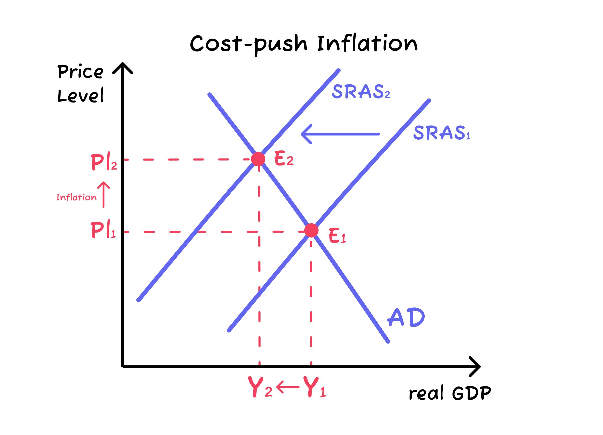

Note:
In the diagram, SRAS shifts from SRAS1 to SRAS2. The economy moves from E1 to E2: the price level rises and output falls from Y1 to Y2.
Higher prices with lower output is stagflation. This creates a policy dilemma: fighting inflation deepens the slowdown.
India example: in 2022, global oil and edible oil prices rose sharply after the Russia-Ukraine war, which pushed up CPI inflation.

---
<!-- layout: image-right -->
## Expectations

### The wage-price loop

- If people expect higher inflation, workers demand higher wages.
- Firms raise prices in advance.
- The loop feeds itself until policy credibility breaks it.

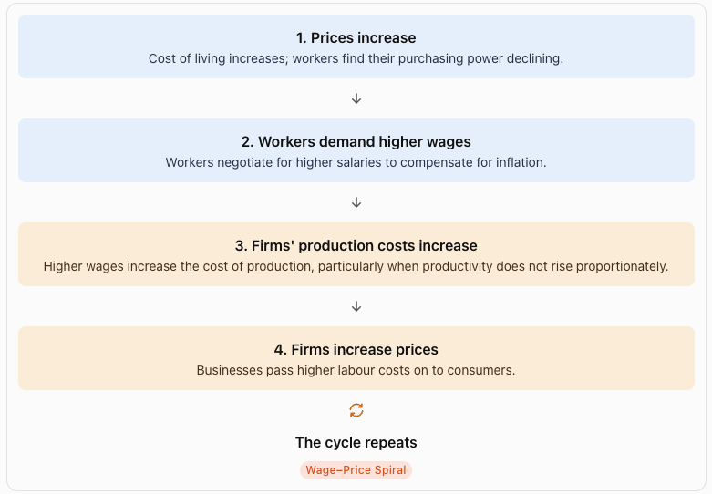

Note:
The loop: prices rise, workers demand higher wages, firms' costs rise, firms raise prices, and the cycle repeats.
This is why central banks care about inflation expectations. RBI runs a regular Inflation Expectations Survey of Households.

---
<!-- layout: image-right -->
## Expectations

### The loop in AD-AS

- Higher wages push SRAS up again and again.
- If demand keeps rising too, the price level keeps climbing.
- A credible central bank breaks the loop by anchoring expectations.

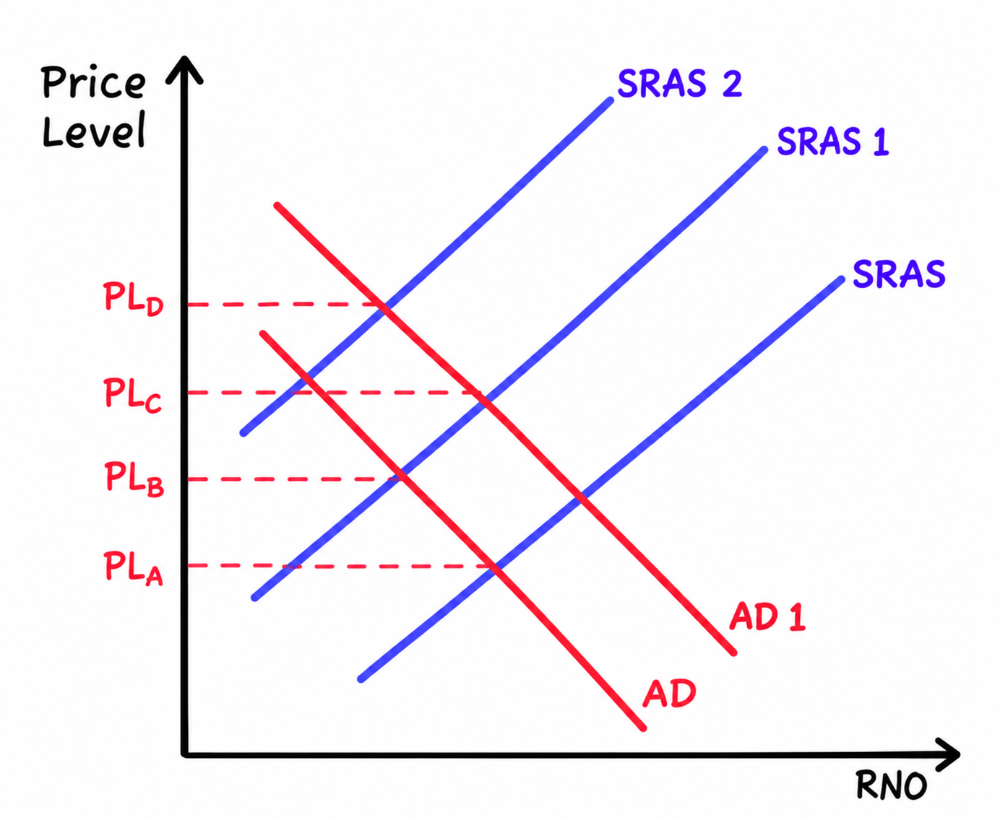

Note:
Each round of higher expected inflation shifts SRAS up (SRAS to SRAS 1 to SRAS 2). If AD also shifts up (AD to AD 1), the price level climbs from PL A to PL D.
Credibility matters: if people believe RBI will keep inflation near 4%, they ask for smaller wage rises and the loop stops early.

---
<!-- layout: table -->
## Measures of Inflation

### Different indices track different prices

| Measure | What it tracks | Key point |
|---|---|---|
| **CPI** | A basket bought by households | Headline inflation |
| **Core CPI** | CPI excluding food and fuel | Less volatile |
| **WPI** | Goods traded in bulk at wholesale | Mostly goods; being phased out in many countries |
| **PPI** | Prices received by domestic producers | Goods and services; global standard (US, EU, OECD) |
| **GDP deflator** | All goods and services produced at home | Covered later in this module |

Note:
In India, CPI is compiled by the National Statistics Office (MoSPI), and WPI by the Office of the Economic Adviser, Department for Promotion of Industry and Internal Trade (DPIIT).
WPI has no services and is more affected by global commodity prices such as oil and metals.

---
<!-- layout: equation -->
## Measures of Inflation

### How to measure the inflation rate

$$
\pi_t = \frac{\text{Index}_t - \text{Index}_{t-1}}{\text{Index}_{t-1}} \times 100
$$

πt is the inflation rate in period t. The index can be CPI, WPI or the GDP deflator.

**Example:** CPI rises from 200 to 210, so π = (210 − 200) / 200 × 100 = **5%**.

---
## Measures of Inflation

### In India

- MoSPI (Ministry of Statistics and Programme Implementation) estimates inflation.
- Earlier, RBI used the Wholesale Price Index (WPI) to gauge inflation.
- On 1 April 2014, RBI adopted the **Consumer Price Index (CPI)** as its main inflation measure, in the first bi-monthly policy statement of 2014-15.
- Reason: CPI is the only national price index based on consumption, and it is the international standard.
- Since 2016: flexible inflation targeting, with a 4% CPI target (band 2% to 6%).

Note:
The shift followed the Urjit Patel Committee report (2014), which recommended CPI as the nominal anchor.
In 2016 the RBI Act was amended. The government sets the inflation target every five years, and the six-member Monetary Policy Committee (MPC) sets the repo rate.

---
## Consumer Price Index

### Headline and core

**1. Consumer Price Index (CPI)**
- Measures the overall cost of goods and services bought by a typical consumer.
- Tracks changes in the cost of living over time. This is headline CPI.

**2. Core CPI**
- Measures the cost of consumer goods and services excluding food and energy.

> Core CPI = Headline CPI − Food − Fuel and energy

In India, NSO (MoSPI) releases CPI every month for rural, urban and combined areas.

Note:
CPI combined (rural plus urban) is the official measure of headline inflation that RBI targets.

---
## How CPI Is Calculated

### Step 1: Fix the basket

The National Statistical Office (MoSPI) surveys consumers to find the basket bought by a typical consumer.

The basket is revised when the base year changes.

|||

**Major components**
- Food and beverages
- Fuel and lighting
- Clothing and footwear
- Housing

|||

&nbsp;
- Pan, tobacco and intoxicants
- Services
- Miscellaneous (health, education, transport)

Note:
The government updates the basket from time to time, so the base year changes.

---
## How CPI Is Calculated: India

### A new CPI series with base year 2024

India's new CPI series uses **2024 as the base year**, replacing the 2012 base. It was released on 12 February 2026.

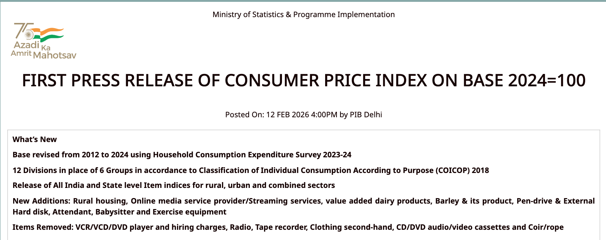

Note:
What is new: basket based on the Household Consumption Expenditure Survey 2023-24; 12 divisions instead of 6 groups, following COICOP 2018.
New items include rural housing, online media and streaming services, value-added dairy products, barley, pen drives and external hard disks, attendants, babysitters and exercise equipment.
Items removed include VCR/VCD/DVD players, radios, tape recorders, second-hand clothing and audio or video cassettes.

---
<!-- layout: table -->
## How CPI Is Calculated: India

### The new basket has 358 weighted items

| Category | Previous series (2012) | New series (2024) |
|---|---|---|
| Goods | 259 | 308 |
| Services | 40 | 50 |
| **Total** | **299** | **358** |

The new weights come from the Household Consumption Expenditure Survey 2023-24.

Note:
More services in the basket reflect how Indian spending has shifted, for example towards mobile data, streaming and eating out.

---
<!-- layout: table -->
## How CPI Is Calculated: India

### Step 2: Give weights to the components (%)

| Category | Weight | Category | Weight |
|---|---|---|---|
| Food and beverages | 36.87 | Transport | 8.52 |
| Pan, tobacco, intoxicants | 3.00 | Information and communication | 3.62 |
| Clothing and footwear | 6.40 | Recreation, sport and culture | 1.52 |
| Housing, water, electricity, gas, fuels | 17.72 | Education services | 3.34 |
| Furnishings and household items | 4.48 | Restaurants and accommodation | 3.36 |
| Health | 6.12 | Personal care and miscellaneous | 5.05 |

> Food and beverages carry about 37% of the weight, so food prices drive headline CPI.

Note:
Weights add up to 100. Food and beverages carry more than a third of the weight, so food prices drive headline CPI in India.
Full names: "Furnishings, household equipment and routine household maintenance"; "Personal care, social protection and miscellaneous goods and services".

---
## How CPI Is Calculated: India

### Steps 3 and 4: Find the prices and cost the basket

**3. Find the Prices**
- Record the price of each good and service in the basket at each point in time.
- NSO collects prices every month from selected rural and urban markets.

**4. Compute the Basket Cost and the CPI**
- Use the prices to compute the total cost of the basket.

$$
\text{CPI} = \frac{\text{Price of basket in current year}}{\text{Price of basket in base year}} \times 100
$$

---
<!-- layout: equation -->
## How CPI Is Calculated: India

### Step 5: Calculate the inflation rate

$$
\text{Inflation rate}_t = \frac{\text{CPI}_t - \text{CPI}_{t-1}}{\text{CPI}_{t-1}} \times 100
$$

It is the percentage change in CPI from the previous period (t − 1). In the base year, CPI is always 100.

**Example:** CPI is 100 in 2024 and 108.42 in 2025, so inflation in 2025 is **8.42%**.

---
<!-- layout: activity -->
## Example: Calculate the Inflation Rate

### 15 minutes to solve

An economy has a CPI base year of 2024. The CPI basket has four categories, including fuel and energy. Each category has three items with equal weights within the category.

Calculate the inflation rate for 2025.

---
<!-- layout: table -->
## Example: The Data

### Prices in rupees, 2024 and 2025

| Item | 2024 | 2025 | Item | 2024 | 2025 |
|---|---|---|---|---|---|
| **Food (40%)** | | | **Transport (15%)** | | |
| Rice (kg) | 50 | 55 | Bus fare | 20 | 22 |
| Wheat flour (kg) | 40 | 44 | Auto fare | 50 | 55 |
| Milk (litre) | 60 | 63 | Train fare | 100 | 105 |
| **Housing (25%)** | | | **Fuel and energy (20%)** | | |
| House rent (month) | 10,000 | 10,500 | LPG cylinder | 900 | 990 |
| Water bill (month) | 500 | 550 | Electricity (kWh) | 8 | 9 |
| Maintenance (month) | 1,000 | 1,050 | PNG (SCM) | 50 | 55 |

---
<!-- layout: steps -->
## Example: Steps

### Work through these in order

1. **Item CPI**: 2025 price ÷ 2024 price × 100
2. **Category CPI**: average of the three items
3. **Overall CPI**: weight each category
4. **Inflation**: % change from 100

Note:
Solution.
Item CPIs: rice 110, wheat flour 110, milk 105; rent 105, water 110, maintenance 105; bus 110, auto 110, train 105; LPG 110, electricity 112.5, PNG 110.
Category CPIs: food 108.33, housing 106.67, transport 108.33, fuel and energy 110.83.
Overall CPI 2025 = 0.40 × 108.33 + 0.25 × 106.67 + 0.15 × 108.33 + 0.20 × 110.83 = 108.42.
Inflation for 2025 = (108.42 − 100) / 100 × 100 = 8.42%.
Extension, core CPI (excluding food and fuel): (0.25 × 106.67 + 0.15 × 108.33) / 0.40 = 107.29, so core inflation is 7.29%. Headline is higher because food and fuel prices rose faster.

---
<!-- layout: table -->
## Example: Solution

### Overall CPI 2025 = 108.42, so inflation = 8.42%

| Category | Item CPIs (2025) | Category CPI | Weight | Weighted CPI |
|---|---|---|---|---|
| Food | 110, 110, 105 | 108.33 | 0.40 | 43.33 |
| Housing | 105, 110, 105 | 106.67 | 0.25 | 26.67 |
| Transport | 110, 110, 105 | 108.33 | 0.15 | 16.25 |
| Fuel and energy | 110, 112.5, 110 | 110.83 | 0.20 | 22.17 |
| **Overall CPI** | | | **1.00** | **108.42** |

Note:
Inflation = (108.42 − 100) / 100 × 100 = 8.42%.
Core CPI (excluding food and fuel) = (26.67 + 16.25) / 0.40 = 107.29, so core inflation is 7.29%. Headline inflation is higher because food and fuel prices rose faster.

---
## CPI vs CFPI

### Overall inflation and food inflation

**1. CPI (Consumer Price Index)**
- Measures price changes for a broad basket of goods and services bought by households.

**2. CFPI (Consumer Food Price Index)**
- Measures price changes for food items bought by households.

> CFPI is measured separately because food prices behave differently from other prices, and food inflation has a large effect on household welfare.

Food prices swing with monsoons, crop failures and supply shocks such as tomato and onion price spikes.

Note:
Poorer households spend a larger share of income on food, so food inflation hurts them most.
In September 2026, CFPI inflation was 7.74%, well above headline CPI inflation of 5.54% (see the trend chart).

---
<!-- layout: compare -->
## Headline CPI vs Core CPI

|||

### Headline CPI

- Covers the entire consumer basket
- Includes food, fuel, housing, transport, clothing, health and education
- Shows the overall inflation households face
- RBI targets headline CPI

|||

### Core CPI

- Excludes food and fuel prices
- Shows underlying inflation pressure
- Helps spot persistent price rises
- Guides whether inflation will last

Note:
Food and fuel prices are very volatile.
Headline CPI measures overall inflation. Core CPI helps assess underlying inflation, because it removes the most volatile items.

---
## India's Inflation Trend

### Headline CPI, core CPI and food inflation

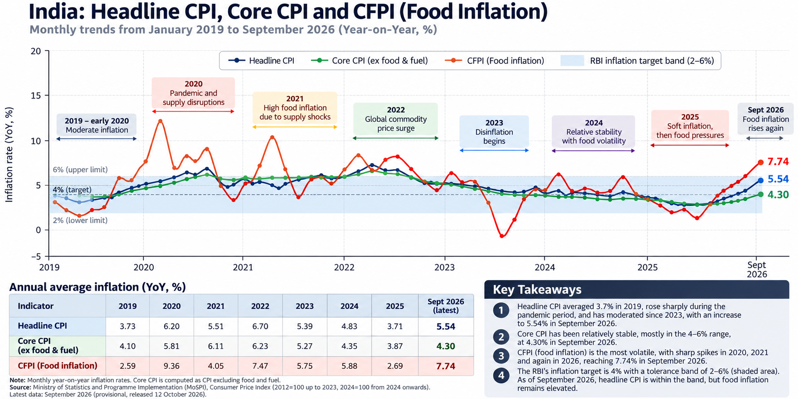

Note:
Annual averages, headline CPI: 3.73% (2019), 6.20% (2020), 5.51% (2021), 6.70% (2022), 5.39% (2023), 4.83% (2024), 3.71% (2025). September 2026: 5.54%.
Core CPI has stayed mostly in the 4% to 6% range, at 4.30% in September 2026.
Food inflation (CFPI) is the most volatile, with spikes in 2020, 2021 and 2026, reaching 7.74% in September 2026.
Headline CPI is inside RBI's 2% to 6% band, but food inflation is high. In October 2026, RBI raised the repo rate by 25 basis points to 5.50%.
Source: MoSPI, CPI (2012 = 100 up to 2023; 2024 = 100 from 2024). Latest data: September 2026, released 12 October 2026.

---
## Problems with CPI

### Three reasons CPI overstates the cost of living

**1. Substitution Bias**
- Consumers switch to goods that become relatively cheaper. A fixed basket misses this.

**2. Introduction of New Goods**
- New goods add variety, so each rupee is worth more. A fixed basket misses this.

**3. Unmeasured Quality Change**
- Better quality raises the value of each rupee. NSO adjusts for quality, but probably misses some.

> In all three cases, CPI **overstates** the rise in the cost of living.

Note:
Substitution example: when tomato prices spike, households buy fewer tomatoes and more of other vegetables. A fixed basket still counts the old quantity of tomatoes.
New goods example: UPI payments, streaming services and online shopping gave consumers more choice at low cost.
Quality example: a Rs. 15,000 smartphone today is far better than one at the same price ten years ago, but CPI may record only the price.
Why it matters: wages, pensions and dearness allowance are often indexed to CPI. If CPI overstates inflation, indexed payments rise faster than the true cost of living.

---
<!-- layout: table -->
## GDP Deflator vs CPI

### Whole economy vs consumption

| Feature | CPI | GDP deflator |
|---|---|---|
| **Coverage** | Goods and services bought by consumers | Goods and services produced at home |
| **Imported consumer goods** | Included | Excluded |
| **Capital goods** | Excluded | Included (if produced at home) |
| **Basket** | Fixed basket | Changes with current output |

GDP deflator = Nominal GDP / Real GDP × 100

Note:
CPI is a fixed-basket (Laspeyres) index. The GDP deflator uses current output (a Paasche index), so it changes as the economy's mix of goods changes.

---
<!-- layout: activity -->
## Example: CPI or GDP Deflator?

### Find the effect on the US CPI and the GDP deflator

1. Starbucks raises the price of muffins.
2. Caterpillar raises the price of the industrial tractors it makes at its Illinois factory.
3. Armani raises the price of the Italian jeans it sells in the US.

---
<!-- layout: table -->
## Answers

### Check what is consumed and where it is produced

| Scenario | CPI | GDP deflator |
|---|---|---|
| Starbucks muffins | Rises | Rises |
| Caterpillar tractors (made in the US) | No change | Rises |
| Armani Italian jeans (imported) | Rises | No change |

Note:
A. Muffins are produced in the US, so their prices are part of the GDP deflator. Consumers buy them, so they are part of the CPI. Both rise.
B. Tractors are produced in the US, so the GDP deflator rises. They are a capital good, not a consumer good, so the CPI does not change.
C. Italian jeans are in the US consumer's basket, so the CPI rises. The GDP deflator includes only domestic production, so it does not change.

---
## Two Measures of Inflation

### US CPI inflation and GDP deflator inflation

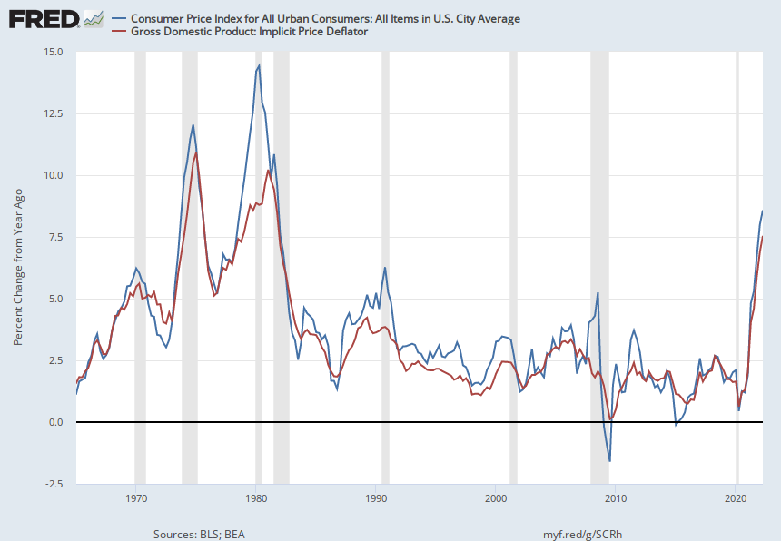

Source: FRED, Federal Reserve Bank of St. Louis.

Note:
The two measures usually move together. They differ most when imported consumer goods such as oil change sharply in price, because oil imports enter the CPI but not the GDP deflator.

---
<!-- layout: equation -->
## Money Value in Different Time Periods

### Comparing money figures from different times

$$
\text{Amount}_{\text{today}} = \text{Amount}_{T} \times \frac{P_{\text{today}}}{P_{T}}
$$

P is the price level, measured by the CPI. T is the earlier year. Inflation makes money amounts from different years hard to compare.

Note:
The same idea works backwards: Amount in year T = Amount today × P_T / P_today.
This is how we compare salaries, prices or GDP across years in real terms.

---
## Example 1

### Grandpa's first salary

John's grandpa's first full-time job was as a car mechanic in 1963. He earned $310 a month.

- CPI in 1963: 30.9
- CPI in 2022: 292.3

How much are grandpa's earnings in 2022 dollars?

> Amount in 2022 dollars = $310 × 292.3 / 30.9 = **$2,932.46**

Note:
Interpretation: $310 a month in 1963 could buy what $2,932.46 buys at 2022 prices.
CPI source: US Bureau of Labor Statistics, CPI-U, June 2022 (292.3).
The textbook has two more examples: Babe Ruth's 1931 salary and President Hoover's 1931 salary.

---
## Example 2

### Ram's first salary

Ram's first job as an engineer in 2015 paid Rs. 80,000 a month.

- CPI in 2015: 126
- CPI in 2025: 192

How much are Ram's earnings in 2025 rupees?

> Amount in 2025 rupees = Rs. 80,000 × 192 / 126 = **Rs. 1,21,905**

Note:
Interpretation: if Ram earns less than Rs. 1,21,905 a month in 2025, his real salary has fallen since 2015, even if his rupee salary has risen.
Ask students: what is the real growth in Ram's salary if he now earns Rs. 1,50,000? Answer: 1,50,000 / 1,21,905 − 1 = 23%.

---
<!-- layout: activity -->
## Active Learning: Tuition Increases

### Tuition and fees at US colleges and universities

| | 1990 | 2022 |
|---|---|---|
| Private non-profit 4-year | $9,340 | $38,070 |
| Public 4-year (in state) | $1,908 | $10,740 |
| Public 2-year | $906 | $3,800 |
| CPI | 130.7 | 292.3 |

1. Express the 1990 tuition in 2022 dollars, then find the real percentage increase for each type.
2. Which type had the largest real increase?

Note:
Give students 5 to 10 minutes. The answers are on the next slide. 2022 means academic year 2021-22; 1990 means 1989-90.
Sources: tuition from College Board, Trends in College Pricing, Table CP-1; CPI from the US Bureau of Labor Statistics (June 2022).

---
<!-- layout: table -->
## Active Learning: Answers

### Amount in 2022 $ = amount in 1990 $ × 292.3 / 130.7

| School type | 1990 (in 2022 $) | 2022 | Real % change |
|---|---|---|---|
| Private non-profit 4-year | $20,888 | $38,070 | 82.3% |
| Public 4-year (in state) | $4,267 | $10,740 | **151.7%** |
| Public 2-year | $2,026 | $3,800 | 87.5% |
| CPI | 130.7 | 292.3 | 123.6% |

Note:
If prices in 1990 had been as high as in 2022, a private 4-year college would have cost $20,888, a public 4-year college (in state) $4,267, and a public 2-year college $2,026.
The largest real increase is at public 4-year colleges and universities (in-state tuition).

---
<!-- layout: callout -->
## Interest Rates

### One price that spreads through the economy

> The interest rate is the **price of borrowing**. It affects loans, jobs, prices, housing, the rupee and the government budget.

Examples: corporate loans, treasury bills, lending and deposit rates.

**India:** RBI's policy rate is the repo rate, the rate at which it lends to banks. It was **5.50%** after October 2026.

Note:
On 7 October 2026, the MPC raised the repo rate by 25 basis points, from 5.25% to 5.50%, and changed its stance to "calibrated tightening". It also raised its FY27 CPI inflation projection to 5.2%.

---
<!-- layout: compare -->
## Interest Rates: A Steering Wheel

|||

### Rate up

- Loans cost more
- People and firms spend and invest less
- Growth cools
- **Inflation falls**

|||

### Rate down

- Loans get cheaper
- Spending and investment rise
- Growth picks up
- **Inflation can rise**

Note:
RBI moves its key rate, the repo rate.
The central bank sets a short-term nominal rate (the repo rate) to stabilise inflation and output.

---
<!-- layout: callout -->
## Interest Rates

### The real cost of money

> What really matters is the interest rate **after inflation**.

Example: the bank pays 7%, prices rise 5%, so your **real gain ≈ 2%**. Real rates guide decisions to save or invest.

Note:
If the bank paid 4% and prices rose 5%, the real return would be about −1%. The saver loses purchasing power even though the rupee balance grows.

---
## Real vs Nominal Interest Rates

### Correcting interest rates for inflation

**1. Nominal Interest Rate**
- Not corrected for inflation: the growth in the rupee value of a deposit or debt.

**2. Real Interest Rate**
- Corrected for inflation: the growth in the purchasing power of a deposit or debt.

$$
r \approx i - \pi^{e}
$$

Fisher equation: real rate (r) ≈ nominal rate (i) − expected inflation (πe).

Note:
Exact form: (1 + i) = (1 + r)(1 + π). The approximation r ≈ i − π works well when rates are low.
Ex ante real rate uses expected inflation, which matters for decisions. Ex post real rate uses actual inflation, which we see afterwards.
Fisher effect: a 1 point rise in expected inflation raises the nominal rate by about 1 point in the long run.

---
## Real vs Nominal Interest Rates

### Example

Amir deposits a $1,000 bonus in his savings account for one year. The nominal interest rate is 9%. Inflation during the year is 3.5%. Can Amir buy more or fewer goods at the end of the year? How much?

> Real interest rate = 9.0% − 3.5% = **5.5%**

- The purchasing power of the deposit grows by 5.5%.
- Amir can buy about **$55 more** goods after a year.

Note:
His bank balance grows by $90 (9% of $1,000). But $35 of that only keeps up with prices (3.5%). The real gain is about $55.

---
<!-- layout: image-left -->
## Negative Real Interest Rates

### When inflation is higher than the policy rate

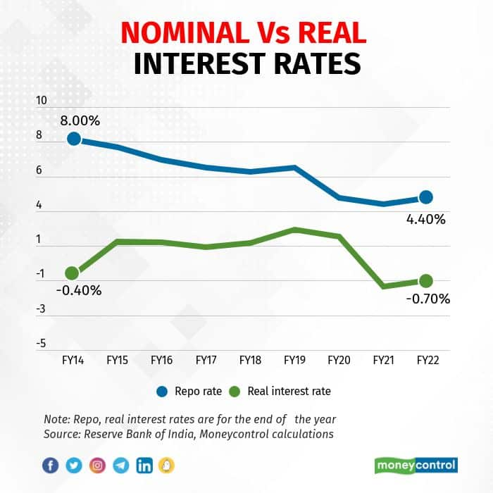

- **Savers lose:** real wealth erodes.
- **Borrowers gain:** debts are repaid in cheaper money.
- **Spending rises:** people spend and invest now.
- **Rupee weakens:** lower real yields reduce foreign inflows.

Note:
The chart shows India's repo rate and real interest rate from FY14 to FY22 (end of year). The real rate turned negative in FY22.
A negative real rate means monetary policy is very loose, or inflation has spiked. The central bank may be stimulating demand, or policy has not caught up with inflation.
Debts are repaid in cheaper money, so there is a transfer from lenders to borrowers, including the government.
Banks and depositors are squeezed. Deposit rates are negative in real terms, so savers shift to gold and real estate.

---
## Homework: Real vs Nominal Rates in the US

### Three-month Treasury bill rate

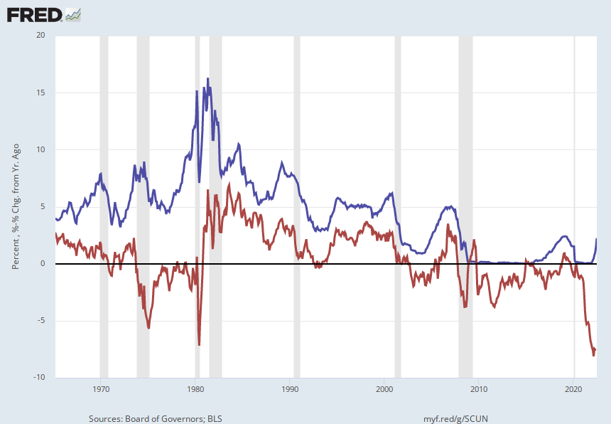

Source: FRED, Federal Reserve Bank of St. Louis. Blue = real, red = nominal.

Note:
The nominal rate is the three-month Treasury bill rate. The real rate is the nominal rate minus CPI inflation.
The two often move apart because inflation changes.
Sources: CPI from the Bureau of Labor Statistics (CPIAUCSL); Treasury bill rate from the Board of Governors of the Federal Reserve System, via FRED.

---
<!-- layout: callout -->
## What Is Hyperinflation?

### Technical definition

> Hyperinflation is an episode of extremely rapid, self-reinforcing price increases, classically defined as inflation of **50% or more per month**.

**Main cause:** governments print money to finance large budget deficits.

**Examples:** Germany (1923), Zimbabwe (2008), Venezuela (2018).

Note:
The 50% per month definition comes from Phillip Cagan (1956). At 50% a month, prices rise about 130 times in a year.
Money loses value so fast that people spend it at once, which pushes prices up even faster.

---
<!-- layout: image-right -->
## Curious Case of Zimbabwe

### The 100-trillion-dollar note

- Prices and exchange rates jumped several times a day.
- A note that bought a loaf in the morning might not by evening.
- The 100-trillion note became a symbol.
- It could barely buy a staple before Zimbabwe dollarised in 2009.

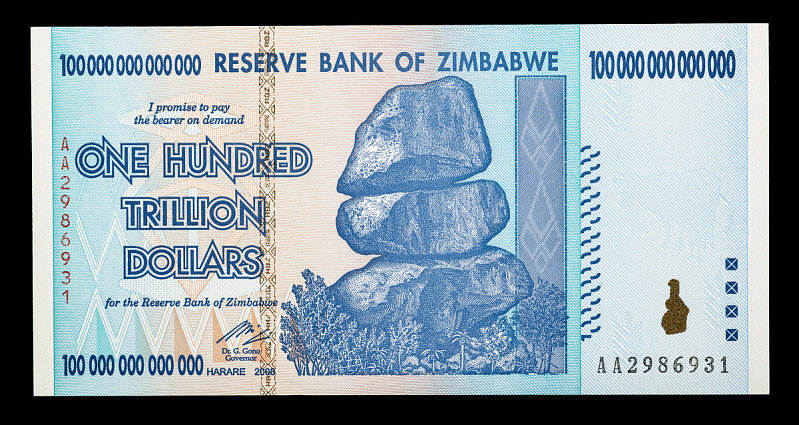

Note:
Cause: the government printed money to pay for its spending while farm output collapsed after land reforms.
Steve Hanke estimates Zimbabwe's monthly inflation peaked at about 79.6 billion percent in November 2008.
In 2009 Zimbabwe stopped using its own currency and used the US dollar and the South African rand instead.

---
<!-- layout: video -->
## Zimbabwe and Hyperinflation

### Who wants to be a trillionaire?

@[Zimbabwe and Hyperinflation: Who Wants to Be a Trillionaire?](https://www.youtube.com/embed/78-BlZXm7wA)

Note:
Video: Marginal Revolution University.

---
<!-- layout: table -->
## Zimbabwe's Hyperinflation in Numbers

### What a note could buy

| Period | Note (face value) | Z$ per US$ | What it could buy |
|---|---|---|---|
| Early 2006 | Z$100,000 | About 1.7 million | A loaf of bread |
| Mid-2007 | Z$10 million | Over 10 million | A dozen eggs or 2 loaves |
| June 2008 | Z$100 billion | About 2.6 billion | Basic groceries or a minibus ride |
| Nov 2008 | Z$100 trillion | About 2.62 trillion | A week's groceries for a small family |
| Early 2009 | Z$100 trillion | Up to 2.6 decillion | Barely a loaf of bread |

Note:
Check before class: the Z$100 trillion note was issued in January 2009, so the November 2008 row should use a smaller note.

---
## What Is Deflation?

### Technical definition

> Deflation is a **sustained fall in the general price level** of goods and services. The inflation rate is **negative**.

**Example:** CPI falls from 120 to 118.

$$
\text{Inflation} = \frac{118 - 120}{120} \times 100 = -1.67\% \;\Rightarrow\; \text{deflation}
$$

**Why it hurts:** people delay spending, and the real burden of debt rises. Example: Japan in the late 1990s and 2000s.

Note:
Deflation is not disinflation. Disinflation means inflation falls but stays positive, for example from 6% to 4%.
In deflation, firms' revenues fall while debts stay fixed, so defaults and job losses can rise. This can become a deflationary spiral.

---
<!-- layout: takeaways -->
## Takeaways

### Five ideas to remember

- Inflation is a sustained rise in the general price level. It is driven by demand, costs and expectations.
- CPI tracks the consumer basket. RBI targets CPI inflation; core CPI removes volatile food and fuel.
- A fixed basket makes CPI overstate the rise in the cost of living.
- Use price indices to compare money across years: multiply by price today / price then.
- Real interest rate ≈ nominal rate − inflation. Negative real rates hurt savers and help borrowers.

Note:
Two more points to stress: hyperinflation comes from printing money to finance deficits, and deflation is harmful because it raises the real burden of debt.

---
<!-- layout: section -->
# Part 2: Unemployment

---

<!-- layout: agenda -->

## Topics

1. Employment, Unemployment, labor force, unemployment rate
1. Types of unemployment
2. Natural rate of unemployment and full employment
3. Beveridge Curve and labor market matching
4. Wage pressure, inflation expectations and the Phillips curve
5. Policy trade-offs using short-run and long-run. 

---
## Why Do We Study Unemployment?

### Unemployment as an Indicator of Economic Health

**1. Utilisation of Human Resources**
   - Labour is a key factor of production.
   - Unemployment indicates that available human resources are not being fully utilised.

**2. Loss of Economic Output**
   - Unemployed workers represent potential productive capacity that remains unused.
   - The economy may produce below its potential output.

**3. Household Income and Living Standards**
   - Unemployment reduces household income and purchasing power.
   - Lower income can reduce consumption and economic well-being.

---
## Why Do We Study Unemployment?

### Unemployment as an Indicator of Economic Health

**4. Economic and Social Stability**
   - Persistent unemployment can increase poverty and inequality.
   - It can create social and economic insecurity.

>Key Takeway: Unemployment is not just a labour-market problem; it represents a loss of productive resources and economic welfare.

---

## Measuring Unemployment

### Working-Age Population:
- Individuals who fall within the age range considered suitable for participation in economic activities, as defined by a country's statistical standards. 

- For India, individuals aged 15 years and above, as defined by the Periodic Labour Force Survey (PLFS). 

### Employed:
- Individuals who are of working age and have performed some economic activity for pay or profit during a specified reference period.

### Unemployed: 
- Individuals of working age who are not currently employed but are actively seeking employment and are available to work during a specified reference period.

---
## Measuring Unemployment

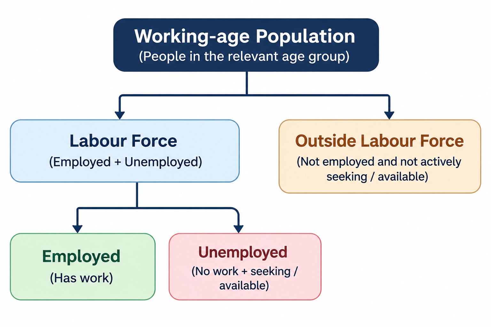

---
## Measuring Unemployment

### Population Divided by Labor-Market Status

$$
\text{Unemployment Rate} =
\left(\frac{\text{Unemployed}}{\text{Labor Force}}\right)\times 100
$$

**Where:**

$$
\text{Labor Force} =
\text{Employed}+\text{Unemployed}
$$

---
## Numerical Example: 

### Problem

Consider an economy with a working-age population of 1 million people. Out of these, 600,000 people are employed, while 100,000 people are unemployed and actively seeking or available for work.

Calculate the unemployment rate of this economy.

---
## Numerical Example: 
### Solution

**Step 1: Calculate the Labour Force**

$$
LF = E + U
$$

$$
LF = 600,000 + 100,000 = 700,000
$$

**Step 2: Calculate the Unemployment Rate**

$$
UR = \frac{U}{LF}\times 100
$$

$$
UR = \frac{100,000}{700,000}\times 100
$$

$$
\boxed{UR = 14.29\%}
$$

**Answer:** The unemployment rate in this economy is **14.29%**.

**Remember:** The other 300,000 people are outside the labor force, so they are not counted.

---

## Types of Unemployment

### Major Forms of Unemployment

**1. Frictional Unemployment**
- Temporary unemployment when individuals move between jobs or enter the labour market.
- Example: An MBA graduate searching for their first job.

**2. Structural Unemployment**
- Occurs when workers' skills do not match the requirements of available jobs.
- Example: Workers in traditional manufacturing displaced by automation.

**3. Cyclical Unemployment**
- Arises due to a decline in aggregate demand during an economic slowdown or recession.
- Example: Layoffs in the automobile industry during an economic downturn.
---
## Types of Unemployment: Other types

### Major Forms of Unemployment

**4. Seasonal Unemployment**
- Occurs when employment opportunities are available only during particular seasons.
- Example: Agricultural labourers during the off-season.

**5. Disguised Unemployment**
- Occurs when more workers are engaged in an activity than actually required, resulting in near-zero marginal productivity of additional workers.
- Example: Five family members working on a farm when three could produce the same output.

---
---
<!-- layout: steps -->
## Business Cycle Channel of Rising Unemployment

### How a fall in aggregate demand leads to job losses

1. **Demand falls**: households and firms spend less
2. **Sales fall**: unsold stock builds up
3. **Output falls**: firms cut production
4. **Jobs lost**: firms lay off workers
5. **Income falls**: spending falls again

> This is **cyclical unemployment**. It falls when demand recovers.

Note:
Step 5 feeds back into step 1. Laid-off workers spend less, so demand falls again. This is the multiplier at work.
Okun's law links the two sides: when output falls below potential, unemployment rises above the natural rate.
Indian example: during the April to June 2020 lockdown, urban unemployment rose to 20.8% (PLFS Quarterly Bulletin).

---
## Natural Rate of Unemployment

### Unemployment that remains when the economy is at full employment

> **Natural rate** = Frictional unemployment + Structural unemployment

- It exists even when the economy produces at potential output.
- Full employment means unemployment equals the natural rate, not zero.
- Cyclical unemployment = Actual rate − Natural rate.
- Example: actual rate 7%, natural rate 5%, so cyclical unemployment is 2%.

Note:
Mankiw defines the natural rate as the normal rate around which the actual rate moves.
It changes slowly. Labour laws, skill gaps, job-matching speed and demographics shift it.
In a recession the actual rate rises above the natural rate. In a boom it can fall below it.

---

---
<!-- layout: table -->
## India's Unemployment: Latest PLFS Data

### September 2026, current weekly status, age 15 and above

| Group | Unemployment rate |
|---|---|
| All India | 5.0% |
| Rural | 4.2% |
| Urban | 6.9% |
| Urban women | 9.2% |
| Youth, 15 to 29 years | 15.2% |
| Urban youth, 15 to 29 years | 19.0% |

Source: MoSPI, PLFS Monthly Bulletin, September 2026 (released 15 October 2026)

Note:
Check with the formula. LFPR = 55.5% and WPR = 52.7% of the population aged 15+.
Unemployment rate = (LFPR − WPR) / LFPR × 100 = (55.5 − 52.7) / 55.5 × 100 ≈ 5.0%.
Discussion point: overall unemployment is low, but urban youth unemployment is almost four times higher. Ask students why educated young people wait for jobs.

---
---
<!-- layout: equation -->
## Actual Rate and the Natural Rate

### Actual unemployment splits into a natural part and a cyclical part

$$
u = u^{*} + u_{c}
$$

u is the actual rate, u* is the natural rate and uc is cyclical unemployment.

**India, September 2026:** 5.0% = 5% + 0%, so cyclical unemployment was close to zero.

Note:
Rearranged: u_c = u − u*. In a recession u_c is positive, so u rises above u*. In a boom u_c can be negative, so u falls below u*.
Numerical example from earlier: 14.29% = 5% + 9.29%.
India: the PLFS rate (CWS, 15+) was 5.0% in September 2026, close to the estimated natural rate of about 5%, so cyclical unemployment was close to zero.

---
## Why Duration Matters

### Short spells vs long-term unemployment

**1. Short-Duration Unemployment**
- Search can improve job matching and wage fit.
- Some unemployment is part of a dynamic labour market.

**2. Long-Duration Unemployment**
- Skills depreciate, networks weaken and employers may infer lower employability.
- This raises the risk of persistent exclusion from work.

> **Hysteresis:** A temporary recession can leave a lasting rise in unemployment if displaced workers lose skills, labour-force attachment or bargaining power.

**Managerial implication:** Reskilling is not only an HR issue. It affects national productivity.

Note:
Hysteresis means the natural rate itself can rise after a long recession. Long-term unemployed workers stop competing for jobs, so they no longer hold wages down.
India link: Singh (2025) finds mild hysteresis in India's unemployment after shocks such as COVID-19.

---
---
<!-- layout: image-left -->
## The Beveridge Curve

### Vacancies vs unemployment

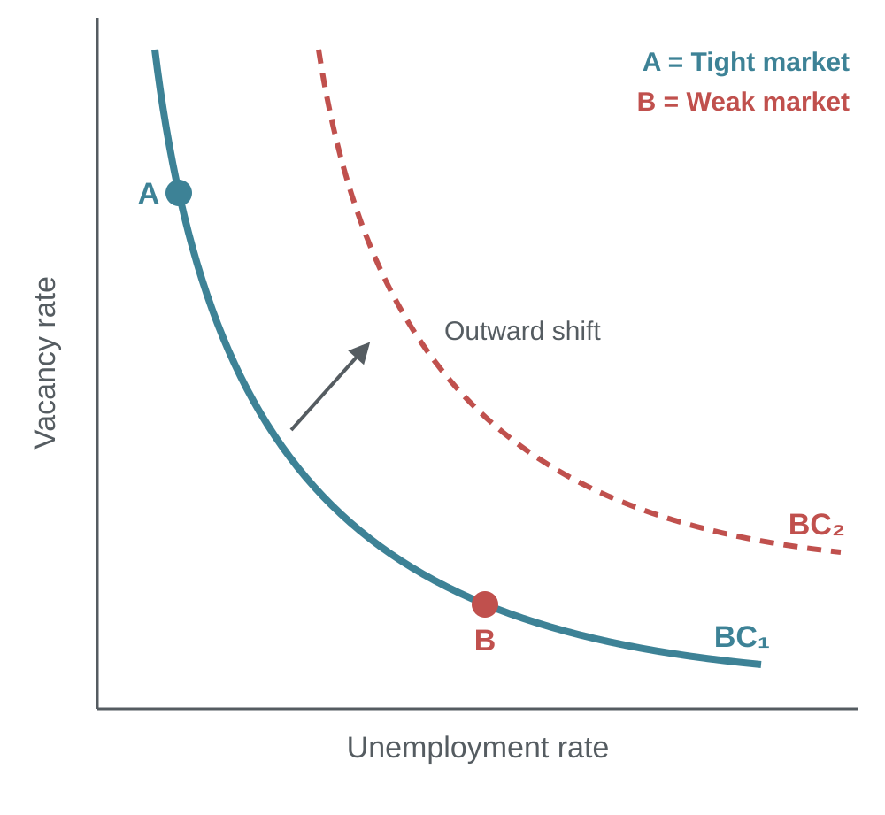

**1. Movement along the curve**
- Demand changes move the economy between A and B.

**2. Outward shift (BC₁ to BC₂)**
- Worse matching: more vacancies and more unemployment.
- Causes: skill and location mismatch.

Note:
Movement along the curve is cyclical. A shift of the curve is structural, so an outward shift means a higher natural rate.
Example: after 2008 and after COVID-19, the US curve shifted out. Firms posted many vacancies, but unemployment stayed high.
India has no official vacancy series, so the curve is hard to draw with Indian data.

---
## Reading the Beveridge Curve

### Business cycle and matching efficiency

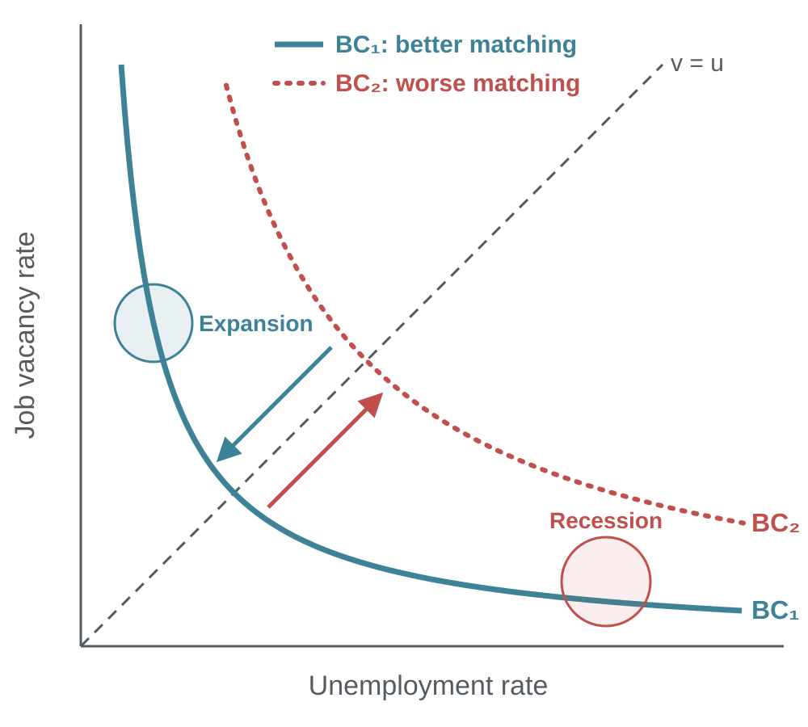

**1. Along the Curve: Business Cycle**
- Boom: firms post more vacancies and the unemployed find jobs fast (up-left).
- Recession: hiring stops, so vacancies fall and unemployment rises (down-right).

**2. Shift of the Curve: Matching Efficiency**
- Out (BC₁ → BC₂): more vacancies and more unemployed together, due to skill or location mismatch.
- In (BC₂ → BC₁): better matching through job portals, training or mobility.

**3. The v = u Line**
- Above it: more jobs than job seekers, so wages rise. Below it: slack.

> An outward shift raises the natural rate of unemployment.

Note:
Start with the axes: the vacancy rate on the vertical axis and the unemployment rate on the horizontal axis. Each point is one state of the labour market.
Movement along the curve is cyclical unemployment. A shift of the curve is structural and frictional unemployment.
Where the curve crosses the v = u line is a rough guide to the natural rate. An outward shift moves this point to the right.
Example: after COVID-19 the US curve shifted out. Firms reported record vacancies while many people were still unemployed.
Ask the class: a city has many unfilled software jobs and many unemployed factory workers. Is this a move along the curve or a shift? (Answer: a shift, due to skill mismatch.)

---
---
## The Costs of Unemployment

### Why high unemployment hurts the whole economy

**1. Output Loss**
- Labour is underused, so actual GDP falls below potential GDP.

**2. Human Capital**
- Skills depreciate. Long joblessness can reduce future productivity.

**3. Distribution**
- Income loss falls on affected households. Inequality and poverty risks rise.

> **Okun's Law:** When unemployment rises above its natural rate, output falls below potential. The link is negative, but its size varies across economies and over time.

Note:
Mankiw's US version: % change in real GDP = 3% − 2 × (change in the unemployment rate). So a 1 point rise in unemployment goes with about 2% lower output growth.
The coefficient differs by country and period. It depends on labour laws, hours flexibility and how much work is informal.
India: most workers are informal or self-employed, so output falls often show up as lower hours and earnings rather than open unemployment. The Okun link is usually weaker.

---
## Okun's Law

### Output and unemployment move in opposite directions

$$
\%\Delta Y = g - \beta \times \Delta u
$$

**Where:**
- %ΔY = growth rate of real GDP
- g = normal growth (potential) rate of output when unemployment is stable
- β = Okun's coefficient, the fall in growth for each 1-point rise in unemployment
- Δu = change in the unemployment rate (percentage points)

**Example (US, Mankiw):** g = 3% and β = 2. If unemployment rises by 1 point, GDP grows by 3% − 2 × 1 = 1%.

Note:
Source: Mankiw, Macroeconomics, using US data.
β is not a universal constant. It varies across economies and over time, with labour laws, hours flexibility and informality.
Gap form: when unemployment is above its natural rate, output is below potential. This links back to u = u* + cyclical unemployment.
India: most workers are informal or self-employed. A slowdown often shows up as fewer hours and lower earnings, not open unemployment, so the Okun link is weaker.

---
## Bridge from Inflation

### Recall: inflation is driven by demand, costs and expectations

**1. Demand-Pull Inflation**
- AD rises → labour demand rises → unemployment falls → wage pressure builds.

**2. Cost-Push Inflation**
- Energy or input costs rise → prices rise even if output and jobs weaken.

**3. Expectations**
- Expected inflation shapes wage bargaining and firms' price setting.

> **Key idea:** Unemployment is not just a labour-market outcome. It also signals demand pressure and possible wage-price dynamics.

Low unemployment does not automatically cause inflation. Supply shocks and expectations also matter.

Note:
This slide links the inflation chapter to unemployment and sets up the Phillips curve.
Productivity and firms' market power also affect inflation.
Slack means unused labour. High unemployment means more slack and less wage pressure. Low unemployment means less slack and more wage pressure.
India example: the 2022 inflation spike came mainly from food and fuel costs (cost-push), not from a tight labour market.

---
<!-- layout: image-left -->
## The Short-Run Phillips Curve

### The short-run trade-off

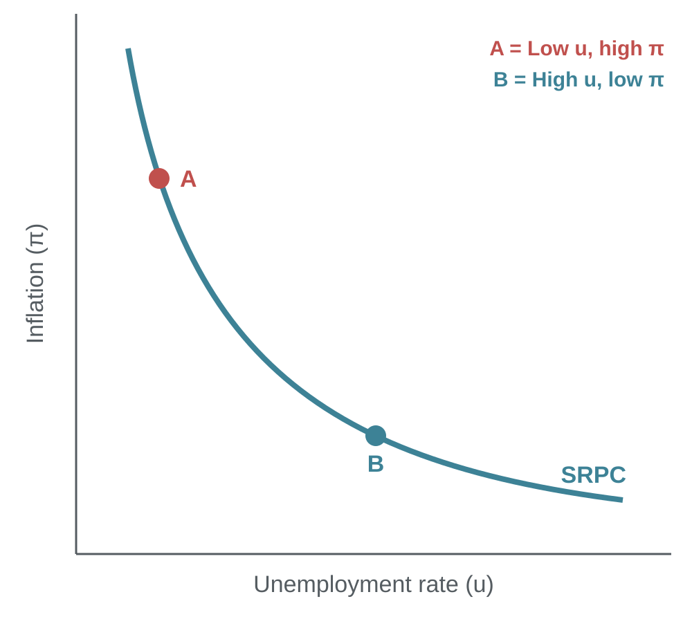

- Strong demand raises labour demand.
- Firms compete for workers, so wages rise.
- Firms pass higher costs on to prices.

> A short-run link, not a permanent policy menu.

Note:
Moving from B to A: demand rises, unemployment falls and inflation rises. Moving from A to B is the reverse.
Not a permanent menu: the curve holds only for given inflation expectations. If policy keeps unemployment below the natural rate, expectations rise and the curve shifts up. In the long run, unemployment returns to the natural rate.
This sets up the next slide on expectations and the long-run Phillips curve.
---
## Expectations-Augmented Phillips Curve

### Expected inflation shifts the short-run curve

$$
\pi = \pi^{e} - \alpha\,(u - u^{*}) + v
$$

**Where:**
- π = actual inflation
- πe = expected inflation
- α = how strongly inflation responds to the unemployment gap
- u − u* = unemployment gap (actual minus natural rate)
- v = supply shock, such as an oil price rise

**Interpretation:** If u is below u*, inflation rises above expected inflation. If u is above u*, inflation falls below expected inflation.

Note:
Source: Mankiw, Macroeconomics. Mankiw writes the same equation with β in place of α and u^n in place of u*.
A rise in π^e shifts the short-run curve up. This explains the 1970s stagflation on the previous slide: higher expectations plus oil shocks (v > 0).
Long run: expectations catch up, so π = π^e. With no supply shock, the equation then gives u = u*. The long-run Phillips curve is vertical at the natural rate.

---
## The Phillips Curve in US Data

### The trade-off holds in some periods and breaks down in others

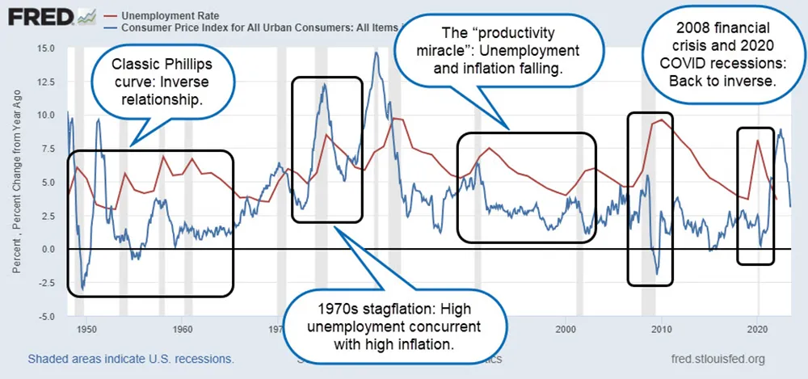

Source: FRED, Federal Reserve Bank of St. Louis. Red = unemployment rate, blue = CPI inflation.

Note:
1950s and 1960s: the classic inverse relationship. Low unemployment came with higher inflation.
1970s stagflation: oil shocks and rising inflation expectations shifted the short-run curve up. High unemployment and high inflation came together.
Late 1990s: a productivity boom let unemployment and inflation fall together.
2008 and 2020 recessions: unemployment jumped and inflation fell, so the inverse link returned.
Lesson: the short-run curve shifts with expectations and supply shocks. It is not a stable menu.

---
<!-- layout: steps -->
## Stagflation

### A negative supply shock raises prices and cuts output

1. **Input shock**: oil or food costs rise
2. **Supply falls**: SRAS shifts left
3. **Prices rise**: cost-push inflation
4. **Output falls**: firms produce less
5. **Jobs lost**: labour demand weakens

> **Policy dilemma:** Tightening cuts inflation but deepens the slowdown. Supporting demand protects jobs but prolongs inflation.

The right response depends on shock length, expectations and policy credibility.

Note:
Input shocks include oil, food and logistics costs.
In the Phillips curve equation, the supply shock is v > 0. Inflation rises at every unemployment rate, so the short-run curve shifts up.
Examples: the 1970s oil shocks in the US. In India, the 2022 food and fuel price rise was a supply shock, though it did not cause a large rise in unemployment.
If expectations stay anchored, a credible central bank can wait for a temporary shock to pass. If expectations rise, it must tighten even at the cost of jobs.

---
<!-- layout: image-left -->
## Stagflation in AD-AS

### A negative supply shock

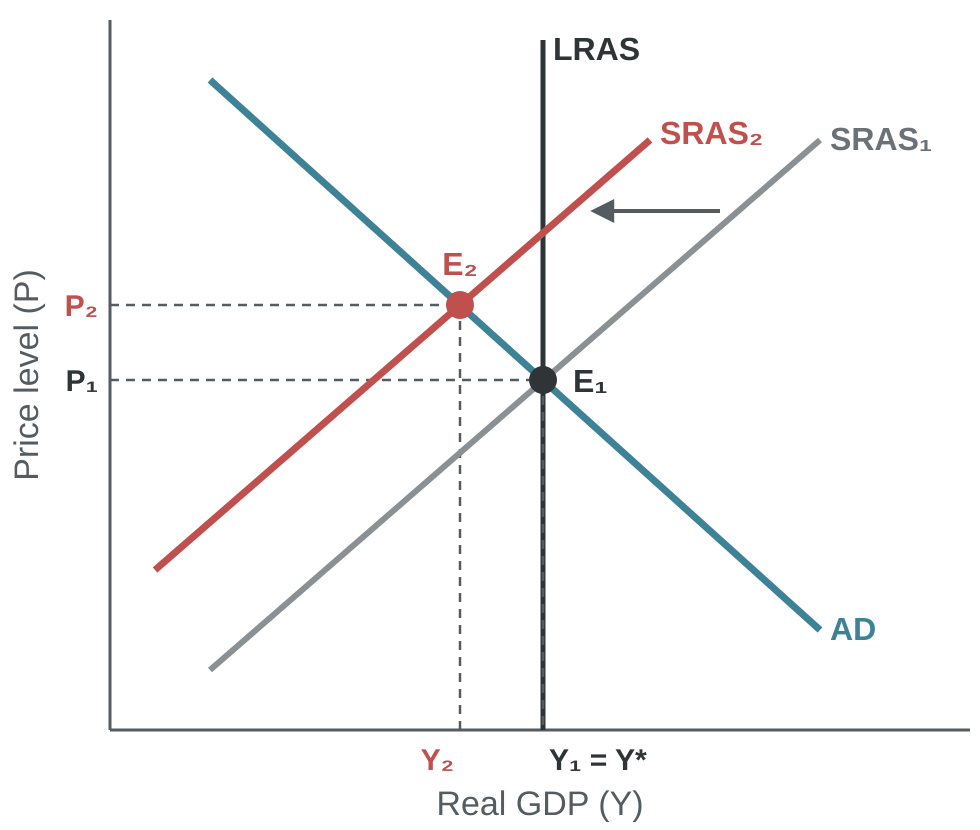

- SRAS shifts left: SRAS₁ to SRAS₂.
- Prices rise: P₁ to P₂.
- Output falls: Y₁ to Y₂, below potential.

> Higher inflation and higher unemployment together.

Note:
Start at E₁, where output is at potential (Y* on LRAS) and unemployment is at the natural rate.
An oil or food price shock raises firms' costs, so SRAS shifts left. The new equilibrium is E₂.
At E₂ the price level is higher and output is lower. Lower output means firms need fewer workers, so unemployment rises above the natural rate.
AD has not moved. This is why demand policy faces the dilemma on the previous slide: raising AD restores output but pushes prices higher still; cutting AD lowers prices but deepens the fall in output.

---
---
## Disinflation and the Sacrifice Ratio

### Lowering inflation has a short-run cost

**1. Disinflation**
- A fall in the rate of inflation. Prices still rise, but more slowly.
- Not deflation: in deflation, the price level itself falls.

**2. Sacrifice Ratio**
- Percent of a year's real GDP lost to cut inflation by 1 percentage point.

**3. Why disinflation rise unemployment in the Short Run**
- Tight monetary policy reduces aggregate demand.
- Firms sell and produce less, so hiring weakens.
- If expectations adjust slowly, output and jobs bear more of the cost.

Note:
Example: inflation falling from 6% to 4% is disinflation. Inflation of −1% is deflation.
Deflation can be harmful: people delay spending, and the real burden of debt rises.
Mankiw cites a typical US sacrifice ratio of about 5: cutting inflation by 1 percentage point costs about 5% of one year's GDP.
Example: the US Volcker disinflation of the early 1980s cut inflation sharply, but unemployment rose to about 10%.
Credibility lowers the sacrifice ratio. If people believe the central bank, expected inflation falls quickly and less output is lost. This links to π = π^e − α(u − u*) + v.
India: CPI inflation fell from about 10% in 2013 to about 4% by 2017, as the RBI moved to inflation targeting.

---
<!-- layout: table -->
## Policy Responses

### Match the policy to the type of unemployment

| Diagnosis | Possible response | Policy logic |
|---|---|---|
| **Cyclical** | Targeted fiscal support; monetary easing if inflation allows | Restore demand, watch inflation expectations |
| **Frictional** | Job information, placement services, mobility support | Cut search time, improve matching |
| **Structural** | Reskilling, apprenticeships, industry-education links | Fix skill and location mismatch |
| **Supply shock (stagflation)** | Protect vulnerable households; ease bottlenecks; anchor expectations | Do not treat a supply shock as excess demand |

> The same unemployment rate can come from very different problems.

Note:
India examples: cyclical, PM Garib Kalyan Yojana and RBI rate cuts in 2020; frictional, the National Career Service portal; structural, Skill India and the PM Internship Scheme; supply shock, export curbs and buffer stock releases for food prices.
Diagnose first, then choose the tool. Using demand stimulus for structural unemployment raises inflation without fixing the mismatch.

---
---
<!-- layout: case -->
## Mini Case: A Difficult Trade-off

### Provide policy suggestions (5 minutes)

**Output:** Growth slows for two consecutive quarters.

**Labour market:** Unemployment rises and vacancies fall.

**Prices:** Food and fuel inflation stay high.

**Questions:**
1. Is this demand-deficient unemployment, supply-shock stagflation, or both?
2. What evidence would you check before recommending a policy?
3. Would a broad interest-rate cut solve the problem? What could go wrong?

Note:
Suggested answer: likely a combination. Falling vacancies and rising unemployment point to weak demand (a move along the Beveridge curve). High food and fuel inflation points to a supply shock.
Evidence to check: core inflation (excluding food and fuel), inflation expectations, wage growth, capacity use, credit growth, and whether the price shock is temporary.
Rate cut risk: it supports demand, but if expectations are rising it can push inflation higher and hurt RBI credibility. Better mix: targeted fiscal support for affected households, supply-side steps on food and fuel, and rate cuts only if core inflation and expectations stay stable.

---
<!-- layout: takeaways -->
## Takeaways

### The labour market completes the inflation story

- Read the unemployment rate with participation and employment data.
- Frictional and structural unemployment remain at full employment. Cyclical unemployment follows the business cycle.
- The Beveridge curve shows matching efficiency. Okun's Law links unemployment and output.
- The short-run Phillips curve depends on expectations and supply shocks.
- Surprise inflation cannot buy lower unemployment for long. Credible policy and better labour markets can.

> **Question to leave with:** When inflation is high and unemployment is rising, what kind of shock is the economy facing?

Note:
Answer to the closing question: most likely a negative supply shock (stagflation), as in the AD-AS slide. Check core inflation and expectations to confirm.
The last takeaway is the long-run Phillips curve: in the long run, unemployment returns to the natural rate whatever the inflation rate.

---

---
<!-- layout: references -->
## References

### Textbooks and sources

- Mankiw, N. G. *Principles of Economics*. Cengage.
- Dornbusch, R., Fischer, S. and Startz, R. *Macroeconomics*. McGraw Hill.
- Mankiw, N. G. *Macroeconomics*. Worth Publishers.
- Ministry of Statistics and Programme Implementation (MoSPI). First press release of Consumer Price Index on base 2024 = 100, 12 February 2026.
- Reserve Bank of India. First Bi-monthly Monetary Policy Statement, 2014-15.
- Reserve Bank of India. Monetary Policy Statement, 7 October 2026.
- Federal Reserve Bank of St. Louis. FRED Economic Data. fred.stlouisfed.org
- Marginal Revolution University. *Zimbabwe and Hyperinflation: Who Wants to Be a Trillionaire?* (video)

---

<!-- layout: end -->
# Questions?
