# Income and Spending

### Module 4: The Keynesian Cross and the Multiplier

Dr. Pawan Ashok Kamble \
Assistant Professor \
Faculty Cabin: F61

---
<!-- layout: agenda -->
## Topics

1. Why we study this module
2. The Keynesian model
3. Aggregate demand and equilibrium output
4. The consumption function and aggregate demand
5. The multiplier
6. The government sector
7. The budget
8. The full-employment budget surplus
9. Case: India's capex-led fiscal strategy

---
<!-- layout: section -->
# Why We Study This Module

Output moves around its potential level. Why?

---
## Why Study This Module?

### One of the central questions in macroeconomics

**1. Output goes up and down**
- India's real GDP fell **5.8%** in 2020-21. It grew **7.8%** in Q1 2026-27.

**2. Modules 1 to 3 explained the long run**
- They did not explain these **short-run swings**.

**3. This module gives the first theory of these swings**
- Spending decides output and income.
- Output and income also decide spending.

---
<!-- layout: table -->
## Where This Module Fits

### From the long run to the short run

| Module | Question | Model |
|---|---|---|
| 1 to 3 | How is output measured, and how does it grow? | The long run |
| **4 (this)** | **What sets output when prices are fixed?** | **The Keynesian cross** |
| 5 | How do interest rates affect demand? | IS-LM |
| 6 | How does trade matter? | The open economy |
| 7 | What happens when prices adjust? | Aggregate supply |

> This module is the **first building block** of the IS-LM model.

---
## What You Will Be Able to Do

### Three questions, answered by the end of the session

1. **Output:** What sets the level of output when prices do not change?
2. **Multiplier:** Why does ₹1 of extra spending raise output by more than ₹1?
3. **Fiscal policy:** How do government spending, taxes and transfers change output and the budget deficit?

> **Managerial use:** forecast demand after a Budget, a tax change or a fall in exports.

---
<!-- layout: section -->
# The Keynesian Model

Prices are fixed. Demand decides output.

---
## The Keynesian Model

### The central simplification

**1. Prices do not change at all**
- Firms sell any amount of output at the given price level.
- So the aggregate supply curve is **flat**.

**2. Spending and output feed each other**
- Spending determines output and income.
- Income in turn determines spending, mainly consumption.

**3. The key result**
- A rise in autonomous spending raises output by **more** than the rise in spending.

---
<!-- layout: compare -->
## Classical vs Keynesian

|||

### Classical

- Prices and wages are flexible
- AS is vertical at potential output Y\*
- **Supply** decides output
- More demand only raises prices

|||

### Keynesian

- Prices and wages are fixed in the short run
- AS is flat
- **Demand** decides output
- More demand raises output

---
## Short Run vs Long Run

### The same rise in demand, two different results

- **Short run:** flat AS. More AD raises **output**.
- **Long run:** vertical AS at Y\*. More AD raises only **prices**.
- This module: the **short run**.

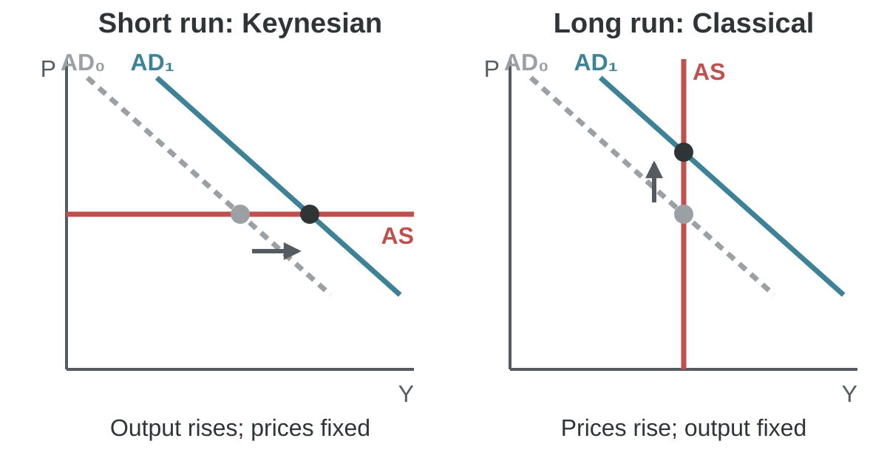

---
<!-- layout: steps -->
## The Spending Loop

### Why a fall in spending feeds on itself

1. **Spending falls**: households or firms spend less
2. **Sales fall**: stocks pile up
3. **Output falls**: firms cut production
4. **Income falls**: wages and profits fall
5. **Spending falls again**: lower income, lower consumption

> The loop also works in reverse. This is the **multiplier**.

---
<!-- layout: table -->
## Notation Used in This Module

### Symbols used on every slide

| Symbol | Meaning | Symbol | Meaning |
|---|---|---|---|
| Y | Output = income | C̄ | Autonomous consumption |
| AD | Aggregate demand | c | MPC |
| C, I | Consumption, investment | s | MPS = 1 − c |
| G, NX | Government purchases, net exports | Ā | Autonomous spending |
| IU | Unplanned inventory change | t | Income tax rate |
| TA, TR | Taxes, transfers | BS | Budget surplus |

> A **bar** over a variable (Ā, C̄, Ḡ) means it is **autonomous**: it does not depend on income.

---
<!-- layout: section -->
# Aggregate Demand and Equilibrium Output

When is output at its equilibrium level?

---
## Aggregate Demand and Equilibrium Output

### Aggregate demand is the total amount of goods demanded in the economy

$$
AD = C + I + G + NX
$$

**Equilibrium:** output produced equals output demanded.

$$
Y = AD = C + I + G + NX
$$

**Unplanned inventory change:**

$$
IU = Y - AD
$$

---
<!-- layout: table -->
## How Firms Reach Equilibrium

### Inventories send the signal

| Situation | Unplanned inventory | What firms do | Output |
|---|---|---|---|
| **Y > AD** | Stocks pile up: IU > 0 | Cut production | Falls |
| **Y < AD** | Stocks run down: IU < 0 | Raise production | Rises |
| **Y = AD** | No change: IU = 0 | Keep production | **Equilibrium** |

> **India example:** when car sales slowed in 2019, unsold stocks piled up at dealers, and carmakers cut production days.

---
<!-- layout: section -->
# The Consumption Function and Aggregate Demand

How does consumption depend on income?

---
## The Consumption Function

### For now: no government, no foreign trade (G = NX = 0)

- **C = C̄ + cY**, with 0 < c < 1
- C̄: consumption when income is zero.
- c: the **marginal propensity to consume (MPC)**.
- **Example:** c = 0.8. If income rises by ₹150, consumption rises by ₹120.

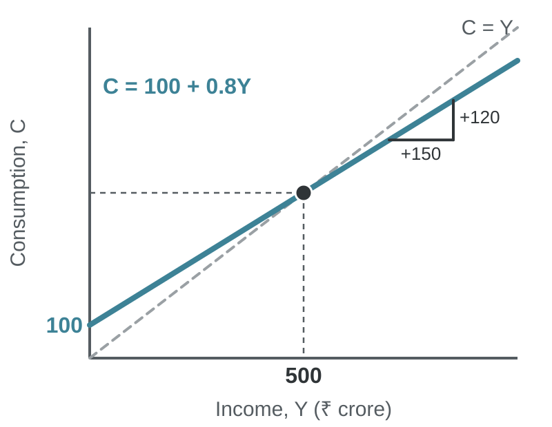

---
## Consumption and Saving

### Income not spent is saved

- Budget constraint: **S = Y − C**
- Saving function: **S = −C̄ + (1 − c)Y**
- **Marginal propensity to save:** s = 1 − c.
- **Example:** c = 0.8, so s = 0.2.

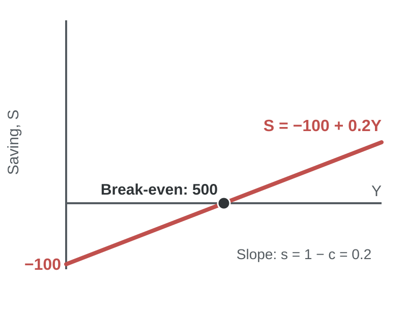

---
<!-- layout: stat -->
## The Consumption Function in Practice

|||

# 0.97

**US:** consumption rises by 97 cents per $1 of disposable income, 1960 to 2008

|||

# 55%

**India:** private consumption is about 55% of GDP, the largest part of aggregate demand

---
<!-- layout: activity -->
## Quick Check: MPC and MPS

### Two minutes

A household's monthly income rises from ₹80,000 to ₹1,00,000. Its consumption rises from ₹70,000 to ₹85,000.

1. What is the MPC?
2. What is the MPS?
3. Income rises by another ₹10,000. How much more will it consume?

---
## Quick Check: Solution

### Use the change in income, not the level

**(1) and (2) MPC and MPS**
- **Step 1:** Change in income: ΔY = 1,00,000 − 80,000 = ₹20,000
- **Step 2:** Change in consumption: ΔC = 85,000 − 70,000 = ₹15,000
- **Step 3:** MPC: c = ΔC ÷ ΔY = 15,000 ÷ 20,000 = **0.75**
- **Step 4:** MPS: s = 1 − c = 1 − 0.75 = **0.25**

**(3) Next ₹10,000 of income**
- **Step 1:** ΔC = c × ΔY = 0.75 × 10,000 = **₹7,500**

---
## Adding Investment, Government and Net Exports

### Aggregate demand, AD = Ā + cY

- Disposable income: **YD = Y − TA + TR**
- Consumption: **C = C̄ + c(Y − TA + TR)**
- **AD = Ā + cY**, where Ā = C̄ − c(TA − TR) + I + G + NX
- Ā is **autonomous spending**. The slope of AD is c.

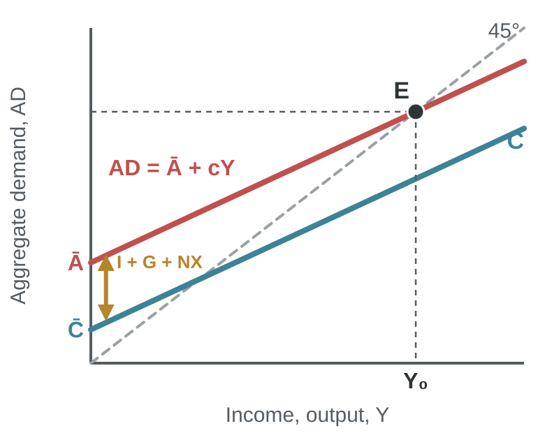

---
## Equilibrium: The Keynesian Cross

### Where aggregate demand meets the 45° line

- On the **45° line**, AD = Y.
- **E** is the only point where AD = Y. Output is Y₀.
- Below Y₀: AD > Y, IU < 0. Firms raise output.
- Above Y₀: AD < Y, IU > 0. Firms cut output.

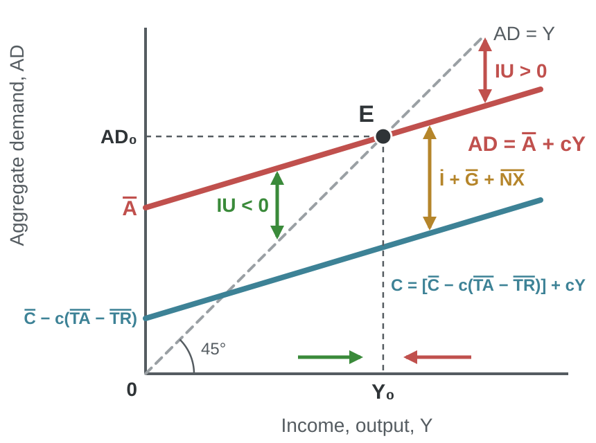

---
## The Formula for Equilibrium Output

### Solve Y = AD for Y

$$
Y = \bar{A} + cY \;\;\Rightarrow\;\; Y_0 = \frac{1}{1 - c}\,\bar{A}
$$

- Higher Ā (a higher AD line) gives a higher Y₀.
- Higher c (a steeper AD line) gives a higher Y₀.

**For a change in Ā:**

$$
\Delta Y_0 = \frac{1}{1 - c}\,\Delta\bar{A}
$$

- **Example:** c = 0.9, so 1 ÷ (1 − c) = 10. ₹1 crore more spending raises output by ₹10 crore.

---
## Saving Equals Investment

### Another way to write the equilibrium condition

**1. No government, no foreign trade**
- Income is consumed or saved: Y = C + S
- Spending: Y = C + I
- So C + S = C + I, which gives **S = I**

**2. With government and foreign trade**

$$
I = S + (TA - TR - G) - NX
$$

- Investment = private saving + government budget surplus − net exports.

---
## The Paradox of Thrift

### If everyone tries to save more, income falls

- People try to save more at every income level: S shifts up, from S₁ to S₂.
- Spending falls, so output falls from Y₁ to Y₂.
- In the new equilibrium, saving is **back to I**. Total saving does not rise.
- **India, 2020-21:** households cut spending and saved more out of caution. This deepened the fall in demand.

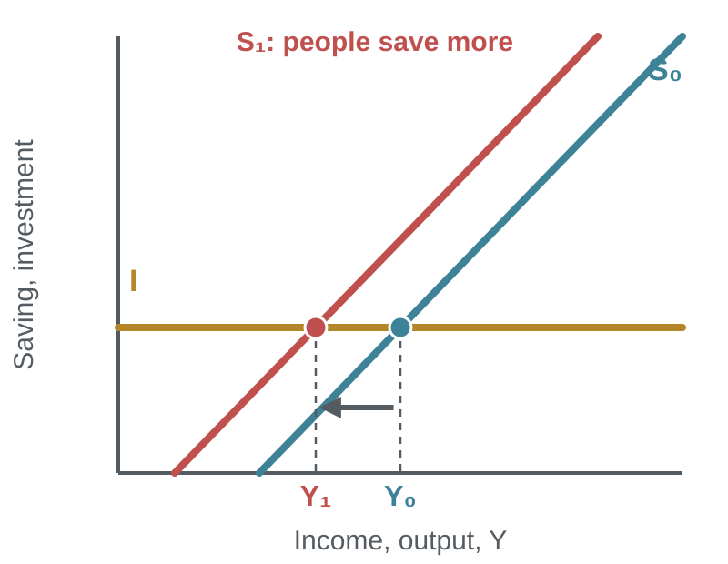

---
<!-- layout: activity -->
## Problem 1

### No government, no foreign trade (₹ crore)

The consumption function is **C = 100 + 0.8Y**. Investment is **I = 50**.

1. What is the equilibrium level of income?
2. What is the level of saving in equilibrium?
3. If output is 800, what is unplanned inventory accumulation?
4. If I rises to 100, what is the new equilibrium income?
5. What is the multiplier?

---
## Problem 1: Solution, Parts (a) and (b)

### C̄ = 100, c = 0.8, I = 50

**(a) Equilibrium income**
- **Step 1:** Ā = C̄ + I = 100 + 50 = 150
- **Step 2:** 1 − c = 1 − 0.8 = 0.2
- **Step 3:** Y₀ = Ā ÷ (1 − c) = 150 ÷ 0.2 = **750**

**(b) Saving in equilibrium**
- **Step 1:** C = 100 + 0.8 × 750 = 700
- **Step 2:** S = Y − C = 750 − 700 = **50**
- **Check:** S = I = 50

---
## Problem 1: Solution, Parts (c) to (e)

### Same economy: C = 100 + 0.8Y, I = 50

**(c) Output is 800**
- **Step 1:** AD = 100 + 0.8 × 800 + 50 = 790
- **Step 2:** IU = Y − AD = 800 − 790 = **+10** (stocks pile up)

**(d) Investment rises to 100**
- **Step 1:** Ā = 100 + 100 = 200
- **Step 2:** Y₀ = 200 ÷ 0.2 = **1,000**

**(e) Multiplier**
- **Step 1:** α = 1 ÷ (1 − 0.8) = **5**
- **Check:** ΔY ÷ ΔI = 250 ÷ 50 = 5

---
## Problem 1: The Diagram

### Part (f): equilibria in (a) and (d)

- AD₀ = 150 + 0.8Y. AD₁ = 200 + 0.8Y.
- AD shifts up by 50.
- E₀ to E₁: Y rises from 750 to 1,000.
- ΔY = **250**, five times ΔI.

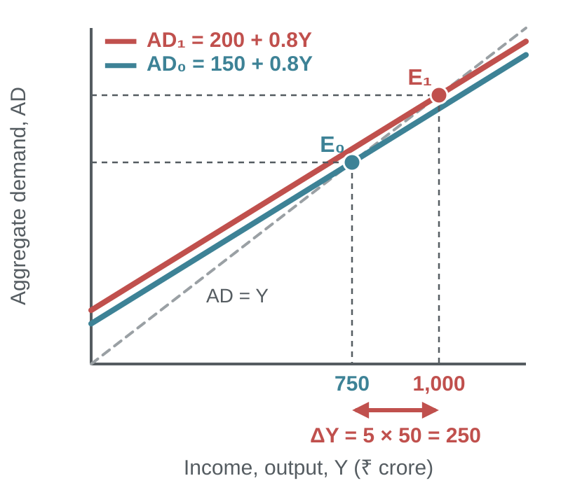

---
## Problem 2

### Consumers now spend more of each rupee: C = 100 + 0.9Y, I = 50

**(a) New equilibrium income**
- **Step 1:** Ā = 100 + 50 = 150
- **Step 2:** 1 − c = 1 − 0.9 = 0.1
- **Step 3:** Y₀ = 150 ÷ 0.1 = **1,500** (higher than 750)

**(b) Investment rises to 100**
- **Step 1:** Ā = 100 + 100 = 200
- **Step 2:** Y₀ = 200 ÷ 0.1 = **2,000**

**(c) Compare with Problem 1**
- Output rises by **500**, not 250. A higher MPC gives a larger multiplier (10, not 5).

---
<!-- layout: section -->
# The Multiplier

Why does ₹1 of spending raise output by more than ₹1?

---
## The Multiplier

### By how much does ₹1 more autonomous spending raise income?

**A simple answer is wrong:** ₹1 more spending does **not** raise income by only ₹1.

**Example:** the government spends ₹100 crore more on a road. c = 0.8.
- **Round 1:** contractors and workers earn ₹100 crore more.
- **Round 2:** they spend 80% of it: ₹80 crore more demand.
- **Round 3:** those who receive ₹80 crore spend ₹64 crore.

Each round is smaller than the last, so the total is finite.

---
<!-- layout: table -->
## The Multiplier, Round by Round

### ₹100 crore of extra autonomous spending, c = 0.8

| Round | Rise in demand this round | Total rise in income |
|---|---|---|
| 1 | ΔĀ = 100.0 | 100.0 |
| 2 | cΔĀ = 80.0 | 180.0 |
| 3 | c²ΔĀ = 64.0 | 244.0 |
| 4 | c³ΔĀ = 51.2 | 295.2 |
| … | … | … |
| **All rounds** | | **ΔĀ ÷ (1 − c) = 500** |

---
## The Multiplier Formula

### Add up all the rounds

- $\Delta AD = \Delta\bar{A}(1 + c + c^2 + c^3 + \dots)$
- $\Delta Y_0 = \dfrac{1}{1-c}\,\Delta\bar{A}$
- **Multiplier:** $\alpha = \dfrac{1}{1-c}$
- c = 0.6: α = 2.5. c = 0.8: α = 5.

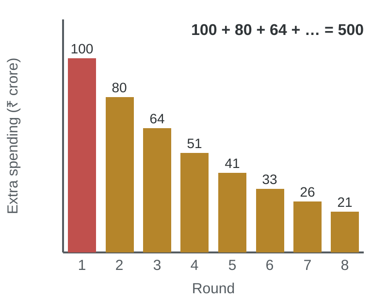

---
## The Multiplier in Pictures

### Autonomous spending rises by 100, c = 0.6

- AD shifts up in parallel by ΔĀ = 100.
- At Y₀, demand now exceeds output. Stocks run down.
- Firms raise output. Higher income raises consumption.
- New equilibrium: output rises by **250** (α = 2.5).

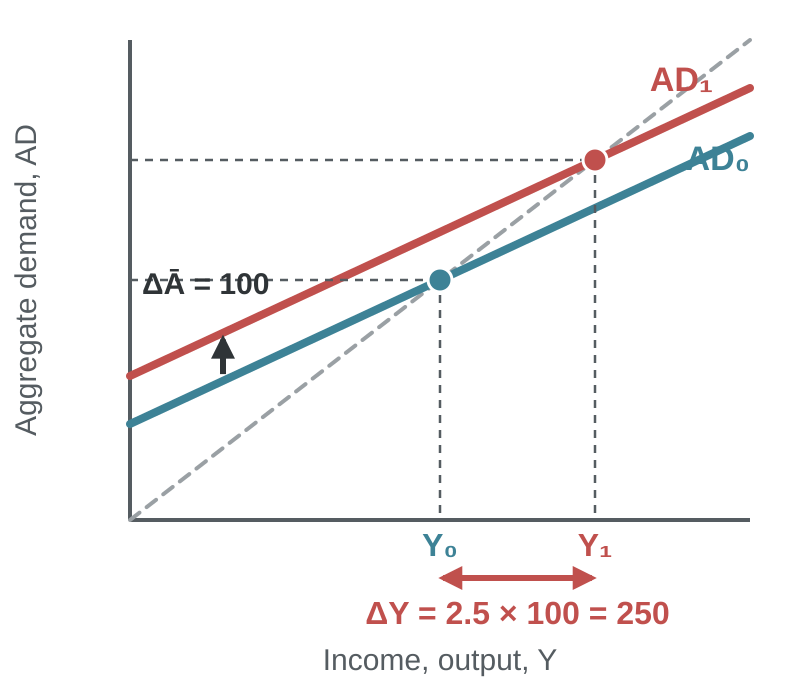

---
<!-- layout: interactive -->
## Interactive: The Multiplier

@[Keynesian cross and the multiplier](shared/interactives/keynesian-cross.html)

---
## Using the Interactive

### Try these four experiments in class

1. **Play the rounds:** press Play. Output climbs to Y₁ in smaller and smaller steps.
2. **Raise the MPC:** move c from 0.8 to 0.9. AD gets steeper. The multiplier rises.
3. **Raise the tax rate:** move t from 25% to 40%. Each round leaks more. The multiplier falls.
4. **Cut spending:** set ΔG below zero. Output falls by a multiple.

> Switch to **Rounds** to see each round's spending and the running total.

---
## The Multiplier in Practice

### Evidence from the US and India

- Real multipliers are smaller than 1 ÷ (1 − c).
- **US:** Robert Hall estimates the multiplier at about **1.7**.
- **India (NIPFP):** ₹1 of capital spending raises GDP by about **₹2.45**. Transfers raise it by **less than ₹1**.
- Why smaller: saving, taxes, imports, and interest rates (Module 5).

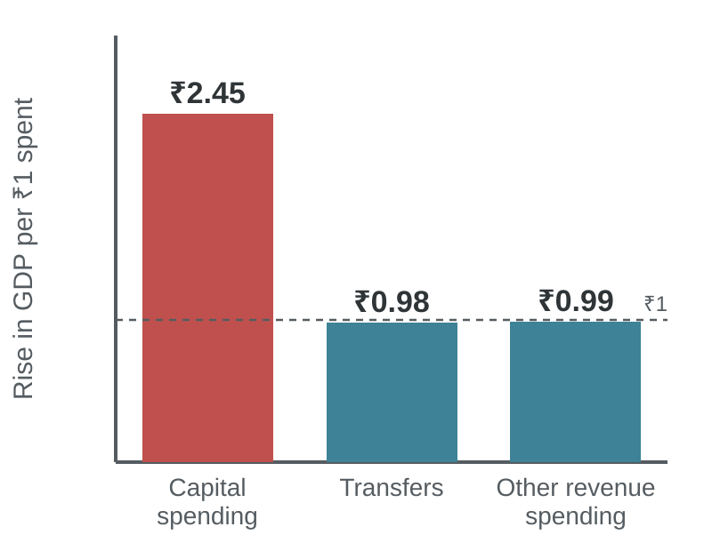

---
<!-- layout: takeaways -->
## Recap: The Multiplier

### Three points to remember

- An increase in autonomous spending raises the equilibrium level of income.
- The increase in income is a **multiple** of the increase in autonomous spending.
- The larger the MPC, the larger the multiplier.

---
<!-- layout: section -->
# The Government Sector

How do purchases, transfers and taxes change output?

---
## The Government Sector

### Fiscal policy: purchases, transfers and the tax structure

$$
G = \bar{G}, \qquad TR = \overline{TR}, \qquad TA = tY
$$

- **G:** purchases of goods and services: roads, defence, salaries.
- **TR:** transfers: pensions, PM-KISAN. They add to income but buy no goods directly.
- **TA = tY:** a proportional income tax at rate t.

**Consumption function with government:**

$$
C = \bar{C} + c\overline{TR} + c(1 - t)Y
$$

---
## Income Taxes Flatten the AD Line

### MPC out of income falls from c to c(1 − t)

- **AD = Ā + c(1 − t)Y**
- Ā = C̄ + cTR + I + G + NX
- Of each extra ₹1 of income, households keep only (1 − t).
- **Example:** c = 0.8, t = 0.25. Slope = 0.8 × 0.75 = **0.6**.

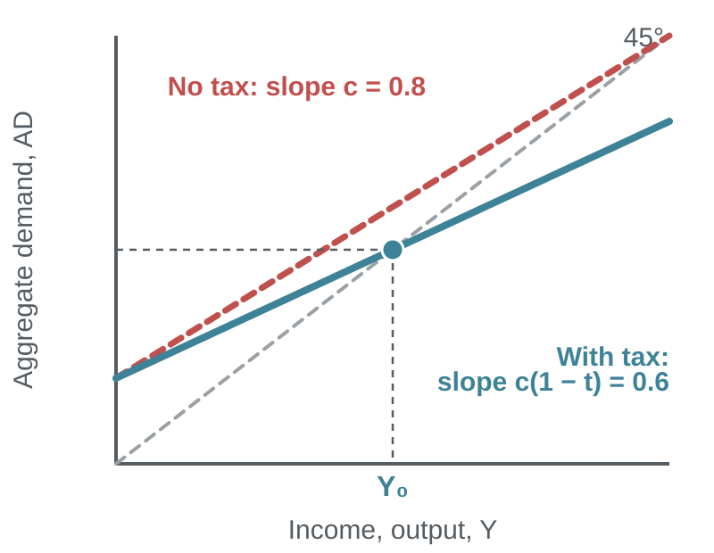

---
## Equilibrium Income with Government

### Solve Y = Ā + c(1 − t)Y

$$
Y_0 = \frac{\bar{A}}{1 - c(1 - t)}
$$

**Compared with the model without government, the government:**
1. adds G to autonomous spending,
2. adds c × TR to autonomous spending, and
3. lowers the multiplier through the income tax.

---
## Income Taxes and the Multiplier

### Taxes cut the multiplier

- With c = 0.8 and no tax: multiplier = **5**.
- With c = 0.8 and t = 0.25: multiplier = 1 ÷ (1 − 0.6) = **2.5**.
- The tax takes a share of every round of extra income.
- So less is spent in each round.

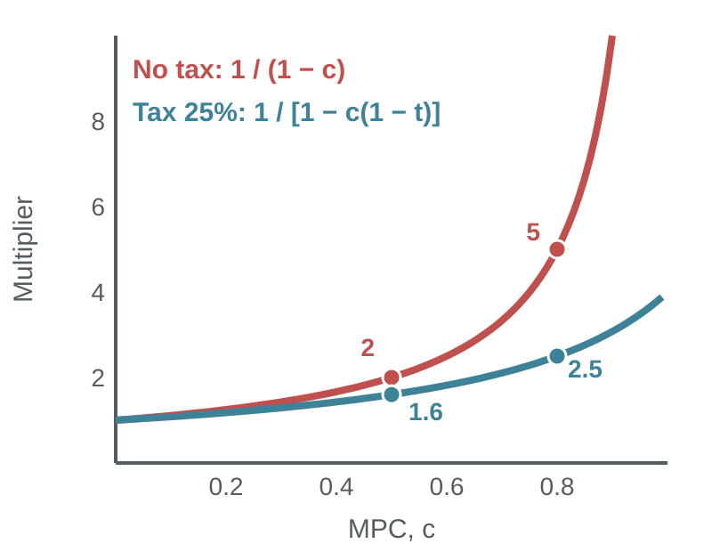

---
## Income Taxes as Automatic Stabilisers

### They reduce output swings without any new decision

- Same fall in demand (−50). Output falls by **250** with no tax, by **125** with t = 0.25.
- Unemployment benefits work the same way: TR rises when Y falls.
- **India:** the income tax base is narrow, and there is no unemployment insurance. MGNREGA acts as a stabiliser.

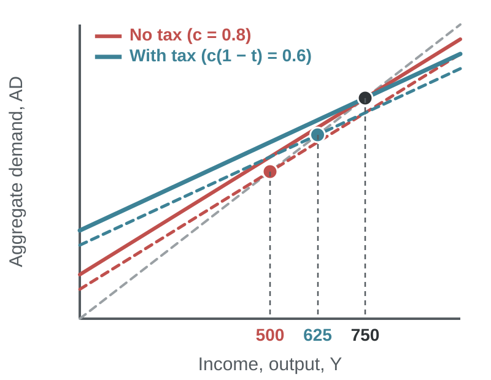

---
## Effects of a Change in Fiscal Policy

### Government purchases rise by 60

- $\Delta Y_0 = \alpha_G\,\Delta\bar{G}$
- $\alpha_G = \dfrac{1}{1 - c(1 - t)}$
- With c = 0.8 and t = 0.25: αG = 2.5.
- ΔG = 60 raises output by 2.5 × 60 = **150**.

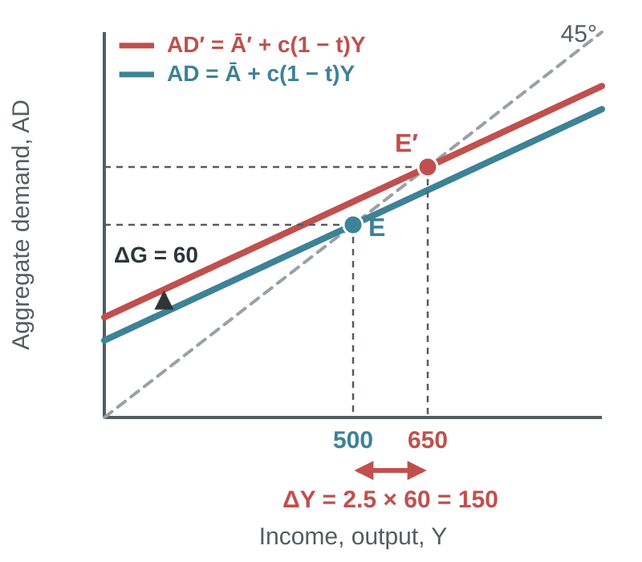

---
<!-- layout: table -->
## Purchases, Transfers and the Tax Rate

### c = 0.8 and t = 0.25, so αG = 2.5

| Policy change | Effect on Ā | Effect on output | ₹100 crore change |
|---|---|---|---|
| **Raise purchases, ΔG** | + ΔG | αG × ΔG | Y rises by ₹250 crore |
| **Raise transfers, ΔTR** | + c × ΔTR | αG × c × ΔTR | Y rises by ₹200 crore |
| **Raise the tax rate, t** | No change | AD flatter, multiplier smaller | Y falls |

> Transfers have a smaller effect than purchases: households **save part** of each transfer.

---
<!-- layout: takeaways -->
## Recap: The Government Sector

### Four points to remember

- Government purchases and transfers act like increases in autonomous spending.
- An income tax works like a fall in the MPC: it lowers the multiplier.
- An income tax is an automatic stabiliser.
- A cut in transfers lowers output.

> **Implication:** in a slump, cut taxes or raise spending. In a boom, do the reverse.

---
## Limits of Fiscal Policy

### Why a government cannot fix every slump by spending more

1. **Time lags:** the slump must be noticed, a Budget passed and projects started. India's Union Budget comes once a year.
2. **Deficit and debt limits:** India now targets a debt-to-GDP ratio of about 50% by 2030-31.
3. **Leakages:** saving, taxes and imports reduce the multiplier.
4. **Interest rates:** more government borrowing can raise interest rates and reduce private investment (Module 5).

---
<!-- layout: section -->
# The Budget

How does fiscal policy change the budget deficit?

---
## The Budget Surplus

### Tax revenue rises with income

- $BS = TA - \bar{G} - \overline{TR}$
- $BS = tY - \bar{G} - \overline{TR}$
- A negative BS is a **budget deficit**.
- Low income: low tax revenue, so a deficit. So deficits rise in recessions even if policy does not change.

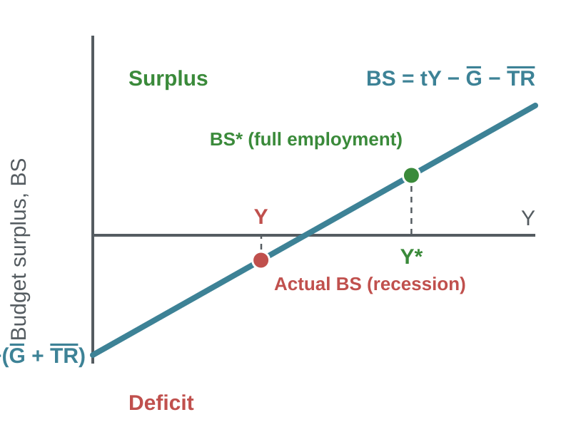

---
## India's Fiscal Deficit

### Centre's fiscal deficit, % of GDP

- **FY21:** the deficit jumped to **9.2%**. Tax revenue fell in the COVID-19 slump, and spending rose.
- As output recovered, revenue rose and the deficit fell.
- Budget target for FY27: **4.3%**.

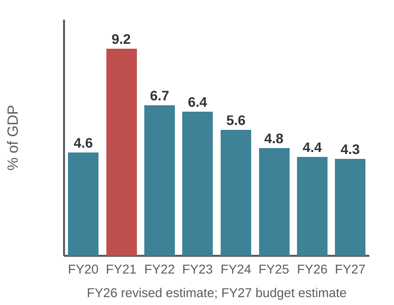

---
## Does More Spending Raise the Deficit?

### Yes, but by less than the extra spending

$$
\Delta BS = t\,\alpha_G\,\Delta\bar{G} - \Delta\bar{G} = -\frac{(1-c)(1-t)}{1-c(1-t)}\,\Delta\bar{G}
$$

**Example: c = 0.8, t = 0.25, G rises by ₹1**
- **Step 1:** Output rises by αG × 1 = ₹2.50
- **Step 2:** Tax revenue rises by t × 2.50 = 0.25 × 2.50 = ₹0.625
- **Step 3:** ΔBS = 0.625 − 1 = **−₹0.375**

---
## Tax Rates and the Balanced Budget Multiplier

### Two more results

**1. A higher tax rate raises the budget surplus**
- It lowers income, but tax revenue still rises.
- See Problem 3 below.

**2. The balanced budget multiplier is 1**
- Raise G and taxes by the **same** amount, so the budget surplus does not change.
- Output rises by exactly the rise in G.
- **Example:** ₹100 crore more spending, paid for by ₹100 crore more tax, raises output by ₹100 crore.

---
<!-- layout: activity -->
## Problem 3

### An economy with a government (₹ crore)

C = 50 + 0.8YD, I = 70, G = 200, TR = 100, t = 0.20

1. Find equilibrium income and the multiplier.
2. Find the budget surplus, BS.
3. t rises to 0.25. Find the new equilibrium income and multiplier.
4. Find the change in the budget surplus.
5. Why is the multiplier 1 when t = 1?

---
## Problem 3: Solution, Parts (a) and (b)

### C̄ = 50, c = 0.8, I = 70, G = 200, TR = 100, t = 0.20

**(a) Equilibrium income and multiplier**
- **Step 1:** Ā = C̄ + cTR + I + G = 50 + 0.8 × 100 + 70 + 200 = 400
- **Step 2:** c(1 − t) = 0.8 × 0.8 = 0.64
- **Step 3:** αG = 1 ÷ (1 − 0.64) = 1 ÷ 0.36 = **2.78**
- **Step 4:** Y₀ = 2.78 × 400 = **1,111.1**

**(b) Budget surplus**
- **Step 1:** Tax revenue tY = 0.20 × 1,111.1 = 222.2
- **Step 2:** BS = tY − G − TR = 222.2 − 200 − 100 = **−77.8** (a deficit)

---
## Problem 3: Solution, Parts (c) to (e)

### The tax rate rises from 0.20 to 0.25

**(c) New equilibrium income and multiplier**
- **Step 1:** c(1 − t) = 0.8 × 0.75 = 0.60
- **Step 2:** αG = 1 ÷ (1 − 0.60) = **2.5**
- **Step 3:** Y₀ = 2.5 × 400 = **1,000**

**(d) Change in the budget surplus**
- **Step 1:** New BS = 0.25 × 1,000 − 200 − 100 = −50
- **Step 2:** ΔBS = −50 − (−77.8) = **+27.8**. Output falls, but the deficit falls too.

**(e) If t = 1**
- c(1 − t) = 0, so αG = 1. All extra income is taxed, so there is no extra consumption.

---
## Problem 4

### Cut transfers by 10, raise purchases by 10: c = 0.8, t = 0.25, Y₀ = 600

**(a) Will output rise or fall?**
- It rises. Purchases are spent in full. Only c of each transfer was spent.

**(b) Change in equilibrium income**
- **Step 1:** ΔĀ = ΔG + cΔTR = 10 + 0.8 × (−10) = 2
- **Step 2:** αG = 1 ÷ (1 − 0.6) = 2.5
- **Step 3:** ΔY₀ = 2.5 × 2 = **5**

**(c) Change in the budget surplus**
- **Step 1:** ΔTA = t × ΔY₀ = 0.25 × 5 = 1.25
- **Step 2:** ΔBS = ΔTA − ΔG − ΔTR = 1.25 − 10 + 10 = **+1.25**

---
<!-- layout: section -->
# The Full-Employment Budget Surplus

How do we measure what fiscal policy is doing?

---
## The Full-Employment Budget Surplus

### The budget surplus at potential output, Y\*

$$
BS^{*} = tY^{*} - \bar{G} - \overline{TR}
$$

**Why we need it**
- The actual deficit changes when private spending changes, even if policy does not.
- So the actual deficit is a poor measure of fiscal policy.

**Other names:** cyclically adjusted surplus, structural surplus, high-employment surplus.

---
## Actual vs Full-Employment Budget

### The difference comes from tax revenue

$$
BS^{*} - BS = t(Y^{*} - Y)
$$

- **Recession (Y < Y\*):** BS\* is larger than the actual BS. The gap is the **cyclical** deficit.
- **Boom (Y > Y\*):** BS\* is smaller than the actual BS.
- **India, FY21:** much of the jump to 9.2% was cyclical. It fell as output recovered.

> **Caution:** Y\* is not known for certain, so estimates of BS\* differ.

---
<!-- layout: section -->
# Case: India's Capex-Led Fiscal Strategy

Relating the case to the concepts

---
<!-- layout: case -->
## Case: India's Capex-Led Fiscal Strategy

### Spending more on assets while cutting the deficit

**Situation:** After COVID-19, the Centre chose to support growth through **capital expenditure** (roads, railways, defence, housing) rather than large cash transfers.

- Capex nearly **tripled**: ₹4.3 lakh crore in FY21 to ₹12.2 lakh crore in FY27 (budget).
- The fiscal deficit fell from 9.2% to 4.3% of GDP.

**Question:** Use the Keynesian cross and the multiplier to explain this choice.

---
## Capex Has Risen Every Year

### Centre's capital expenditure, ₹ lakh crore

- FY27 budget: **₹12.2 lakh crore**, up from ₹11.2 lakh crore in FY26.
- Total spending in FY27: ₹54.1 lakh crore. Capex is about **22%** of it.
- Revenue spending (salaries, interest, subsidies) grew more slowly.

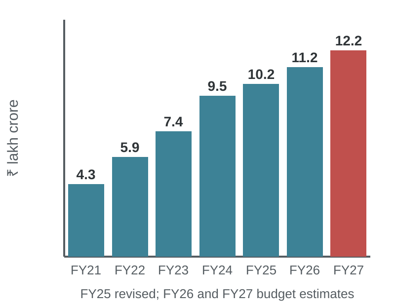

---
<!-- layout: table -->
## Relating the Case to the Concepts

### What the model says about India's choice

| Concept | What it means for the case |
|---|---|
| **Autonomous spending, Ā** | Capex is part of G. It shifts AD up directly |
| **Multiplier** | Capex ≈ 2.45; transfers ≈ 1 |
| **Purchases vs transfers** | Transfers are partly saved. Capex is spent in full |
| **Budget surplus** | Higher output raises tax revenue |
| **Full-employment budget** | Part of the fall in the deficit since FY21 was cyclical |
| **Long run (Module 2)** | Roads and railways also raise potential output Y\* |

---
## Case: A Rough Calculation

### Extra capex of ₹1 lakh crore in FY27 (₹11.2 to ₹12.2 lakh crore)

**Capex**
- **Step 1:** Rise in GDP = 2.45 × ₹1 lakh crore ≈ **₹2.45 lakh crore**
- **Step 2:** GDP in FY27 is about ₹392 lakh crore
- **Step 3:** Share of GDP = 2.45 ÷ 392 ≈ **0.6%**

**If the same money were spent as transfers**
- **Step 1:** Rise in GDP = 0.98 × ₹1 lakh crore ≈ ₹1 lakh crore
- **Step 2:** Share of GDP = 0.98 ÷ 392 ≈ **0.25%**

> This is a first-year, demand-side estimate. Imports, interest rates and supply limits can make the actual effect smaller.

---
<!-- layout: table -->
## Other Fiscal Tools India Has Used

### Linking each tool to the model

| Measure | In the model | Effect |
|---|---|---|
| **Income tax relief, Budget 2025** (no tax up to ₹12 lakh) | Lower t | Higher YD and a larger multiplier |
| **GST 2.0, 22 September 2025** (two main rates, 5% and 18%) | Indirect tax cut | About ₹2 lakh crore back to households |
| **PM-KISAN** (₹6,000 a year to farmers) | Higher TR | Output rises by αG × c × ΔTR |
| **Food and cash support, 2020** | Higher TR | Protected consumption when income fell |

---
<!-- layout: discussion -->
## Discussion: Capex or Tax Cuts?

### Think for two minutes, then discuss in pairs

- Should the next Budget raise capex further, or cut taxes to boost consumption?
- Which has the bigger multiplier? Which helps more in the long run?
- What happens to the budget deficit in each case?

---
<!-- layout: takeaways -->
## Summary

### Key points from this module

- Output is at equilibrium when aggregate demand equals output: Y = AD.
- Inventory changes move output towards equilibrium.
- Consumption rises with income: C = C̄ + cY. Saving is S = −C̄ + (1 − c)Y.
- Equilibrium output: Y₀ = Ā ÷ (1 − c). The multiplier is α = 1 ÷ (1 − c).
- Purchases and transfers act like autonomous spending. Income taxes lower the multiplier to 1 ÷ [1 − c(1 − t)].
- More government purchases raise the deficit, but by less than the extra spending.
- The full-employment surplus measures fiscal policy without the business cycle.

---
<!-- layout: references -->
## References

### Textbook and sources

- Dornbusch, R., Fischer, S. and Startz, R. *Macroeconomics*, 11th edition. McGraw Hill. Chapter 9: Income and Spending.
- Hall, R. E. (2009). "On the Government Purchases Multiplier". *Brookings Papers on Economic Activity*, Fall 2009.
- Bose, S. and Bhanumurthy, N. R. (2013). "Fiscal Multipliers for India". NIPFP Working Paper 125.
- Government of India. Union Budget 2026-27.
- PRS Legislative Research. Union Budget 2026-27 Analysis.
- National Statistics Office, MoSPI. GDP estimates, Q1 2026-27.

---
<!-- layout: end -->
# Questions?

Dr. Pawan Ashok Kamble
