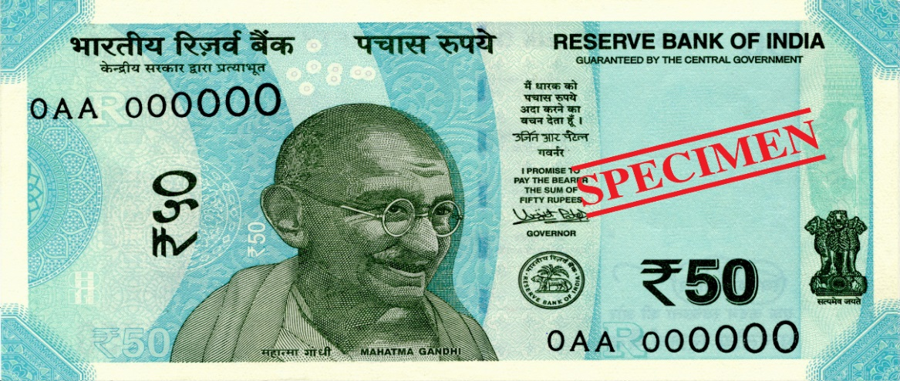
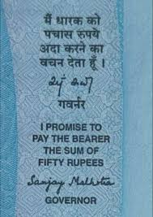
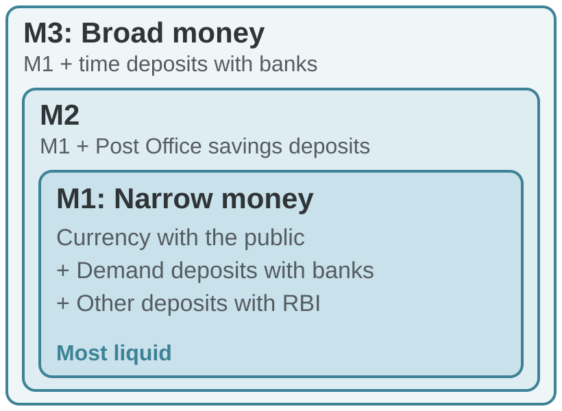
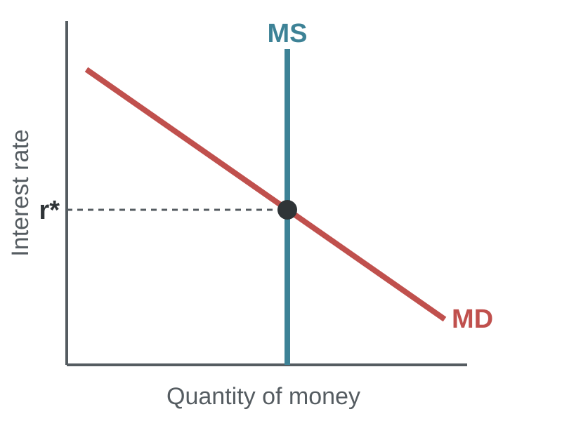
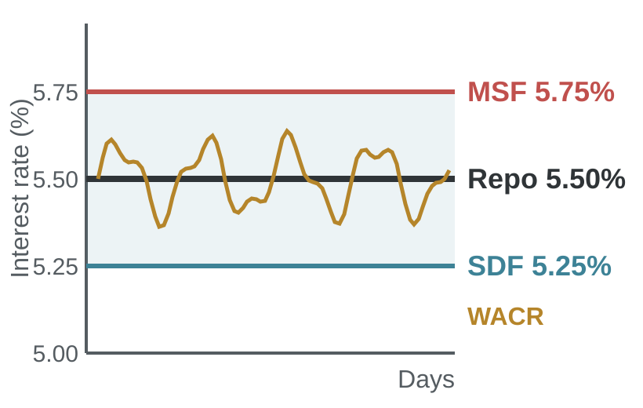
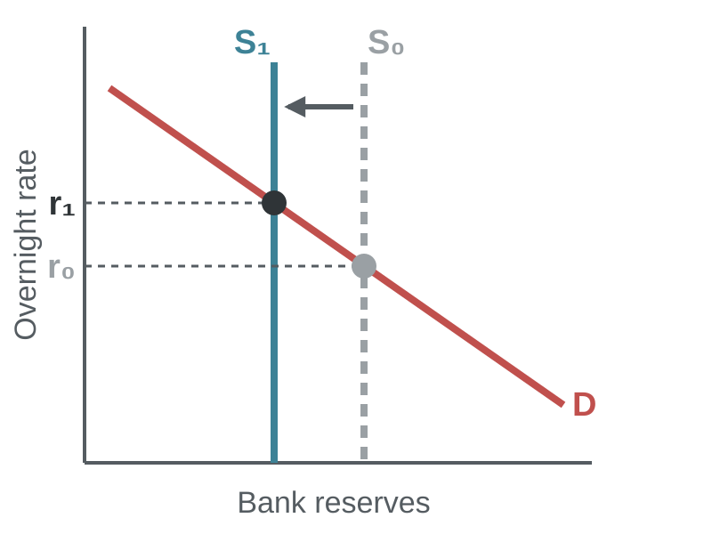
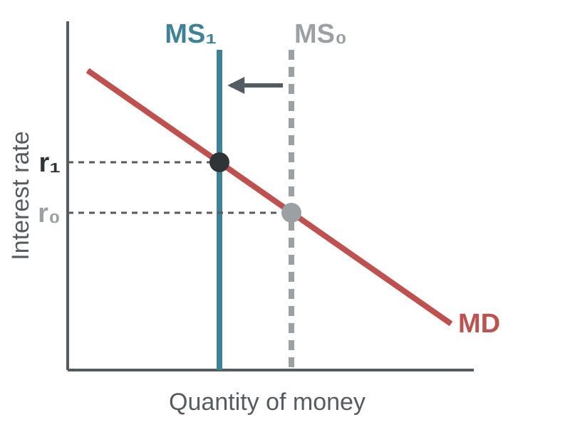

# The Monetary System

### Module 4

Dr. Pawan Ashok Kamble \
Assistant Professor \
Faculty Cabin: F61

---
<!-- layout: agenda -->
## Topics

1. What money is: functions and kinds of money
2. Measuring money in India: M0, M1, M2, M3, M4
3. The Reserve Bank of India and its jobs
4. Banks and money creation: the money multiplier
5. Demand for and supply of money
6. Tools of monetary policy and transmission
7. Quantity theory, velocity and money neutrality
8. Case: Demonetisation 2016

---
<!-- layout: compare -->
## Why Do We Need Money?

|||

### Barter

- Exchange one good or service for another
- Needs a **double coincidence of wants**: each person must want what the other has
- Wastes time searching for a trading partner
- Hard to divide goods or store value

|||

### Money

- Everyone accepts it in exchange
- No need to find a matching partner
- Prices in one common unit
- Lets people specialise and trade more

---
## What Is Money?

### The set of assets people regularly use to buy goods and services

> Money is not the same as wealth or income. A house is wealth, a salary is income; **money** is the asset you use to pay.

Money has three functions:

1. **Medium of exchange:** what buyers give sellers to purchase goods and services.
2. **Unit of account:** the yardstick people use to post prices and record debts.
3. **Store of value:** a way to carry purchasing power from today into the future.

---
<!-- layout: table -->
## The Functions of Money in India

### Each function solves a problem of barter

| Function | Meaning | Indian example |
|---|---|---|
| **Medium of exchange** | Accepted in payment | Paying ₹40 for chai by cash or UPI |
| **Unit of account** | Common measure of value | MRP printed in rupees; a loan of ₹5 lakh |
| **Store of value** | Holds purchasing power over time | Keeping ₹10,000 in a savings account |

> Inflation weakens money as a **store of value**: at 5% inflation, ₹100 buys only about ₹95 of goods a year later.

---
## Store of Value, Wealth and Liquidity

### Money is one store of value among many

**1. Wealth**
- The total of all stores of value: money and non-monetary assets such as FDs, shares, gold and property.

**2. Liquidity**
- The ease of converting an asset into the medium of exchange.
- Cash is perfectly liquid. A house is very illiquid.

**3. The trade-off**
- Liquid assets earn little or no return. Holding money has an **opportunity cost**: the interest you give up.

> **Most liquid →** cash, savings account, fixed deposit, government bonds, shares, gold, property **→ least liquid**

---
<!-- layout: table -->
## The Kinds of Money

### From gold coins to UPI

| Kind | What it is | Example |
|---|---|---|
| **Commodity money** | Has intrinsic value; useful even if not used as money | Gold and silver coins |
| **Fiat money** | No intrinsic value; money by government decree | Rupee notes and coins, US dollar |
| **Bank money** | Deposits that can be spent by cheque, card or transfer | Savings and current accounts |
| **Digital central bank money** | A digital form of currency issued by the central bank | e-Rupee (e₹), RBI pilot since 2022 |

> UPI is **not** a new kind of money. It is a fast way to move **bank deposits**.

---
<!-- layout: image-grid -->
## Fiat Money in India

### "I promise to pay the bearer": the RBI's promise, not a promise of gold

---
<!-- layout: stat -->
## How Indians Pay Today

|||

# 25.5 bn

UPI transactions in October 2026, a record

|||

# ₹31.5

Value of UPI payments in October 2026 (₹ lakh crore)

|||

# ₹42.6

Currency with the public (₹ lakh crore), 15 October 2026, up 14.1% in a year

---
## Money in the Economy

### The money stock has two main parts

**1. Money stock**
- The quantity of money circulating in the economy.

**2. Currency**
- Notes and coins held by the public. Cash held by banks and the RBI is **not** counted.

**3. Demand deposits**
- Bank balances that depositors can use on demand: by cheque, debit card or UPI.

> Digital payments have grown fast, but cash use has also grown. India uses **both**.

---
<!-- layout: table -->
## Measuring Money in India

### RBI's monetary aggregates, from most to least liquid

| Aggregate | Components | Also called |
|---|---|---|
| **M0** | Currency in circulation + bankers' deposits with RBI + other deposits with RBI | Reserve money, base money, high-powered money |
| **M1** | Currency with the public + demand deposits with banks + other deposits with RBI | Narrow money |
| **M2** | M1 + savings deposits with Post Office savings banks | |
| **M3** | M1 + time deposits with banks (FDs, RDs) | Broad money |
| **M4** | M3 + all deposits with Post Office savings organisations | |

---

## Putting It Together

### M1 ⊂ M2 ⊂ M3 ⊂ M4

- **M0** is the base: the RBI's own liabilities.
- **M3** is the main measure RBI tracks.
- M4 = M3 + all Post Office savings deposits.
- Each wider "M" adds **less liquid** money.

---
<!-- layout: table -->
## India's Money Stock Today

### Broad money (M3) on 15 October 2026, ₹ lakh crore

| Component | Amount | Share of M3 | Growth in a year |
|---|---|---|---|
| Currency with the public | 42.6 | 12.8% | 14.1% |
| Demand deposits with banks | 34.5 | 10.4% | 10.7% |
| Time deposits with banks | 254.6 | 76.5% | 17.1% |
| **Broad money, M3** | **333.0** | 100% | **16.0%** |
| *Reserve money, M0* | *53.2* | | *10.3%* |

Source: RBI Weekly Statistical Supplement (23 October 2026); Business Standard. M3 also includes about ₹1.3 lakh crore of other deposits with RBI.

---
<!-- layout: activity -->
## Activity: Calculate M1, M2 and M3

### Use only the items that belong in each measure (₹ crore)

| Component | Amount |
|---|---|
| Currency notes and coins held by the public | 1,200 |
| Currency held by commercial banks | 200 |
| Demand deposits (current + savings) with commercial banks | 2,800 |
| Other deposits with RBI | 100 |
| Savings deposits with Post Office Savings Bank | 500 |
| Time deposits (FDs, RDs, etc.) with commercial banks | 4,000 |
| Time deposits with Post Office under small savings schemes | 700 |

---
<!-- layout: steps -->
## Activity: Solution

### Build each measure step by step

1. **M1** = 1,200 + 2,800 + 100 = **₹4,100 crore**
2. **M2** = M1 + 500 = **₹4,600 crore**
3. **M3** = M1 + 4,000 = **₹8,100 crore**
4. **Excluded**: cash held by banks (₹200) is not with the public; Post Office time deposits (₹700) go into M4

> M4 = M3 + all Post Office deposits = 8,100 + 500 + 700 = **₹9,300 crore**

---
<!-- layout: table -->
## Why the Aggregates Matter

### What each measure tells policymakers

| Signal | What it suggests | Who uses it |
|---|---|---|
| M3 grows much faster than real GDP | More spending power than goods: **demand-pull inflation** risk | RBI: raise the repo rate |
| M3 grows too slowly | Tight credit; growth slows, unemployment can rise | RBI: inject liquidity (OMO, CRR) |
| M1 rises fast | People hold spendable money: strong current demand | RBI, businesses |
| Shift from savings to FDs | Response to higher interest rates | Banks, RBI |
| Bank and Post Office deposits rise | Financial deepening and saving | Government: Jan Dhan, small savings |

---
## The Reserve Bank of India

### India's central bank

> A **central bank** oversees the banking system and regulates the quantity of money in the economy.

- Set up on **1 April 1935** under the RBI Act, 1934; nationalised in 1949.
- Headquarters: Mumbai.
- Sole issuer of currency notes in India (coins are issued by the Government of India and put into circulation through RBI).
- Since 2016, sets interest rates to meet an **inflation target**: 4% CPI inflation, band 2% to 6%, now extended to **March 2031**.

---
<!-- layout: table -->
## Who Runs the RBI?

### Leadership and the Monetary Policy Committee (MPC), November 2026

| Role | Who |
|---|---|
| **Governor** | Sanjay Malhotra, since 11 December 2024 |
| **Deputy Governors** | Swaminathan J (June 2023), Poonam Gupta (April 2025), S. C. Murmu (October 2025), Rohit Jain (May 2026) |
| **Monetary Policy Committee** | Six members: Governor (chair), Deputy Governor for monetary policy, one RBI officer, three external members |
| **External MPC members** | Nagesh Kumar, Ram Singh, Saugata Bhattacharya |

The MPC meets six times a year and decides the repo rate by majority vote. The Governor has a casting vote in a tie.

---
<!-- layout: table -->
## The RBI's Jobs

### More than setting interest rates

| Role | What it does |
|---|---|
| **Monetary authority** | Sets the repo rate and manages liquidity to control inflation |
| **Issuer of currency** | Prints and distributes notes; withdraws soiled notes |
| **Banker to banks** | Holds bank reserves, clears payments, **lender of last resort** |
| **Regulator and supervisor** | Licenses banks, monitors their health, sets capital rules |
| **Banker to government** | Manages government accounts and borrowing |
| **Forex manager** | Manages reserves and the rupee exchange rate |
| **Payments overseer** | Regulates payment systems such as UPI and RTGS |

---
<!-- layout: compare -->
## Banks and the Money Supply: 100% Reserves

|||

### Bank 1: T-account

| Assets | ₹ | Liabilities | ₹ |
|---|---|---|---|
| Reserves | 100 | Deposits | 100 |

|||

### What happens

- You deposit ₹100 of cash
- The bank keeps all of it as **reserves**
- Currency falls by ₹100, deposits rise by ₹100
- **Money supply does not change**

---
<!-- layout: compare -->
## Fractional-Reserve Banking

|||

### Bank 1: T-account

| Assets | ₹ | Liabilities | ₹ |
|---|---|---|---|
| Reserves | 10 | Deposits | 100 |
| Loans | 90 | | |

|||

### What happens

- Reserve ratio **R = 10%**
- Bank keeps ₹10, lends ₹90
- The borrower spends the ₹90, which is deposited in another bank
- Money supply = ₹100 deposit + ₹90 borrowed = **₹190**

> Banks **create money** when they lend.

---
<!-- layout: table -->
## The Money Creation Process

### A ₹1,000 deposit with R = 10%

| Bank | New deposit | Reserves (10%) | New loans |
|---|---|---|---|
| Bank 1 | 1,000 | 100 | 900 |
| Bank 2 | 900 | 90 | 810 |
| Bank 3 | 810 | 81 | 729 |
| Bank 4 | 729 | 73 | 656 |
| … | … | … | … |
| **Total** | **10,000** | **1,000** | **9,000** |

> ₹1,000 of new reserves supports ₹10,000 of deposits.

---
<!-- layout: equation -->
## The Money Multiplier

### How much money each rupee of reserves supports

$$
\text{Money multiplier} = \frac{1}{R}
$$

R is the reserve ratio: the share of deposits that banks hold as reserves.

**Example:** R = 10%, so the multiplier = 1 / 0.10 = **10**. With R = 20%, it is only **5**.

> The higher the reserve ratio, the less each deposit is lent out and the smaller the multiplier.

---
## The Money Multiplier with Currency

### People also hold cash, so the multiplier is smaller

$$
M = m \times M0, \qquad m = \frac{1 + c}{c + r}
$$

**Where:**
- M = money supply (M3); M0 = reserve money
- c = currency held by the public ÷ deposits
- r = bank reserves ÷ deposits

**India, October 2026:** c = 42.6 ÷ 289.2 ≈ 0.15 and r ≈ 0.03 (CRR), so m ≈ 1.15 ÷ 0.18 ≈ **6.5**.

---
<!-- layout: stat -->
## India's Money Multiplier

|||

# ₹53.2

Reserve money, M0 (₹ lakh crore), October 2026

|||

# ₹333

Broad money, M3 (₹ lakh crore), 15 October 2026

|||

# 6.3

Money multiplier: M3 ÷ M0

---
## Bank Capital and Leverage

### Banks also fund assets with their own capital

| Assets | ₹ | Liabilities and capital | ₹ |
|---|---|---|---|
| Reserves | 200 | Deposits | 800 |
| Loans | 700 | Debt | 150 |
| Securities | 100 | **Capital (owners' equity)** | **50** |

- **Leverage ratio** = assets ÷ capital = 1,000 ÷ 50 = **20**.
- If asset values fall just 5% (₹50), the bank's capital is wiped out.
- So the RBI sets a **capital requirement**: total capital of at least 9% of risk-weighted assets, plus a 2.5% buffer.

---
<!-- layout: table -->
## The Demand for Money

### Why do people hold money instead of interest-earning assets?

| Motive | Why people hold money | Depends on |
|---|---|---|
| **Transaction** | To pay for day-to-day purchases | Income (Y): more income, more transactions |
| **Precautionary** | To meet emergencies such as illness or job loss | Income and uncertainty |
| **Speculative** | To wait for better investment opportunities | Interest rate (i): higher i, less money held |

> Holding money has an opportunity cost: the interest you could have earned on a bond or FD.

---
## The Money Demand Function

### Money demand rises with income and falls with the interest rate

$$
M^{d} = L(Y, i)
$$

**Where:**
- Y = real income (real GDP); i = nominal interest rate
- LY > 0: as Y increases, money demand increases
- Li < 0: as i increases, money demand falls

**Simple form:** Md = k × PY, k > 0. People hold a fraction k of their nominal income as money.

---

## Money Market Equilibrium

### The interest rate balances money demand and supply

- **MS:** set by the RBI, so it is vertical.
- **MD:** slopes down; a higher rate makes holding money costlier.
- **r\*:** money demanded equals money supplied.

---
<!-- layout: stat -->
## Monetary Policy in India, October 2026

|||

# 5.50%

Repo rate, raised 25 bp on 7 October 2026

|||

# 5.2%

RBI's CPI inflation projection for 2026-27

|||

# 7.1%

RBI's real GDP growth projection for 2026-27

---
<!-- layout: table -->
## The October 2026 Decision

### 63rd MPC meeting, 5 to 7 October 2026

| Item | Before | After |
|---|---|---|
| **Repo rate** | 5.25% | **5.50%** |
| **SDF rate** | 5.00% | 5.25% |
| **MSF rate and Bank Rate** | 5.50% | 5.75% |
| **Stance** | Neutral | **Calibrated tightening** |

**Why:** CPI inflation rose to 4.8% in August (and 5.5% in September), led by food and fuel. Risks: crude oil, a weak monsoon and tight global conditions. Vote on the rate: unanimous. Next meeting: 2 to 4 December 2026.

---
<!-- layout: table -->
## India's Repo Rate: Recent Path

### From easing in 2025 to tightening in 2026

| MPC decision | Change | Repo rate | Reason |
|---|---|---|---|
| February 2025 | −25 bp | 6.25% | Inflation easing, growth slowing |
| April 2025 | −25 bp | 6.00% | Inflation below 4% |
| June 2025 | −50 bp | 5.50% | Front-loaded support for growth |
| December 2025 | −25 bp | 5.25% | Record-low inflation |
| October 2026 | **+25 bp** | **5.50%** | Food and fuel inflation rising |

> Monetary policy reacts to the **outlook** for inflation and growth, not just today's numbers.

---
<!-- layout: compare -->
## Tools of Monetary Policy

|||

### Quantitative tools

- Repo rate (policy rate)
- Standing facilities: SDF and MSF
- Liquidity Adjustment Facility (LAF)
- Open market operations (OMO)
- Cash Reserve Ratio (CRR)
- Statutory Liquidity Ratio (SLR)

|||

### Qualitative tools

- Moral suasion and guidance
- Selective credit controls
- Macroprudential rules: risk weights, loan-to-value limits

> Quantitative tools change the **amount and price** of money; qualitative tools change **where** credit goes.

---
## The Repo Rate: The Main Tool

### The rate at which RBI lends overnight to banks against government securities

**1. Repo rate up**
- Borrowing costs more for banks, so they raise loan rates.
- Credit slows, demand falls, inflation cools.

**2. Repo rate down**
- Borrowing gets cheaper, so banks cut loan rates.
- Credit grows, spending rises, growth is supported.

> The repo rate is the RBI's main **signal** of its policy direction.

---

## The Policy Rate Corridor

### SDF rate ≤ Repo rate ≤ MSF rate

- **MSF:** ceiling; banks borrow overnight at a penal rate.
- **SDF:** floor; RBI absorbs surplus funds.
- The overnight rate (**WACR**) stays inside, close to repo.

---
## Liquidity Adjustment Facility (LAF)

### Daily fine-tuning of liquidity and overnight rates

**1. When banks are short of funds**
- RBI **injects** liquidity through repo and variable rate repo (VRR) auctions.

**2. When banks have surplus funds**
- RBI **absorbs** liquidity through the SDF and variable rate reverse repo (VRRR) auctions.

**3. Goal**
- Keep the overnight rate close to the repo rate, so the policy signal reaches the market.

---
<!-- layout: compare -->
## Open Market Operations (OMO)

|||

### RBI buys government securities

- Pays banks for the bonds
- Bank reserves rise: liquidity **injected**
- Money supply rises
- Bond yields and interest rates fall
- **Example:** OMO purchase of ₹1 lakh crore announced in December 2025

|||

### RBI sells government securities

- Banks pay RBI for the bonds
- Bank reserves fall: liquidity **drained**
- Money supply falls
- Bond yields and interest rates rise
- Used to back a tighter policy stance

---

## How Draining Liquidity Raises Rates

### The market for bank reserves

- RBI sells bonds (OMO) or runs reverse repo auctions.
- Reserves fall: S₀ to S₁.
- The overnight rate rises: r₀ to r₁, in line with a higher repo rate.

---
<!-- layout: table -->
## Reserve Requirements: CRR and SLR

### Shares of a bank's net demand and time liabilities (NDTL)

| | Cash Reserve Ratio (CRR) | Statutory Liquidity Ratio (SLR) |
|---|---|---|
| **What** | Cash banks must keep with RBI, earning no interest | Assets banks must hold in government securities, cash or gold |
| **Current rate** | **3%** | **18%** |
| **If raised** | Less to lend; money supply falls | More funds locked in safe assets; less lending |
| **If cut** | More to lend; money supply rises | More funds available for loans |

> **CRR in action:** RBI cut CRR from 4% to 3% in four steps, September to November 2025, releasing about **₹2.5 lakh crore** for lending.

---
<!-- layout: compare -->
## Quantitative Easing (QE)

|||

### Normal OMO

- Routine and small
- Short-term government bonds
- Fine-tunes daily liquidity
- Used all the time by RBI

|||

### Quantitative easing

- Huge and sustained purchases
- Long-term bonds, sometimes corporate bonds
- Pushes down long-term interest rates
- Used when rates are near zero: US Fed after 2008 and 2020

> QE is "OMO on steroids": a crisis tool when normal rate cuts no longer work.

---
<!-- layout: table -->
## Qualitative Tools

### Guiding where credit goes

| Tool | How it works | Indian example |
|---|---|---|
| **Moral suasion** | RBI persuades or nudges banks through letters and speeches | "Go slow on unsecured personal loans" |
| **Priority sector lending** | Banks must lend a share of credit to chosen sectors | 40% of credit to agriculture, MSMEs and weaker sections |
| **Risk weights** | Higher capital needed for riskier loans | November 2023: risk weights on consumer loans raised from 100% to 125% |
| **Loan-to-value limits** | Caps on how much can be lent against an asset | Limits on gold loans and home loans |

---
<!-- layout: steps -->
## Monetary Policy Transmission

### How a repo rate change reaches the economy

1. **RBI**: changes the repo rate
2. **Money markets**: overnight and T-bill rates follow
3. **Banks**: loan and deposit rates change
4. **Spending**: households and firms borrow and spend less (or more)
5. **Economy**: output and inflation adjust

> Transmission takes time: about **two to three quarters** for a full effect on output and inflation.

---
<!-- layout: table -->
## Channels of Transmission

### Several routes from the repo rate to the economy

| Channel | How a rate hike works | India example |
|---|---|---|
| **Interest rate** | Loans cost more, so investment and big purchases fall | Home loan EMIs rise |
| **Credit** | Banks lend less and are choosier | Slower personal loan growth |
| **Exchange rate** | Higher returns attract foreign capital; the rupee strengthens | Cheaper imports, costlier exports |
| **Asset prices** | Bond and share prices fall; wealth falls | Lower mutual fund values |
| **Expectations** | A credible RBI keeps inflation expectations in check | Smaller wage demands |

Since October 2019, new floating-rate retail and MSME loans are linked to an **external benchmark**, usually the repo rate, so transmission is faster.

---

## Tight Money in the Money Market

### Lower money supply means a higher interest rate

- RBI cuts the money supply: MS₀ to MS₁.
- People sell bonds to get money; bond prices fall.
- The interest rate rises: r₀ to r₁.

---
## The Velocity of Money

### How fast money changes hands

$$
V = \frac{P \times Y}{M}
$$

**Where:**
- V = velocity of money; P = price level; Y = real output
- P × Y = nominal GDP; M = quantity of money

**Example:** an economy produces 1,000 pizzas at ₹100 each, so nominal GDP is ₹1,00,000. With M = ₹20,000, V = 1,00,000 ÷ 20,000 = **5**. Each rupee is spent five times a year.

---
<!-- layout: stat -->
## India's Velocity of Money

|||

# ₹353

Nominal GDP at an annual rate (₹ lakh crore): 4 × Q1 2026-27 GDP of ₹88.3

|||

# ₹333

Broad money, M3 (₹ lakh crore), October 2026

|||

# ≈ 1.1

Velocity of M3: nominal GDP ÷ M3

---
## The Quantity Theory of Money

### The quantity equation

$$
M \times V = P \times Y
$$

$$
\%\Delta M + \%\Delta V = \%\Delta P + \%\Delta Y
$$

**Assumptions of the quantity theory**
- V is stable over time.
- Y is set by real factors: labour, capital and technology (Module 2).

> So %ΔP ≈ %ΔM − %ΔY: when money grows faster than output, **inflation** results.

---
<!-- layout: activity -->
## Activity: The Quantity Theory in India

### Use %ΔM + %ΔV = %ΔP + %ΔY

India, 2026-27:

- Broad money (M3) growth: **16.0%**
- Real GDP growth (RBI projection): **7.1%**

1. If velocity were constant, what inflation rate would the quantity theory predict?
2. CPI inflation is actually about **5%**. What happened to velocity?

---
<!-- layout: steps -->
## Activity: Solution

### The quantity theory works in the long run, not every year

1. **Predicted inflation** (V constant): 16.0 − 7.1 = **8.9%**
2. **Actual inflation**: about 5%
3. **Implied change in V**: 5 + 7.1 − 16.0 = **−3.9%**
4. **Why V fell**: more saving in bank deposits (financial deepening), so M3 grows faster than spending

> Velocity is **not** constant in the short run. Over long periods, money growth and inflation move together.

---
<!-- layout: compare -->
## Money Neutrality and the Classical Dichotomy

|||

### Nominal variables

- Measured in money
- Price level, nominal wage, nominal GDP, nominal interest rate
- **Affected by money**

|||

### Real variables

- Measured in physical units
- Real GDP, real wage, real interest rate, employment
- **Not affected by money in the long run**

> **Money neutrality:** in the long run, doubling the money supply doubles prices but leaves real output unchanged.

---
## Is Money Neutral?

### Long run: yes. Short run: no.

**1. Long run**
- Prices and wages adjust fully, so money changes only nominal variables.
- **Fisher effect:** i = r + π. Faster money growth raises inflation and the nominal interest rate, not the real rate (Module 3).

**2. Short run**
- Prices and wages are sticky, so a change in money can change real output and jobs.
- This is why the RBI's rate decisions matter for growth (Module 5: IS-LM).

**3. When money growth gets extreme**
- Governments that print money to pay their bills cause **hyperinflation** (Zimbabwe, Module 3).

---
<!-- layout: case -->
## Demonetisation, November 2016

### A natural experiment in how money works

**Situation:** On 8 November 2016, the government withdrew legal tender status of all ₹500 and ₹1,000 notes. These were **86%** of the currency in circulation. People had to deposit or exchange old notes at banks.

**Aims:** Curb black money and counterfeit notes; push the economy towards digital payments.

**Question:** What happened to money, banks and the economy? Use the concepts from this module.

---
<!-- layout: stat -->
## Demonetisation in Numbers

|||

# ₹15.4

Value of ₹500 and ₹1,000 notes withdrawn (₹ lakh crore)

|||

# 50%

Fall in currency in circulation: ₹17.97 lakh crore (4 Nov 2016) to ₹8.98 lakh crore (6 Jan 2017)

|||

# 99.3%

Share of withdrawn notes that came back to RBI

---
<!-- layout: table -->
## Relating the Case to the Concepts (1)

### What demonetisation did to money

| Concept | What happened |
|---|---|
| **Medium of exchange** | Old notes could not be used, so cash-based trade stalled; some trade moved to credit or barter |
| **Store of value** | Cash savings had to be deposited and explained; the value of hoarded notes was at risk |
| **M0 (reserve money)** | Currency in circulation halved in two months, so M0 fell sharply |
| **M1 vs M3** | Cash moved into bank deposits: currency fell, deposits rose, so M3 changed much less than M0 |
| **Money multiplier** | The currency ratio c fell, so the multiplier m = (1 + c) ÷ (c + r) **rose** for a while |

---
<!-- layout: table -->
## Relating the Case to the Concepts (2)

### What it did to banks, policy and the economy

| Concept | What happened |
|---|---|
| **Bank liquidity** | Deposits surged; banks had large surplus funds |
| **RBI tools** | RBI imposed a temporary 100% incremental CRR and raised the limit on market stabilisation bonds to absorb liquidity |
| **Transmission** | Banks cut deposit and lending rates in January 2017 |
| **Velocity and output** | Fewer notes meant fewer cash transactions; informal trade and output slowed in the short run |
| **Money neutrality** | A cash shortage had **real** effects in the short run: money was not neutral |
| **Kinds of money** | Digital payments jumped; BHIM-UPI launched in December 2016 |

---
<!-- layout: compare -->
## Demonetisation: Ten Years On

|||

### Cash is still king

- Currency in circulation recovered to ₹18.04 lakh crore by March 2018
- It reached **₹43.46 lakh crore** by October 2026
- Growth of 13.5% in a year: the fastest in five years

|||

### Digital money is now huge

- UPI: **25.5 billion** transactions in October 2026
- Over ₹1 lakh crore a day
- Cash and digital payments grow **together**

> Lesson: policy can change **how** people pay, but not quickly **why** they hold cash.

---
<!-- layout: discussion -->
## Discussion: Will Digital Money Replace Cash?

### Think for two minutes, then discuss in pairs

- UPI and the e-Rupee make payments cheap and fast.
- Yet currency with the public keeps growing faster than nominal GDP.

Which motives for holding money (transaction, precautionary, speculative) explain why cash survives? What would it take for India to become cashless?

---
<!-- layout: takeaways -->
## Takeaways

### Eight ideas to remember

- Money is a medium of exchange, a unit of account and a store of value.
- RBI measures money from M0 (reserve money) to M3 (broad money, ₹333 lakh crore).
- Banks create money when they lend; the money multiplier links M3 to M0 (about 6.3 in India).
- Money demand rises with income and falls with the interest rate.
- The repo rate is RBI's main tool; SDF and MSF form a corridor around it.
- OMO, CRR and SLR change liquidity; transmission reaches the economy with a lag.
- MV = PY: in the long run, money growth above output growth causes inflation.
- Money is neutral in the long run but not in the short run, as demonetisation showed.

---
<!-- layout: references -->
## References

### Textbooks and sources

- Mankiw, N. G. *Principles of Economics*. Cengage. Chapter: The Monetary System.
- Dornbusch, R., Fischer, S. and Startz, R. *Macroeconomics*. McGraw Hill. Chapter: Money, interest and income.
- Reserve Bank of India. Monetary Policy Statement, 7 October 2026.
- Reserve Bank of India. Weekly Statistical Supplement: Money stock, 23 October 2026.
- Reserve Bank of India. Annual Report 2017-18 (demonetised notes).
- National Payments Corporation of India (NPCI). UPI product statistics, October 2026.

---
<!-- layout: end -->
# Questions?

Dr. Pawan Ashok Kamble · BIMTECH
