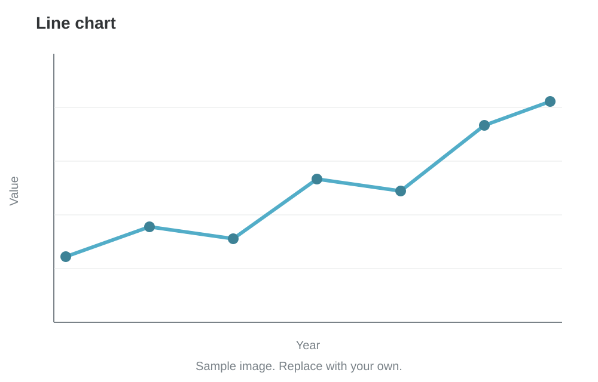
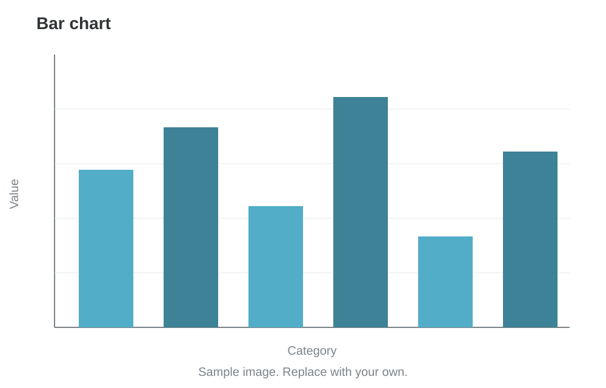
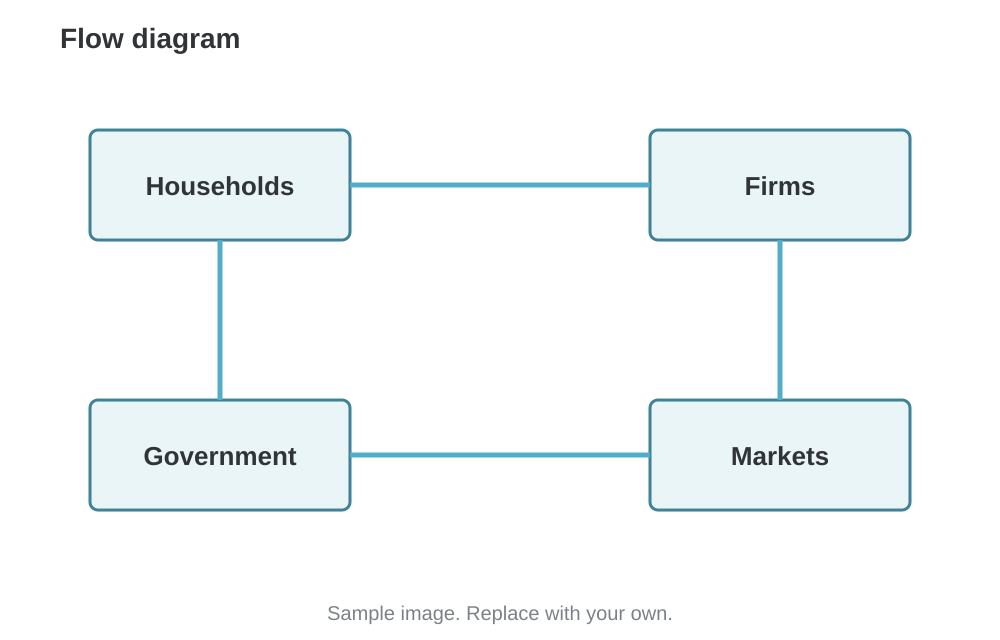

# Unemployment

### Module 3

Dr. Pawan Ashok Kamble \
Assistant Professor \
Faculty Cabin (F61)

---
<!-- layout: Topics -->
## Topics

1. Employment, Unemployment, labor force, unemployment rate
1. Types of unemployment
2. Natural rate of unemployment and full employment
3. Beveridge Curve and labor market matching
4. Wage pressure, inflation expectations and the Phillips curve
5. Policy trade-offs using short-run and long-run. 

---
## Why Do We Study Unemployment?

### Unemployment as an Indicator of Economic Health

**1. Utilisation of Human Resources**
   - Labour is a key factor of production.
   - Unemployment indicates that available human resources are not being fully utilised.

**2. Loss of Economic Output**
   - Unemployed workers represent potential productive capacity that remains unused.
   - The economy may produce below its potential output.

**3. Household Income and Living Standards**
   - Unemployment reduces household income and purchasing power.
   - Lower income can reduce consumption and economic well-being.

---
## Why Do We Study Unemployment?

### Unemployment as an Indicator of Economic Health

**4. Economic and Social Stability**
   - Persistent unemployment can increase poverty and inequality.
   - It can create social and economic insecurity as well as inequality.

>Key Takeway: Unemployment is not just a labour-market problem; it represents a loss of productive resources and economic welfare.

---


## Measuring Unemployment

### Working-Age Population:
- Individuals who fall within the age range considered suitable for participation in economic activities, as defined by a country's statistical standards. 

- For India, individuals aged 15 years and above, as defined by the Periodic Labour Force Survey (PLFS). 

### Employed:
- Individuals who are of working age and have performed some economic activity for pay or profit during a specified reference period.

### Unemployed: 
- Individuals of working age who are not currently employed but are actively seeking employment and are available to work during a specified reference period.


---
## Measuring Unemployment

<div style="text-align: center;">


</div>


---
## Measuring Unemployment

### Population Divided by Labor-Market Status

$$
\text{Unemployment Rate} =
\left(\frac{\text{Unemployed}}{\text{Labor Force}}\right)\times 100
$$

**Where:**

$$
\text{Labor Force} =
\text{Employed}+\text{Unemployed}
$$

---
## Types of Unemployment

### Major Forms of Unemployment

**1. Frictional Unemployment**
- Temporary unemployment when individuals move between jobs or enter the labour market.
- Example: An MBA graduate searching for their first job.

**2. Structural Unemployment**
- Occurs when workers' skills do not match the requirements of available jobs.
- Example: Workers in traditional manufacturing displaced by automation.

**3. Cyclical Unemployment**
- Arises due to a decline in aggregate demand during an economic slowdown or recession.
- Example: Layoffs in the automobile industry during an economic downturn.
---
## Types of Unemployment: Other types

### Major Forms of Unemployment

**4. Seasonal Unemployment**
- Occurs when employment opportunities are available only during particular seasons.
- Example: Agricultural labourers during the off-season.

**5. Disguised Unemployment**
- Occurs when more workers are engaged in an activity than actually required, resulting in near-zero marginal productivity of additional workers.
- Example: Five family members working on a farm when three could produce the same output.
---

## Fit above the footer

### Limits for one slide

- Bullets: four at most, about ten words each
- Tables: six rows at most, short cells
- Stats: three numbers at most
- Move detail into `Note:` and split long slides

Note:
These limits assume a title and a subheading. A slide without a subheading has room for one more bullet or row.

---

## All layouts: text

### Write the name in the layout line

| Text | Use |
|---|---|
| (none) | Plain bullets |
| Three bars on one line | Two or three columns |
| `compare` | Two ideas side by side |
| `callout` | Key idea or definition |
| `quote` | A quotation |
| `stat` | Big numbers |

---

## All layouts: more

### Formulas, flow, media and closing

| Text | Use |
|---|---|
| `equation`, `table`, `code` | Formula, table, code |
| `agenda`, `steps`, `takeaways` | Plans and summaries |
| `activity`, `discussion`, `case` | Class work |
| `image-right`, `image-left`, `image-full`, `image-grid` | Images |
| `interactive`, `interactive-right`, `interactive-left`, `video` | Interactives and video |
| `section`, `references`, `end` | Structure |

---

<!-- layout: section -->
# Part 1: Text layouts

Ways to set out words and numbers

---

## Plain bullets (default)

### No layout line needed

- Keep each bullet to one idea
- Use four bullets at most
- Bold the key term: **price elasticity**

---

## Two columns

### Split the slide with three bars

|||

**Left column**

- Put `|||` on its own line to split the slide
- Works for text, lists and tables

|||

**Right column**

- Add a third `|||` for three columns
- Put an equation or example here

$$MR = MC$$

---

<!-- layout: compare -->
## Layout: compare

### Two market structures side by side

|||

### Perfect competition

- Many sellers
- Price taker
- Zero long-run profit

|||

### Monopoly

- One seller
- Price maker
- Profit can last

---

<!-- layout: callout -->
## Layout: callout

### The one rule to remember

> A rational decision maker compares **marginal benefit** with **marginal cost**.

Use this for a definition, a rule, or the one thing students must remember.

---

<!-- layout: quote -->
> Write the quotation here. Keep it to one or two lines.

Name, Source and year

---

<!-- layout: stat -->
## Layout: stat

### Say where the numbers come from

|||

# 6.5%

Label for the first number

|||

# 25

Label for the second number

|||

# 7

Label for the third number

---

<!-- layout: equation -->
## Layout: equation

### The quantity theory of money

$$MV = PY$$

M is the money supply, V is velocity, P is the price level and Y is real output.

---

<!-- layout: table -->
## Layout: table

### Market structures compared

| Structure | Sellers | Price power |
|---|---|---|
| Perfect competition | Many | None |
| Monopolistic competition | Many | Some |
| Oligopoly | Few | Large |
| Monopoly | One | Largest |

---

<!-- layout: code -->
## Layout: code

### A wage regression in R

|||

```r
model <- lm(wage ~ educ + exper, data = d)
summary(model)
```

|||

- `lm` fits a linear model
- `summary` prints the coefficients and standard errors

---

<!-- layout: section -->
# Part 2: Session flow

Plans, steps, exercises and summaries

---

<!-- layout: agenda -->
## Layout: agenda

### Four parts, about 60 minutes

1. Recap of last session
2. New concept: elasticity
3. Worked example
4. Group exercise

---

<!-- layout: steps -->
## Layout: steps

### How to run the simulation

1. **Plan**: set a starting price
2. **Run**: play each day
3. **Record**: fill in the sheet
4. **Review**: find what raised profit

---

<!-- layout: activity -->
## Price a new product

### Groups of four. Ten minutes.

1. Choose a product
2. Set a price
3. Predict how sales change if the price rises by 10%

Note:
Walk around the room. Pick two groups to share.

---

<!-- layout: discussion -->
## Should the RBI raise the repo rate?

### Weigh inflation against growth

Think for one minute, then discuss with the person next to you.

---

<!-- layout: case -->
## Case title goes here

### One line on the setting

**Situation:** Two or three lines that set the scene.

**Question:** The decision students must make.

**Data:** Point to a table or a link.

---

<!-- layout: takeaways -->
## Layout: takeaways

### Three ideas to remember

- Elasticity measures how strongly demand responds to price
- Revenue rises with price only when demand is inelastic
- Check both the sign and the size before you act

---

<!-- layout: section -->
# Part 3: Images

Charts, photos and diagrams

---

<!-- layout: image-right -->
## Layout: image-right

### Text on the left, image on the right

- The image is shown whole, never cut
- The words in the brackets become the caption



---

<!-- layout: image-left -->
## Layout: image-left

### Image on the left, text on the right

- Good for a chart you then explain point by point



---

<!-- layout: image-full -->


## Layout: image-full

### A title band keeps the text readable on any image

---

<!-- layout: image-full cover -->


## Layout: image-full cover

### Add the word cover to fill the slide

The edges may be trimmed.

---

<!-- layout: image-grid -->
## Layout: image-grid

### Use two to four images to compare


---

<!-- layout: section -->
# Part 4: Interactives and video

HTML files shown inside the slide

---

<!-- layout: interactive -->
## Layout: interactive

### Move the sliders

The interactive fills the rest of the slide.

@[IS-LM interactive](interactives/is-lm.html)

---

<!-- layout: interactive-right -->
## Layout: interactive-right

### The interactive gets most of the width

- Short instructions on the left

@[IS-LM interactive](interactives/is-lm.html)

---

<!-- layout: interactive-left -->
## Layout: interactive-left

### The interactive on the left

- Notes and prompts on the right

@[IS-LM interactive](interactives/is-lm.html)

---

## Video

### Use the video layout with a YouTube embed link

- First line of the slide: `<!-- layout: video -->`
- Then a title line starting with `##`
- Then a subheading line starting with `###`
- Then the video: `@[Video title](https://www.youtube.com/embed/VIDEO_ID)`

---

<!-- layout: references -->
## Layout: references

### Textbooks and sources

- Mankiw, N. G. *Principles of Economics*. Cengage.
- Dornbusch, R., Fischer, S. and Startz, R. *Macroeconomics*. McGraw Hill.

---

<!-- layout: end -->
# Questions?

Dr. Pawan Ashok Kamble · BIMTECH
