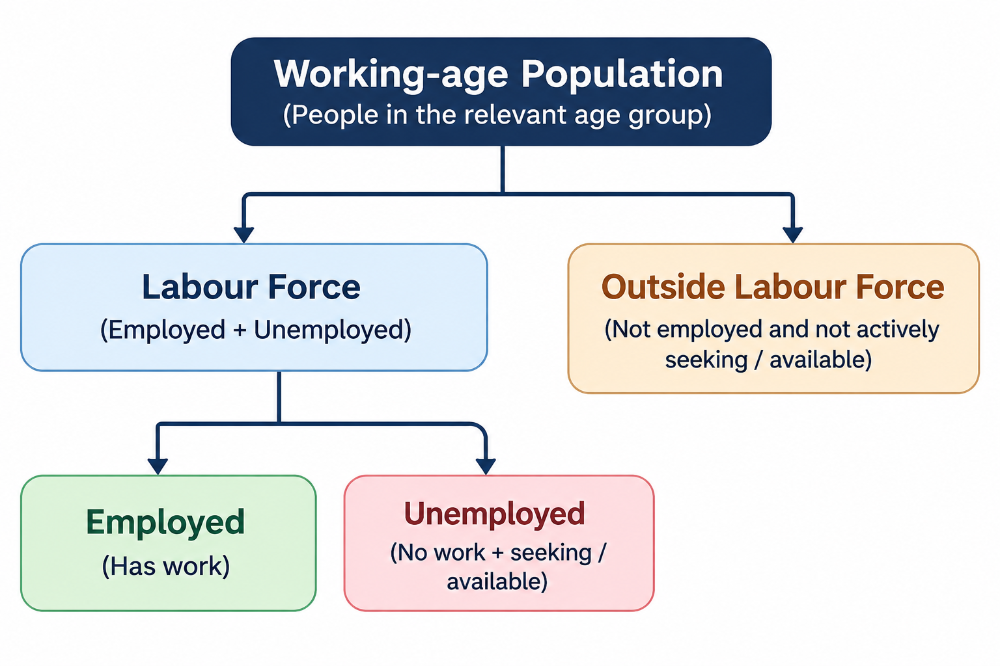
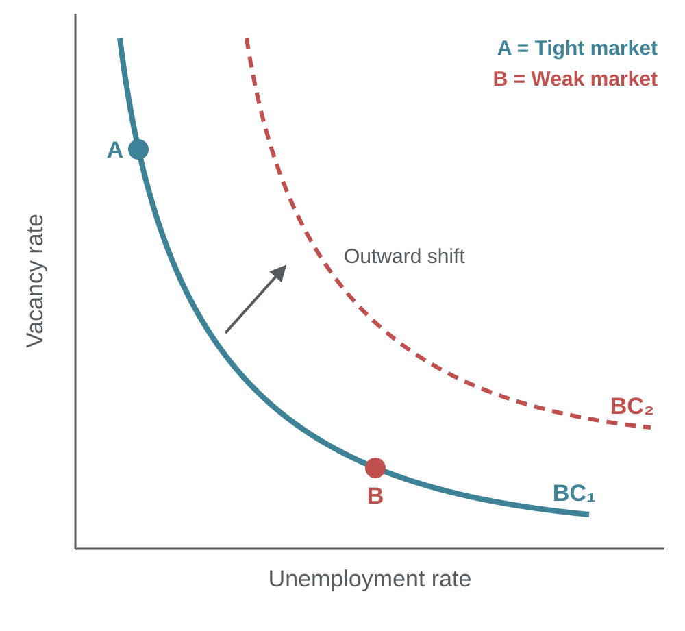
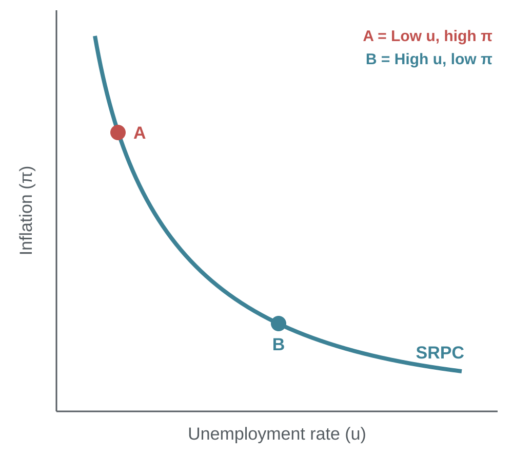
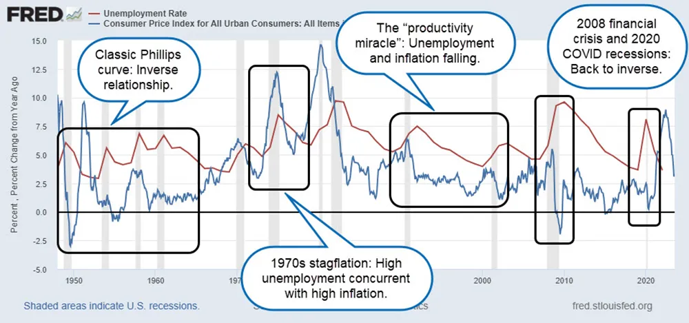
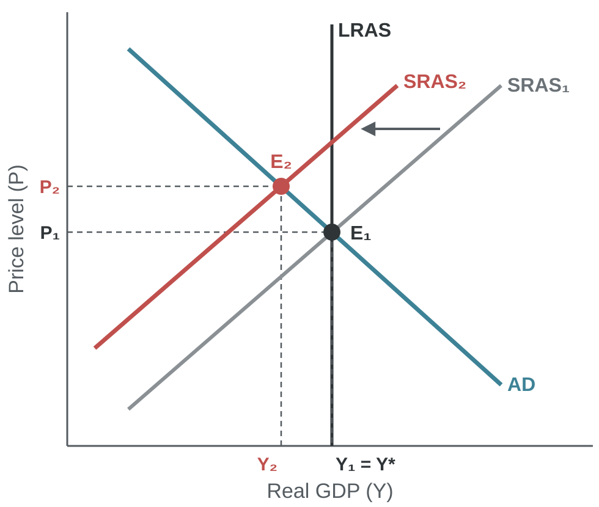

# Unemployment

### Module 3

Dr. Pawan Ashok Kamble \
Assistant Professor \
Faculty Cabin (F61)

---
<!-- layout: Topics -->
## Topics

1. Employment, Unemployment, labor force, unemployment rate
1. Types of unemployment
2. Natural rate of unemployment and full employment
3. Beveridge Curve and labor market matching
4. Wage pressure, inflation expectations and the Phillips curve
5. Policy trade-offs using short-run and long-run. 

---
## Why Do We Study Unemployment?

### Unemployment as an Indicator of Economic Health

**1. Utilisation of Human Resources**
   - Labour is a key factor of production.
   - Unemployment indicates that available human resources are not being fully utilised.

**2. Loss of Economic Output**
   - Unemployed workers represent potential productive capacity that remains unused.
   - The economy may produce below its potential output.

**3. Household Income and Living Standards**
   - Unemployment reduces household income and purchasing power.
   - Lower income can reduce consumption and economic well-being.

---
## Why Do We Study Unemployment?

### Unemployment as an Indicator of Economic Health

**4. Economic and Social Stability**
   - Persistent unemployment can increase poverty and inequality.
   - It can create social and economic insecurity.

>Key Takeway: Unemployment is not just a labour-market problem; it represents a loss of productive resources and economic welfare.

---

## Measuring Unemployment

### Working-Age Population:
- Individuals who fall within the age range considered suitable for participation in economic activities, as defined by a country's statistical standards. 

- For India, individuals aged 15 years and above, as defined by the Periodic Labour Force Survey (PLFS). 

### Employed:
- Individuals who are of working age and have performed some economic activity for pay or profit during a specified reference period.

### Unemployed: 
- Individuals of working age who are not currently employed but are actively seeking employment and are available to work during a specified reference period.

---
## Measuring Unemployment

---
## Measuring Unemployment

### Population Divided by Labor-Market Status

$$
\text{Unemployment Rate} =
\left(\frac{\text{Unemployed}}{\text{Labor Force}}\right)\times 100
$$

**Where:**

$$
\text{Labor Force} =
\text{Employed}+\text{Unemployed}
$$

---
## Numerical Example: 

### Problem

Consider an economy with a working-age population of 1 million people. Out of these, 600,000 people are employed, while 100,000 people are unemployed and actively seeking or available for work.

Calculate the unemployment rate of this economy.

---
## Numerical Example: 
### Solution

**Step 1: Calculate the Labour Force**

$$
LF = E + U
$$

$$
LF = 600,000 + 100,000 = 700,000
$$

**Step 2: Calculate the Unemployment Rate**

$$
UR = \frac{U}{LF}\times 100
$$

$$
UR = \frac{100,000}{700,000}\times 100
$$

$$
\boxed{UR = 14.29\%}
$$

**Answer:** The unemployment rate in this economy is **14.29%**.

**Remember:** The other 300,000 people are outside the labor force, so they are not counted.

---

## Types of Unemployment

### Major Forms of Unemployment

**1. Frictional Unemployment**
- Temporary unemployment when individuals move between jobs or enter the labour market.
- Example: An MBA graduate searching for their first job.

**2. Structural Unemployment**
- Occurs when workers' skills do not match the requirements of available jobs.
- Example: Workers in traditional manufacturing displaced by automation.

**3. Cyclical Unemployment**
- Arises due to a decline in aggregate demand during an economic slowdown or recession.
- Example: Layoffs in the automobile industry during an economic downturn.
---
## Types of Unemployment: Other types

### Major Forms of Unemployment

**4. Seasonal Unemployment**
- Occurs when employment opportunities are available only during particular seasons.
- Example: Agricultural labourers during the off-season.

**5. Disguised Unemployment**
- Occurs when more workers are engaged in an activity than actually required, resulting in near-zero marginal productivity of additional workers.
- Example: Five family members working on a farm when three could produce the same output.

---
---
<!-- layout: steps -->
## Business Cycle Channel of Rising Unemployment

### How a fall in aggregate demand leads to job losses

1. **Demand falls**: households and firms spend less
2. **Sales fall**: unsold stock builds up
3. **Output falls**: firms cut production
4. **Jobs lost**: firms lay off workers
5. **Income falls**: spending falls again

> This is **cyclical unemployment**. It falls when demand recovers.

Note:
Step 5 feeds back into step 1. Laid-off workers spend less, so demand falls again. This is the multiplier at work.
Okun's law links the two sides: when output falls below potential, unemployment rises above the natural rate.
Indian example: during the April to June 2020 lockdown, urban unemployment rose to 20.8% (PLFS Quarterly Bulletin).

---
## Natural Rate of Unemployment

### Unemployment that remains when the economy is at full employment

> **Natural rate** = Frictional unemployment + Structural unemployment

- It exists even when the economy produces at potential output.
- Full employment means unemployment equals the natural rate, not zero.
- Cyclical unemployment = Actual rate − Natural rate.
- Example: actual rate 7%, natural rate 5%, so cyclical unemployment is 2%.

Note:
Mankiw defines the natural rate as the normal rate around which the actual rate moves.
It changes slowly. Labour laws, skill gaps, job-matching speed and demographics shift it.
In a recession the actual rate rises above the natural rate. In a boom it can fall below it.

---

---
<!-- layout: table -->
## India's Unemployment: Latest PLFS Data

### September 2026, current weekly status, age 15 and above

| Group | Unemployment rate |
|---|---|
| All India | 5.0% |
| Rural | 4.2% |
| Urban | 6.9% |
| Urban women | 9.2% |
| Youth, 15 to 29 years | 15.2% |
| Urban youth, 15 to 29 years | 19.0% |

Source: MoSPI, PLFS Monthly Bulletin, September 2026 (released 15 October 2026)

Note:
Check with the formula. LFPR = 55.5% and WPR = 52.7% of the population aged 15+.
Unemployment rate = (LFPR − WPR) / LFPR × 100 = (55.5 − 52.7) / 55.5 × 100 ≈ 5.0%.
Discussion point: overall unemployment is low, but urban youth unemployment is almost four times higher. Ask students why educated young people wait for jobs.

---
---
<!-- layout: equation -->
## Actual Rate and the Natural Rate

### Actual unemployment splits into a natural part and a cyclical part

$$
u = u^{*} + u_{c}
$$

u is the actual rate, u* is the natural rate and uc is cyclical unemployment.

**India, September 2026:** 5.0% = 5% + 0%, so cyclical unemployment was close to zero.

Note:
Rearranged: u_c = u − u*. In a recession u_c is positive, so u rises above u*. In a boom u_c can be negative, so u falls below u*.
Numerical example from earlier: 14.29% = 5% + 9.29%.
India: the PLFS rate (CWS, 15+) was 5.0% in September 2026, close to the estimated natural rate of about 5%, so cyclical unemployment was close to zero.

---
## Why Duration Matters

### Short spells vs long-term unemployment

**1. Short-Duration Unemployment**
- Search can improve job matching and wage fit.
- Some unemployment is part of a dynamic labour market.

**2. Long-Duration Unemployment**
- Skills depreciate, networks weaken and employers may infer lower employability.
- This raises the risk of persistent exclusion from work.

> **Hysteresis:** A temporary recession can leave a lasting rise in unemployment if displaced workers lose skills, labour-force attachment or bargaining power.

**Managerial implication:** Reskilling is not only an HR issue. It affects national productivity.

Note:
Hysteresis means the natural rate itself can rise after a long recession. Long-term unemployed workers stop competing for jobs, so they no longer hold wages down.
India link: Singh (2025) finds mild hysteresis in India's unemployment after shocks such as COVID-19.

---
---
<!-- layout: image-left -->
## The Beveridge Curve

### Vacancies vs unemployment

**1. Movement along the curve**
- Demand changes move the economy between A and B.

**2. Outward shift (BC₁ to BC₂)**
- Worse matching: more vacancies and more unemployment.
- Causes: skill and location mismatch.

Note:
Movement along the curve is cyclical. A shift of the curve is structural, so an outward shift means a higher natural rate.
Example: after 2008 and after COVID-19, the US curve shifted out. Firms posted many vacancies, but unemployment stayed high.
India has no official vacancy series, so the curve is hard to draw with Indian data.

---
---
## The Costs of Unemployment

### Why high unemployment hurts the whole economy

**1. Output Loss**
- Labour is underused, so actual GDP falls below potential GDP.

**2. Human Capital**
- Skills depreciate. Long joblessness can reduce future productivity.

**3. Distribution**
- Income loss falls on affected households. Inequality and poverty risks rise.

> **Okun's Law:** When unemployment rises above its natural rate, output falls below potential. The link is negative, but its size varies across economies and over time.

Note:
Mankiw's US version: % change in real GDP = 3% − 2 × (change in the unemployment rate). So a 1 point rise in unemployment goes with about 2% lower output growth.
The coefficient differs by country and period. It depends on labour laws, hours flexibility and how much work is informal.
India: most workers are informal or self-employed, so output falls often show up as lower hours and earnings rather than open unemployment. The Okun link is usually weaker.

---
## Okun's Law

### Output and unemployment move in opposite directions

$$
\%\Delta Y = g - \beta \times \Delta u
$$

**Where:**
- %ΔY = growth rate of real GDP
- g = normal growth rate of output when unemployment is stable
- β = Okun's coefficient, the fall in growth for each 1-point rise in unemployment
- Δu = change in the unemployment rate (percentage points)

**Example (US, Mankiw):** g = 3% and β = 2. If unemployment rises by 1 point, GDP grows by 3% − 2 × 1 = 1%.

Note:
Source: Mankiw, Macroeconomics, using US data.
β is not a universal constant. It varies across economies and over time, with labour laws, hours flexibility and informality.
Gap form: when unemployment is above its natural rate, output is below potential. This links back to u = u* + cyclical unemployment.
India: most workers are informal or self-employed. A slowdown often shows up as fewer hours and lower earnings, not open unemployment, so the Okun link is weaker.

---
## Bridge from Inflation

### Recall: inflation is driven by demand, costs and expectations

**1. Demand-Pull Inflation**
- AD rises → labour demand rises → unemployment falls → wage pressure builds.

**2. Cost-Push Inflation**
- Energy or input costs rise → prices rise even if output and jobs weaken.

**3. Expectations**
- Expected inflation shapes wage bargaining and firms' price setting.

> **Key idea:** Unemployment is not just a labour-market outcome. It also signals demand pressure and possible wage-price dynamics.

Low unemployment does not automatically cause inflation. Supply shocks and expectations also matter.

Note:
This slide links the inflation chapter to unemployment and sets up the Phillips curve.
Productivity and firms' market power also affect inflation.
Slack means unused labour. High unemployment means more slack and less wage pressure. Low unemployment means less slack and more wage pressure.
India example: the 2022 inflation spike came mainly from food and fuel costs (cost-push), not from a tight labour market.

---
<!-- layout: image-left -->
## The Short-Run Phillips Curve

### The short-run trade-off

- Strong demand raises labour demand.
- Firms compete for workers, so wages rise.
- Firms pass higher costs on to prices.

> A short-run link, not a permanent policy menu.

Note:
Moving from B to A: demand rises, unemployment falls and inflation rises. Moving from A to B is the reverse.
Not a permanent menu: the curve holds only for given inflation expectations. If policy keeps unemployment below the natural rate, expectations rise and the curve shifts up. In the long run, unemployment returns to the natural rate.
This sets up the next slide on expectations and the long-run Phillips curve.
---
## Expectations-Augmented Phillips Curve

### Expected inflation shifts the short-run curve

$$
\pi = \pi^{e} - \alpha\,(u - u^{*}) + v
$$

**Where:**
- π = actual inflation
- πe = expected inflation
- α = how strongly inflation responds to the unemployment gap
- u − u* = unemployment gap (actual minus natural rate)
- v = supply shock, such as an oil price rise

**Interpretation:** If u is below u*, inflation rises above expected inflation. If u is above u*, inflation falls below expected inflation.

Note:
Source: Mankiw, Macroeconomics. Mankiw writes the same equation with β in place of α and u^n in place of u*.
A rise in π^e shifts the short-run curve up. This explains the 1970s stagflation on the previous slide: higher expectations plus oil shocks (v > 0).
Long run: expectations catch up, so π = π^e. With no supply shock, the equation then gives u = u*. The long-run Phillips curve is vertical at the natural rate.

---
## The Phillips Curve in US Data

### The trade-off holds in some periods and breaks down in others

Source: FRED, Federal Reserve Bank of St. Louis. Red = unemployment rate, blue = CPI inflation.

Note:
1950s and 1960s: the classic inverse relationship. Low unemployment came with higher inflation.
1970s stagflation: oil shocks and rising inflation expectations shifted the short-run curve up. High unemployment and high inflation came together.
Late 1990s: a productivity boom let unemployment and inflation fall together.
2008 and 2020 recessions: unemployment jumped and inflation fell, so the inverse link returned.
Lesson: the short-run curve shifts with expectations and supply shocks. It is not a stable menu.

---
<!-- layout: image-left -->
## Stagflation in AD-AS

### A negative supply shock

- SRAS shifts left: SRAS₁ to SRAS₂.
- Prices rise: P₁ to P₂.
- Output falls: Y₁ to Y₂, below potential.

> Higher inflation and higher unemployment together.

Note:
Start at E₁, where output is at potential (Y* on LRAS) and unemployment is at the natural rate.
An oil or food price shock raises firms' costs, so SRAS shifts left. The new equilibrium is E₂.
At E₂ the price level is higher and output is lower. Lower output means firms need fewer workers, so unemployment rises above the natural rate.
AD has not moved. This is why demand policy faces the dilemma on the previous slide: raising AD restores output but pushes prices higher still; cutting AD lowers prices but deepens the fall in output.

---

---
<!-- layout: references -->
## Layout: references

### Textbooks and sources

- Mankiw, N. G. *Principles of Economics*. Cengage.
- Dornbusch, R., Fischer, S. and Startz, R. *Macroeconomics*. McGraw Hill.

---

<!-- layout: end -->
# Questions?

Dr. Pawan Ashok Kamble · BIMTECH
